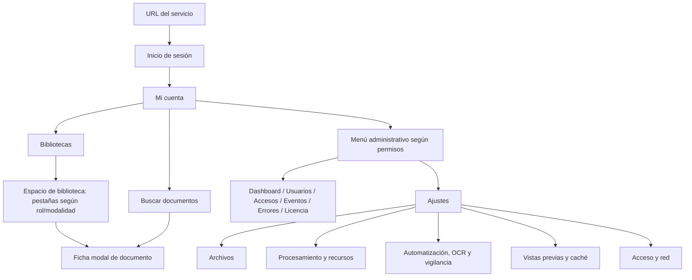

# AIBID — Pantallas, navegación y permisos

**Fecha de elaboración: 2026-10-09.** Actualización de la base elaborada el 8 de octubre; nombres y procedimientos contrastados con la transición de producción. Base de trabajo para los futuros manuales; no es un manual final.

## Alcance del mapa

Se identificaron **53 superficies**: páginas, áreas de trabajo, formularios en línea, acordeones relevantes, diálogos y asistentes/terminales de instalación. **No son 53 rutas web**. Las fichas, expedientes y pestañas de biblioteca viven como estado de React dentro de `/libraries`; no se inventan URL propias. Las rutas reales también están enumeradas por el servidor en [internal/httpapi/server.go](../../internal/httpapi/server.go).

La UI actual no se abrió en vivo: componentes y controles identificados en código; pruebas previas citadas en cada FUN. Una pantalla pendiente de captura no implica ausencia de implementación. Las ocho imágenes de prueba conservadas son provisionales, véase [catálogo](05-catalogo-capturas.md).

## Navegación general

La opción **Eventos** abre una página titulada **Auditoría**. **Sistema · Errores** abre **Errores y diagnósticos**. El encabezado principal **Ajustes** agrupa páginas existentes; son enlaces navegables con `aria-current`, no paneles ocultos de una única ruta. `/admin/settings` selecciona Archivos, preservando `/admin/files` y las demás rutas antiguas. Las pestañas de biblioteca sí utilizan `role=tablist/tab` y estado local.

No se identificó un conmutador de tema nocturno: existen variantes de logotipo para fondos oscuros; esto no equivale a modo oscuro implementado.

## Roles realmente sembrados

| Perfil visible / identificador | Ámbito | Permisos acumulados actuales | Evidencia |
| --- | --- | --- | --- |
| Administrador de instalación (`installation_admin`) | Global | `backup.manage`, `libraries.create`, `license.manage`, `permissions.manage_global`, `restore.manage`, `sessions.revoke`, `system.configure`, `users.manage`, `users.reset_password` | Migración 0001 |
| Auditor de accesos (`access_auditor`) | Global | `audit.read_global`, `authentication_attempts.read`, `sessions.read_all` | Migración 0001 |
| Lector (`library_reader`) | Por biblioteca | `documents.download`, `documents.read`, `search.execute` | Migraciones 0002,0003,0004 |
| Gestor (`library_manager`) | Por biblioteca | `audit.read_library`, `cases.manage`, `catalogs.manage`, `documents.associate`, `documents.cancel_own`, `documents.classify`, `documents.download`, `documents.finalize`, `documents.read`, `documents.reassign`, `documents.remove_index`, `documents.submit`, `documents.upload`, `indexing.retry`, `indexing.run`, `libraries.configure`, `permissions.manage_library`, `requirements.edit`, `search.execute`, `storage.manage_roots`, `storage.view_paths`, `templates.manage` | Migraciones 0002,0003,0004 |
| Auditor (`library_auditor`) | Por biblioteca | `audit.read_library`, `audit.search_details` | Migraciones 0002,0003,0004 |
| Colaborador (`library_contributor`) | Por biblioteca | `documents.associate`, `documents.cancel_own`, `documents.classify`, `documents.download`, `documents.read`, `documents.submit`, `documents.upload`, `search.execute` | Migraciones 0002,0003,0004 |
| Revisor (`library_reviewer`) | Por biblioteca | `documents.approve`, `documents.download`, `documents.read`, `documents.reject`, `documents.review`, `search.execute` | Migraciones 0002,0003,0004 |

Las referencias son [db/migrations/0001_identity.up.sql](../../db/migrations/0001_identity.up.sql), [db/migrations/0002_linked_libraries.up.sql](../../db/migrations/0002_linked_libraries.up.sql), [db/migrations/0003_managed_organization.up.sql](../../db/migrations/0003_managed_organization.up.sql) y [db/migrations/0004_document_workflow.up.sql](../../db/migrations/0004_document_workflow.up.sql). Colaborador y Revisor copian permisos de Lector al sembrarse. Varios perfiles asignados suman permisos. No existe un editor de definición de roles personalizados en UI. `documents.approve_own` se comprueba como excepción auditada en [internal/libraries/workflow.go](../../internal/libraries/workflow.go), pero **no está concedido por ninguno de los perfiles predeterminados ni tiene selector administrativo propio**.

`backup.manage` y `restore.manage` son permisos globales declarados, **sin pantalla/endpoints/CLI general que materialice respaldo/restauración**; no son funcionalidades inventariadas como disponibles ([VAL-007](07-pendientes-validacion.md#val-007)).

## Diferencias entre visibilidad y autorización

| Caso | Restricción UI | Comprobación backend | Consecuencia |
| --- | --- | --- | --- |
| Crear biblioteca | libraries.create muestra Nueva biblioteca | Create exige además permissions.manage_global y módulos de modalidad | Botón no demuestra que servidor vaya a aceptar; perfiles sembrados combinan ambos. |
| Administrar instalación | Menús según global permissions | protected() y AuthorizedWrite() recargan identidad/permisos | Global admin no es lector global de originales. |
| Accesos | Exige sessions.read_all y authentication_attempts.read | Endpoints separados exigen su propio permiso | Permisos parciales pueden tener API disponible pero pantalla oculta. |
| Pestaña biblioteca | Permiso+modalidad+cases_enabled | Read/write/requireOrganization + license gates | URL genérica no es autorización del recurso. |
| Borrador privado | Lista/ficha usan flags can_* | visibleDocumentSQL, autor/revisor y estado comprobados al leer | Gestor no implica acceso general a borradores ajenos. |
| Descarga vs preview | can_download / can_preview_original | download exige documents.download, content documents.read | Lectura no concede necesariamente descargar por endpoint. |
| Auditoría exacta | Sección Consultas exactas si audit.search_details | Audita solo consultas con TODOS sus ámbitos autorizados | Auditoría global general no revela todas las búsquedas exactas. |
| Operación en solo lectura | Flags y banners pueden limitar acciones | write + CheckFeatures se ejecutan de nuevo | Un control visible no vence licencia ni revisión; combinaciones pendientes VAL-014. |
| Estado de revisión | Workflow can_submit/approve/reject/finalize | Asignación, autor, revisión/version y configuración | No aprobar propia carga salvo excepción especial explícita. |
| Root paths | Solo se muestran rutas donde corresponde | storage.view_paths y autorización por raíz; OS service account | Permiso de usuario Windows no implica permiso del servicio. |

## Inventario detallado

| ID | Nombre | Ruta/ubicación | Acceso | FUN |
| --- | --- | --- | --- | --- |
| [PAN-001](02-pantallas-y-permisos.md#pan-001) | Inicio de sesión | /login | Sin sesión; cuenta habilitada | [FUN-001](01-inventario-funcional.md#fun-001), [FUN-002](01-inventario-funcional.md#fun-002) |
| [PAN-002](02-pantallas-y-permisos.md#pan-002) | Mi cuenta | /account | Sesión válida | [FUN-003](01-inventario-funcional.md#fun-003), [FUN-004](01-inventario-funcional.md#fun-004), [FUN-005](01-inventario-funcional.md#fun-005), [FUN-006](01-inventario-funcional.md#fun-006) |
| [PAN-003](02-pantallas-y-permisos.md#pan-003) | Usuarios | /admin/users | users.manage | [FUN-011](01-inventario-funcional.md#fun-011) |
| [PAN-004](02-pantallas-y-permisos.md#pan-004) | Nuevo usuario y edición | Usuarios → formulario en línea | users.manage; reset users.reset_password; global permissions.manage_global | [FUN-007](01-inventario-funcional.md#fun-007), [FUN-008](01-inventario-funcional.md#fun-008), [FUN-009](01-inventario-funcional.md#fun-009), [FUN-010](01-inventario-funcional.md#fun-010) |
| [PAN-005](02-pantallas-y-permisos.md#pan-005) | Accesos | /admin/access | UI exige sessions.read_all Y authentication_attempts.read | [FUN-012](01-inventario-funcional.md#fun-012) |
| [PAN-006](02-pantallas-y-permisos.md#pan-006) | Auditoría / Eventos | /admin/events | audit.read_global | [FUN-068](01-inventario-funcional.md#fun-068) |
| [PAN-007](02-pantallas-y-permisos.md#pan-007) | Detalle del evento | Eventos / Auditoría / historial → Ver detalles | Permiso del visor; detalle de búsquedas audit.search_details | [FUN-069](01-inventario-funcional.md#fun-069) |
| [PAN-008](02-pantallas-y-permisos.md#pan-008) | Bibliotecas | /libraries | Sesión; listado según roles o administración de permisos | [FUN-013](01-inventario-funcional.md#fun-013) |
| [PAN-009](02-pantallas-y-permisos.md#pan-009) | Crear biblioteca | Bibliotecas → creación en línea | UI libraries.create; backend también permissions.manage_global | [FUN-014](01-inventario-funcional.md#fun-014), [FUN-015](01-inventario-funcional.md#fun-015) |
| [PAN-010](02-pantallas-y-permisos.md#pan-010) | Espacio de biblioteca | /libraries → biblioteca seleccionada (estado local) | Permiso de cada pestaña | [FUN-071](01-inventario-funcional.md#fun-071), [FUN-072](01-inventario-funcional.md#fun-072) |
| [PAN-011](02-pantallas-y-permisos.md#pan-011) | Documentos / Explorador | Biblioteca → Documentos | documents.read | [FUN-029](01-inventario-funcional.md#fun-029), [FUN-030](01-inventario-funcional.md#fun-030), [FUN-031](01-inventario-funcional.md#fun-031) |
| [PAN-012](02-pantallas-y-permisos.md#pan-012) | Ficha de documento | Explorador / Búsqueda / expediente / Cargas → Ver ficha o Clasificar | documents.read y visibilidad privada | [FUN-032](01-inventario-funcional.md#fun-032), [FUN-033](01-inventario-funcional.md#fun-033) |
| [PAN-013](02-pantallas-y-permisos.md#pan-013) | Texto y último procesamiento | Ficha → Texto extraído / Último procesamiento | documents.read | [FUN-034](01-inventario-funcional.md#fun-034), [FUN-080](01-inventario-funcional.md#fun-080), [FUN-081](01-inventario-funcional.md#fun-081) |
| [PAN-014](02-pantallas-y-permisos.md#pan-014) | Vista previa Word y Excel | Ficha → panel de vista previa | documents.read; políticas global y biblioteca | [FUN-035](01-inventario-funcional.md#fun-035) |
| [PAN-015](02-pantallas-y-permisos.md#pan-015) | Reindexar documento | Ficha → Reindexar documento | indexing.run; estado admisible | [FUN-036](01-inventario-funcional.md#fun-036) |
| [PAN-016](02-pantallas-y-permisos.md#pan-016) | Clasificación | Ficha → Clasificación | documents.classify / documents.associate / documents.reassign según operación | [FUN-051](01-inventario-funcional.md#fun-051), [FUN-052](01-inventario-funcional.md#fun-052), [FUN-053](01-inventario-funcional.md#fun-053) |
| [PAN-017](02-pantallas-y-permisos.md#pan-017) | Revisión e incorporación | Ficha → acciones de WorkflowPanel | documents.submit / review / approve / reject / finalize según estado y configuración | [FUN-055](01-inventario-funcional.md#fun-055), [FUN-057](01-inventario-funcional.md#fun-057), [FUN-058](01-inventario-funcional.md#fun-058), [FUN-059](01-inventario-funcional.md#fun-059), [FUN-060](01-inventario-funcional.md#fun-060) |
| [PAN-018](02-pantallas-y-permisos.md#pan-018) | Huella y trazabilidad | Ficha → Huella y trazabilidad | documents.read; detalle audit según alcance | [FUN-067](01-inventario-funcional.md#fun-067) |
| [PAN-019](02-pantallas-y-permisos.md#pan-019) | Retirar del índice | Ficha → Retirar del índice | documents.remove_index; estados y expediente compatibles | [FUN-037](01-inventario-funcional.md#fun-037) |
| [PAN-020](02-pantallas-y-permisos.md#pan-020) | Carpetas | Biblioteca → Carpetas | storage.manage_roots | [FUN-022](01-inventario-funcional.md#fun-022) |
| [PAN-021](02-pantallas-y-permisos.md#pan-021) | Plan de carpeta | Carpetas → Inspeccionar carpeta | storage.manage_roots | [FUN-023](01-inventario-funcional.md#fun-023), [FUN-024](01-inventario-funcional.md#fun-024), [FUN-025](01-inventario-funcional.md#fun-025), [FUN-026](01-inventario-funcional.md#fun-026) |
| [PAN-022](02-pantallas-y-permisos.md#pan-022) | Configuración y retiro de carpeta | Carpetas → Configurar carpeta | storage.manage_roots | [FUN-027](01-inventario-funcional.md#fun-027), [FUN-028](01-inventario-funcional.md#fun-028) |
| [PAN-023](02-pantallas-y-permisos.md#pan-023) | Personas | Biblioteca → Personas | permissions.manage_library O permissions.manage_global | [FUN-016](01-inventario-funcional.md#fun-016) |
| [PAN-024](02-pantallas-y-permisos.md#pan-024) | Configuración de biblioteca | Biblioteca → Configuración | libraries.configure | [FUN-017](01-inventario-funcional.md#fun-017), [FUN-018](01-inventario-funcional.md#fun-018), [FUN-019](01-inventario-funcional.md#fun-019), [FUN-021](01-inventario-funcional.md#fun-021) |
| [PAN-025](02-pantallas-y-permisos.md#pan-025) | Vista previa del formato guardado | Configuración → Vista previa del formato guardado | libraries.configure | [FUN-020](01-inventario-funcional.md#fun-020) |
| [PAN-026](02-pantallas-y-permisos.md#pan-026) | Reglas de archivos de biblioteca | Biblioteca → Configuración → reglas de archivos | libraries.configure | [FUN-085](01-inventario-funcional.md#fun-085) |
| [PAN-027](02-pantallas-y-permisos.md#pan-027) | Reglas avanzadas de biblioteca | Biblioteca → Configuración → reglas avanzadas | libraries.configure | [FUN-090](01-inventario-funcional.md#fun-090) |
| [PAN-028](02-pantallas-y-permisos.md#pan-028) | Catálogos | Biblioteca no vinculada → Catálogos | documents.read; edición catalogs.manage | [FUN-038](01-inventario-funcional.md#fun-038), [FUN-039](01-inventario-funcional.md#fun-039) |
| [PAN-029](02-pantallas-y-permisos.md#pan-029) | Editor de plantilla | Catálogos → Plantillas | templates.manage; expedientes habilitados | [FUN-040](01-inventario-funcional.md#fun-040) |
| [PAN-030](02-pantallas-y-permisos.md#pan-030) | Expedientes | Biblioteca → Expedientes | documents.read; expedientes habilitados; edición cases.manage | [FUN-041](01-inventario-funcional.md#fun-041), [FUN-042](01-inventario-funcional.md#fun-042) |
| [PAN-031](02-pantallas-y-permisos.md#pan-031) | Detalle de expediente | Expedientes → expediente seleccionado | documents.read; gestión cases.manage / requirements.edit | [FUN-043](01-inventario-funcional.md#fun-043), [FUN-044](01-inventario-funcional.md#fun-044), [FUN-045](01-inventario-funcional.md#fun-045), [FUN-046](01-inventario-funcional.md#fun-046) |
| [PAN-032](02-pantallas-y-permisos.md#pan-032) | Cargas | Biblioteca no vinculada → Cargas | documents.upload | [FUN-047](01-inventario-funcional.md#fun-047), [FUN-048](01-inventario-funcional.md#fun-048), [FUN-049](01-inventario-funcional.md#fun-049) |
| [PAN-033](02-pantallas-y-permisos.md#pan-033) | Historial de cargas | Cargas → historial | Autor; revisores autorizados; aislamiento de borradores | [FUN-050](01-inventario-funcional.md#fun-050) |
| [PAN-034](02-pantallas-y-permisos.md#pan-034) | Cancelar carga | Ficha privada → cancelación | documents.cancel_own; autor; estado admisible | [FUN-054](01-inventario-funcional.md#fun-054) |
| [PAN-035](02-pantallas-y-permisos.md#pan-035) | Revisiones | Biblioteca → Revisiones | documents.review y lectura efectiva | [FUN-056](01-inventario-funcional.md#fun-056) |
| [PAN-036](02-pantallas-y-permisos.md#pan-036) | Procesamiento de biblioteca | Biblioteca → Procesamiento | indexing.run; retry indexing.retry | [FUN-073](01-inventario-funcional.md#fun-073), [FUN-074](01-inventario-funcional.md#fun-074), [FUN-075](01-inventario-funcional.md#fun-075), [FUN-076](01-inventario-funcional.md#fun-076), [FUN-077](01-inventario-funcional.md#fun-077), [FUN-078](01-inventario-funcional.md#fun-078), [FUN-079](01-inventario-funcional.md#fun-079), [FUN-082](01-inventario-funcional.md#fun-082), [FUN-083](01-inventario-funcional.md#fun-083) |
| [PAN-037](02-pantallas-y-permisos.md#pan-037) | Duplicados | Biblioteca → Duplicados | documents.read y alcance autorizado | [FUN-066](01-inventario-funcional.md#fun-066) |
| [PAN-038](02-pantallas-y-permisos.md#pan-038) | Buscar documentos | /search | search.execute por biblioteca | [FUN-061](01-inventario-funcional.md#fun-061), [FUN-062](01-inventario-funcional.md#fun-062), [FUN-063](01-inventario-funcional.md#fun-063), [FUN-064](01-inventario-funcional.md#fun-064) |
| [PAN-039](02-pantallas-y-permisos.md#pan-039) | Notificaciones de cambios | Buscar documentos → avisos | documents.read por biblioteca; licencia de lectura | [FUN-065](01-inventario-funcional.md#fun-065) |
| [PAN-040](02-pantallas-y-permisos.md#pan-040) | Auditoría de biblioteca | Biblioteca → Auditoría | audit.read_library | [FUN-070](01-inventario-funcional.md#fun-070) |
| [PAN-041](02-pantallas-y-permisos.md#pan-041) | Dashboard | /admin/dashboard | system.configure | [FUN-098](01-inventario-funcional.md#fun-098), [FUN-099](01-inventario-funcional.md#fun-099) |
| [PAN-042](02-pantallas-y-permisos.md#pan-042) | Ajustes / Archivos | /admin/settings (alias /admin/files) | system.configure | [FUN-084](01-inventario-funcional.md#fun-084), [FUN-086](01-inventario-funcional.md#fun-086) |
| [PAN-043](02-pantallas-y-permisos.md#pan-043) | Procesamiento y recursos | /admin/processing | system.configure | [FUN-091](01-inventario-funcional.md#fun-091), [FUN-092](01-inventario-funcional.md#fun-092), [FUN-093](01-inventario-funcional.md#fun-093) |
| [PAN-044](02-pantallas-y-permisos.md#pan-044) | Automatización, OCR y vigilancia | /admin/advanced | system.configure | [FUN-087](01-inventario-funcional.md#fun-087), [FUN-088](01-inventario-funcional.md#fun-088), [FUN-089](01-inventario-funcional.md#fun-089) |
| [PAN-045](02-pantallas-y-permisos.md#pan-045) | Vistas previas y caché | /admin/previews | system.configure | [FUN-094](01-inventario-funcional.md#fun-094), [FUN-095](01-inventario-funcional.md#fun-095) |
| [PAN-046](02-pantallas-y-permisos.md#pan-046) | Acceso y red | /admin/network | system.configure | [FUN-096](01-inventario-funcional.md#fun-096), [FUN-097](01-inventario-funcional.md#fun-097) |
| [PAN-047](02-pantallas-y-permisos.md#pan-047) | Errores y diagnósticos | /admin/errors | system.configure | [FUN-100](01-inventario-funcional.md#fun-100), [FUN-101](01-inventario-funcional.md#fun-101), [FUN-102](01-inventario-funcional.md#fun-102) |
| [PAN-048](02-pantallas-y-permisos.md#pan-048) | Licencia de AIBID | /admin/license | license.manage | [FUN-103](01-inventario-funcional.md#fun-103), [FUN-104](01-inventario-funcional.md#fun-104), [FUN-105](01-inventario-funcional.md#fun-105), [FUN-106](01-inventario-funcional.md#fun-106), [FUN-107](01-inventario-funcional.md#fun-107), [FUN-108](01-inventario-funcional.md#fun-108), [FUN-109](01-inventario-funcional.md#fun-109) |
| [PAN-049](02-pantallas-y-permisos.md#pan-049) | Instalación en Windows | Asistente NSIS; Inicio → AIBID | Administrador del sistema operativo | [FUN-110](01-inventario-funcional.md#fun-110), [FUN-111](01-inventario-funcional.md#fun-111), [FUN-112](01-inventario-funcional.md#fun-112) |
| [PAN-050](02-pantallas-y-permisos.md#pan-050) | Desinstalación en Windows | AIBID → Desinstalar / aplicaciones Windows | Administrador del sistema operativo | [FUN-113](01-inventario-funcional.md#fun-113), [FUN-114](01-inventario-funcional.md#fun-114) |
| [PAN-051](02-pantallas-y-permisos.md#pan-051) | Instalación y administración en Ubuntu | Terminal → APT; aibid-admin / aibid-uninstall | sudo/root para instalar/administrar | [FUN-115](01-inventario-funcional.md#fun-115), [FUN-116](01-inventario-funcional.md#fun-116), [FUN-117](01-inventario-funcional.md#fun-117), [FUN-118](01-inventario-funcional.md#fun-118) |
| [PAN-052](02-pantallas-y-permisos.md#pan-052) | Instalación y administración en macOS | Installer .pkg; /Applications/AIBID/*.command | Administrador del sistema operativo | [FUN-119](01-inventario-funcional.md#fun-119), [FUN-120](01-inventario-funcional.md#fun-120), [FUN-121](01-inventario-funcional.md#fun-121) |
| [PAN-053](02-pantallas-y-permisos.md#pan-053) | Herramientas locales de administración | Terminal → aibid-server subcomando --config ruta | Cuenta autorizada por permisos del SO; bloqueo de estado | [FUN-122](01-inventario-funcional.md#fun-122), [FUN-123](01-inventario-funcional.md#fun-123), [FUN-124](01-inventario-funcional.md#fun-124), [FUN-125](01-inventario-funcional.md#fun-125), [FUN-126](01-inventario-funcional.md#fun-126), [FUN-127](01-inventario-funcional.md#fun-127) |

### PAN-001 — Inicio de sesión

| Aspecto | Registro |
| --- | --- |
| Módulo / ubicación | Identidad; /login |
| Cómo acceder | Acceder por enlace del menú permitido o URL existente, con sesión válida. |
| Componentes y tablas | Marca; formulario; error; aviso de recuperación |
| Pestañas y acordeones | Las secciones indicadas en componentes. Acordeones/tablas exactos en [web/src/App.tsx](../../web/src/App.tsx); no se presume que todo componente sea pestaña. |
| Botones y acciones | Iniciar sesión |
| Formularios y campos | Usuario; Contraseña |
| Modales relacionados | Formularios en línea/asistente según componentes; no se inventa un modal de confirmación adicional. |
| Permisos | Sin sesión; cuenta habilitada |
| Backend / interfaz | Backend y reglas de operación en [FUN-001](01-inventario-funcional.md#fun-001), [FUN-002](01-inventario-funcional.md#fun-002); permiso aparente UI no sustituye ámbito, revisión, licencia ni acceso físico del servicio. |
| Funcionalidades | [FUN-001](01-inventario-funcional.md#fun-001), [FUN-002](01-inventario-funcional.md#fun-002) |
| Capturas | [CAP-001](05-catalogo-capturas.md#cap-001), [CAP-002](05-catalogo-capturas.md#cap-002) |
| Fuente | [web/src/App.tsx](../../web/src/App.tsx) |
| Estado de observación | Identificada en código; referencias de prueba por FUN; no observada en UI actual durante esta investigación. |

### PAN-002 — Mi cuenta

| Aspecto | Registro |
| --- | --- |
| Módulo / ubicación | Identidad; /account |
| Cómo acceder | Acceder por enlace del menú permitido o URL existente, con sesión válida. |
| Componentes y tablas | Datos de cuenta; formulario; Mis accesos |
| Pestañas y acordeones | Las secciones indicadas en componentes. Acordeones/tablas exactos en [web/src/Account.tsx](../../web/src/Account.tsx); no se presume que todo componente sea pestaña. |
| Botones y acciones | Actualizar contraseña; navegación de accesos; Cerrar sesión en cabecera |
| Formularios y campos | Contraseña actual; Nueva contraseña; Repetir nueva contraseña |
| Modales relacionados | Formularios en línea/asistente según componentes; no se inventa un modal de confirmación adicional. |
| Permisos | Sesión válida |
| Backend / interfaz | Backend y reglas de operación en [FUN-003](01-inventario-funcional.md#fun-003), [FUN-004](01-inventario-funcional.md#fun-004), [FUN-005](01-inventario-funcional.md#fun-005), [FUN-006](01-inventario-funcional.md#fun-006); permiso aparente UI no sustituye ámbito, revisión, licencia ni acceso físico del servicio. |
| Funcionalidades | [FUN-003](01-inventario-funcional.md#fun-003), [FUN-004](01-inventario-funcional.md#fun-004), [FUN-005](01-inventario-funcional.md#fun-005), [FUN-006](01-inventario-funcional.md#fun-006) |
| Capturas | [CAP-003](05-catalogo-capturas.md#cap-003), [CAP-004](05-catalogo-capturas.md#cap-004), [CAP-005](05-catalogo-capturas.md#cap-005), [CAP-006](05-catalogo-capturas.md#cap-006) |
| Fuente | [web/src/Account.tsx](../../web/src/Account.tsx) |
| Estado de observación | Identificada en código; referencias de prueba por FUN; no observada en UI actual durante esta investigación. |

### PAN-003 — Usuarios

| Aspecto | Registro |
| --- | --- |
| Módulo / ubicación | Identidad; /admin/users |
| Cómo acceder | Acceder por enlace del menú permitido o URL existente, con sesión válida. |
| Componentes y tablas | Tabla; creación y edición en línea |
| Pestañas y acordeones | Las secciones indicadas en componentes. Acordeones/tablas exactos en [web/src/Users.tsx](../../web/src/Users.tsx); no se presume que todo componente sea pestaña. |
| Botones y acciones | Nuevo usuario; Editar; Cerrar sesiones de este usuario |
| Formularios y campos | Filtros/editores según apertura |
| Modales relacionados | Formularios en línea/asistente según componentes; no se inventa un modal de confirmación adicional. |
| Permisos | users.manage |
| Backend / interfaz | Backend y reglas de operación en [FUN-011](01-inventario-funcional.md#fun-011); permiso aparente UI no sustituye ámbito, revisión, licencia ni acceso físico del servicio. |
| Funcionalidades | [FUN-011](01-inventario-funcional.md#fun-011) |
| Capturas | [CAP-011](05-catalogo-capturas.md#cap-011) |
| Fuente | [web/src/Users.tsx](../../web/src/Users.tsx) |
| Estado de observación | Identificada en código; referencias de prueba por FUN; no observada en UI actual durante esta investigación. |

### PAN-004 — Nuevo usuario y edición

| Aspecto | Registro |
| --- | --- |
| Módulo / ubicación | Identidad; Usuarios → formulario en línea |
| Cómo acceder | Usuarios → formulario en línea |
| Componentes y tablas | Datos; permisos globales; restablecimiento; deshabilitación |
| Pestañas y acordeones | Las secciones indicadas en componentes. Acordeones/tablas exactos en [web/src/Users.tsx](../../web/src/Users.tsx); no se presume que todo componente sea pestaña. |
| Botones y acciones | Crear cuenta; Guardar datos; Guardar permisos; restablecer contraseña |
| Formularios y campos | Nombre visible; Nombre de usuario; Contraseña inicial; Deshabilitar cuenta y cerrar sesiones; roles; nueva contraseña |
| Modales relacionados | Formularios en línea/asistente según componentes; no se inventa un modal de confirmación adicional. |
| Permisos | users.manage; reset users.reset_password; global permissions.manage_global |
| Backend / interfaz | Backend y reglas de operación en [FUN-007](01-inventario-funcional.md#fun-007), [FUN-008](01-inventario-funcional.md#fun-008), [FUN-009](01-inventario-funcional.md#fun-009), [FUN-010](01-inventario-funcional.md#fun-010); permiso aparente UI no sustituye ámbito, revisión, licencia ni acceso físico del servicio. |
| Funcionalidades | [FUN-007](01-inventario-funcional.md#fun-007), [FUN-008](01-inventario-funcional.md#fun-008), [FUN-009](01-inventario-funcional.md#fun-009), [FUN-010](01-inventario-funcional.md#fun-010) |
| Capturas | [CAP-007](05-catalogo-capturas.md#cap-007), [CAP-008](05-catalogo-capturas.md#cap-008), [CAP-009](05-catalogo-capturas.md#cap-009), [CAP-010](05-catalogo-capturas.md#cap-010) |
| Fuente | [web/src/Users.tsx](../../web/src/Users.tsx) |
| Estado de observación | Identificada en código; referencias de prueba por FUN; no observada en UI actual durante esta investigación. |

### PAN-005 — Accesos

| Aspecto | Registro |
| --- | --- |
| Módulo / ubicación | Seguridad; /admin/access |
| Cómo acceder | Acceder por enlace del menú permitido o URL existente, con sesión válida. |
| Componentes y tablas | Pestañas Sesiones / Intentos de acceso; tabla; paginación |
| Pestañas y acordeones | Las secciones indicadas en componentes. Acordeones/tablas exactos en [web/src/Activity.tsx](../../web/src/Activity.tsx); no se presume que todo componente sea pestaña. |
| Botones y acciones | Filtrar; Mostrar más |
| Formularios y campos | Desde; Hasta (sin incluir); resultado |
| Modales relacionados | Formularios en línea/asistente según componentes; no se inventa un modal de confirmación adicional. |
| Permisos | UI exige sessions.read_all Y authentication_attempts.read |
| Backend / interfaz | Backend y reglas de operación en [FUN-012](01-inventario-funcional.md#fun-012); permiso aparente UI no sustituye ámbito, revisión, licencia ni acceso físico del servicio. |
| Funcionalidades | [FUN-012](01-inventario-funcional.md#fun-012) |
| Capturas | [CAP-012](05-catalogo-capturas.md#cap-012) |
| Fuente | [web/src/Activity.tsx](../../web/src/Activity.tsx) |
| Estado de observación | Identificada en código; referencias de prueba por FUN; no observada en UI actual durante esta investigación. |

### PAN-006 — Auditoría / Eventos

| Aspecto | Registro |
| --- | --- |
| Módulo / ubicación | Auditoría; /admin/events |
| Cómo acceder | Acceder por enlace del menú permitido o URL existente, con sesión válida. |
| Componentes y tablas | Visor de eventos; filtros; tabla ordenable |
| Pestañas y acordeones | Las secciones indicadas en componentes. Acordeones/tablas exactos en [web/src/AuditTable.tsx](../../web/src/AuditTable.tsx); no se presume que todo componente sea pestaña. |
| Botones y acciones | Aplicar filtros; Restablecer; Anterior; Siguiente; Ver detalles |
| Formularios y campos | Desde; Hasta; Tipo de evento; Usuario; Buscar |
| Modales relacionados | Formularios en línea/asistente según componentes; no se inventa un modal de confirmación adicional. |
| Permisos | audit.read_global |
| Backend / interfaz | Backend y reglas de operación en [FUN-068](01-inventario-funcional.md#fun-068); permiso aparente UI no sustituye ámbito, revisión, licencia ni acceso físico del servicio. |
| Funcionalidades | [FUN-068](01-inventario-funcional.md#fun-068) |
| Capturas | [CAP-068](05-catalogo-capturas.md#cap-068) |
| Fuente | [web/src/AuditTable.tsx](../../web/src/AuditTable.tsx) |
| Estado de observación | Identificada en código; referencias de prueba por FUN; no observada en UI actual durante esta investigación. |

### PAN-007 — Detalle del evento

| Aspecto | Registro |
| --- | --- |
| Módulo / ubicación | Auditoría; Eventos / Auditoría / historial → Ver detalles |
| Cómo acceder | Eventos / Auditoría / historial → Ver detalles |
| Componentes y tablas | Modal; datos descriptivos; Información avanzada · registro original |
| Pestañas y acordeones | Las secciones indicadas en componentes. Acordeones/tablas exactos en [web/src/AuditTable.tsx](../../web/src/AuditTable.tsx); no se presume que todo componente sea pestaña. |
| Botones y acciones | Cerrar detalle; desplegar información |
| Formularios y campos | Sin formulario de escritura |
| Modales relacionados | Es un diálogo de detalle con cierre; ficha puede contener PDF ampliado. |
| Permisos | Permiso del visor; detalle de búsquedas audit.search_details |
| Backend / interfaz | Backend y reglas de operación en [FUN-069](01-inventario-funcional.md#fun-069); permiso aparente UI no sustituye ámbito, revisión, licencia ni acceso físico del servicio. |
| Funcionalidades | [FUN-069](01-inventario-funcional.md#fun-069) |
| Capturas | [CAP-069](05-catalogo-capturas.md#cap-069) |
| Fuente | [web/src/AuditTable.tsx](../../web/src/AuditTable.tsx) |
| Estado de observación | Identificada en código; referencias de prueba por FUN; no observada en UI actual durante esta investigación. |

### PAN-008 — Bibliotecas

| Aspecto | Registro |
| --- | --- |
| Módulo / ubicación | Bibliotecas; /libraries |
| Cómo acceder | Acceder por enlace del menú permitido o URL existente, con sesión válida. |
| Componentes y tablas | Tarjetas; creación; selección de biblioteca |
| Pestañas y acordeones | Las secciones indicadas en componentes. Acordeones/tablas exactos en [web/src/Libraries.tsx](../../web/src/Libraries.tsx); no se presume que todo componente sea pestaña. |
| Botones y acciones | Abrir biblioteca; crear biblioteca |
| Formularios y campos | Nombre; modalidad; gestor |
| Modales relacionados | Formularios en línea/asistente según componentes; no se inventa un modal de confirmación adicional. |
| Permisos | Sesión; listado según roles o administración de permisos |
| Backend / interfaz | Backend y reglas de operación en [FUN-013](01-inventario-funcional.md#fun-013); permiso aparente UI no sustituye ámbito, revisión, licencia ni acceso físico del servicio. |
| Funcionalidades | [FUN-013](01-inventario-funcional.md#fun-013) |
| Capturas | [CAP-013](05-catalogo-capturas.md#cap-013) |
| Fuente | [web/src/Libraries.tsx](../../web/src/Libraries.tsx) |
| Estado de observación | Identificada en código; referencias de prueba por FUN; no observada en UI actual durante esta investigación. |

### PAN-009 — Crear biblioteca

| Aspecto | Registro |
| --- | --- |
| Módulo / ubicación | Bibliotecas; Bibliotecas → creación en línea |
| Cómo acceder | Bibliotecas → creación en línea |
| Componentes y tablas | Formulario; modalidad; asignación inicial |
| Pestañas y acordeones | Las secciones indicadas en componentes. Acordeones/tablas exactos en [web/src/Libraries.tsx](../../web/src/Libraries.tsx); no se presume que todo componente sea pestaña. |
| Botones y acciones | Crear biblioteca |
| Formularios y campos | Nombre; Vinculada / Administrada / Híbrida; checkbox de gestor inicial |
| Modales relacionados | Formularios en línea/asistente según componentes; no se inventa un modal de confirmación adicional. |
| Permisos | UI libraries.create; backend también permissions.manage_global |
| Backend / interfaz | Backend y reglas de operación en [FUN-014](01-inventario-funcional.md#fun-014), [FUN-015](01-inventario-funcional.md#fun-015); permiso aparente UI no sustituye ámbito, revisión, licencia ni acceso físico del servicio. |
| Funcionalidades | [FUN-014](01-inventario-funcional.md#fun-014), [FUN-015](01-inventario-funcional.md#fun-015) |
| Capturas | [CAP-014](05-catalogo-capturas.md#cap-014), [CAP-015](05-catalogo-capturas.md#cap-015) |
| Fuente | [web/src/Libraries.tsx](../../web/src/Libraries.tsx) |
| Estado de observación | Identificada en código; referencias de prueba por FUN; no observada en UI actual durante esta investigación. |

### PAN-010 — Espacio de biblioteca

| Aspecto | Registro |
| --- | --- |
| Módulo / ubicación | Bibliotecas; /libraries → biblioteca seleccionada (estado local) |
| Cómo acceder | Acceder por enlace del menú permitido o URL existente, con sesión válida. |
| Componentes y tablas | Documentos; Duplicados; Cargas; Revisiones; Expedientes; Catálogos; Carpetas; Procesamiento; Personas; Configuración; Auditoría, condicionales; Consultas exactas bajo Documentos para audit.search_details |
| Pestañas y acordeones | Pestañas condicionales enumeradas en componentes; selección local. |
| Botones y acciones | ← Todas las bibliotecas; Verificar biblioteca ahora; selección de pestaña |
| Formularios y campos | No formulario general |
| Modales relacionados | Formularios en línea/asistente según componentes; no se inventa un modal de confirmación adicional. |
| Permisos | Permiso de cada pestaña |
| Backend / interfaz | Backend y reglas de operación en [FUN-071](01-inventario-funcional.md#fun-071), [FUN-072](01-inventario-funcional.md#fun-072); permiso aparente UI no sustituye ámbito, revisión, licencia ni acceso físico del servicio. |
| Funcionalidades | [FUN-071](01-inventario-funcional.md#fun-071), [FUN-072](01-inventario-funcional.md#fun-072) |
| Capturas | [CAP-071](05-catalogo-capturas.md#cap-071), [CAP-072](05-catalogo-capturas.md#cap-072) |
| Fuente | [web/src/Libraries.tsx](../../web/src/Libraries.tsx) |
| Estado de observación | Identificada en código; referencias de prueba por FUN; no observada en UI actual durante esta investigación. |

### PAN-011 — Documentos / Explorador

| Aspecto | Registro |
| --- | --- |
| Módulo / ubicación | Documentos; Biblioteca → Documentos |
| Cómo acceder | Biblioteca → Documentos |
| Componentes y tablas | Filtros; búsqueda local; migas; listas/cuadrícula; carpetas; archivos; resumen duplicados |
| Pestañas y acordeones | Las secciones indicadas en componentes. Acordeones/tablas exactos en [web/src/Libraries.tsx](../../web/src/Libraries.tsx); no se presume que todo componente sea pestaña. |
| Botones y acciones | Actualizar documentos; Inicio de carpeta; Carpeta superior; Vista de lista; Vista de cuadrícula; Ver ficha; Mostrar más |
| Formularios y campos | Carpeta raíz; Vista lógica; Formato; Disponibilidad; búsqueda y alcance |
| Modales relacionados | Formularios en línea/asistente según componentes; no se inventa un modal de confirmación adicional. |
| Permisos | documents.read |
| Backend / interfaz | Backend y reglas de operación en [FUN-029](01-inventario-funcional.md#fun-029), [FUN-030](01-inventario-funcional.md#fun-030), [FUN-031](01-inventario-funcional.md#fun-031); permiso aparente UI no sustituye ámbito, revisión, licencia ni acceso físico del servicio. |
| Funcionalidades | [FUN-029](01-inventario-funcional.md#fun-029), [FUN-030](01-inventario-funcional.md#fun-030), [FUN-031](01-inventario-funcional.md#fun-031) |
| Capturas | [CAP-029](05-catalogo-capturas.md#cap-029), [CAP-030](05-catalogo-capturas.md#cap-030), [CAP-031](05-catalogo-capturas.md#cap-031) |
| Fuente | [web/src/Libraries.tsx](../../web/src/Libraries.tsx) |
| Estado de observación | Identificada en código; referencias de prueba por FUN; no observada en UI actual durante esta investigación. |

### PAN-012 — Ficha de documento

| Aspecto | Registro |
| --- | --- |
| Módulo / ubicación | Documentos; Explorador / Búsqueda / expediente / Cargas → Ver ficha o Clasificar |
| Cómo acceder | Explorador / Búsqueda / expediente / Cargas → Ver ficha o Clasificar |
| Componentes y tablas | Modal; original; texto; procesamiento; clasificación; workflow; huella; retiro |
| Pestañas y acordeones | Las secciones indicadas en componentes. Acordeones/tablas exactos en [web/src/Documents.tsx](../../web/src/Documents.tsx); no se presume que todo componente sea pestaña. |
| Botones y acciones | Cerrar ficha; Descargar FORMATO; Ampliar PDF; controles de unidades; acciones condicionales |
| Formularios y campos | Unidad de texto / Página; clasificación y flujo según documento |
| Modales relacionados | Es un diálogo de detalle con cierre; ficha puede contener PDF ampliado. |
| Permisos | documents.read y visibilidad privada |
| Backend / interfaz | Backend y reglas de operación en [FUN-032](01-inventario-funcional.md#fun-032), [FUN-033](01-inventario-funcional.md#fun-033); permiso aparente UI no sustituye ámbito, revisión, licencia ni acceso físico del servicio. |
| Funcionalidades | [FUN-032](01-inventario-funcional.md#fun-032), [FUN-033](01-inventario-funcional.md#fun-033) |
| Capturas | [CAP-032](05-catalogo-capturas.md#cap-032), [CAP-033](05-catalogo-capturas.md#cap-033) |
| Fuente | [web/src/Documents.tsx](../../web/src/Documents.tsx) |
| Estado de observación | Identificada en código; referencias de prueba por FUN; no observada en UI actual durante esta investigación. |

### PAN-013 — Texto y último procesamiento

| Aspecto | Registro |
| --- | --- |
| Módulo / ubicación | Extracción; Ficha → Texto extraído / Último procesamiento |
| Cómo acceder | Ficha → Texto extraído / Último procesamiento |
| Componentes y tablas | Texto nativo/OCR; contexto; unidad; resumen y advertencias |
| Pestañas y acordeones | Las secciones indicadas en componentes. Acordeones/tablas exactos en [web/src/Documents.tsx](../../web/src/Documents.tsx); no se presume que todo componente sea pestaña. |
| Botones y acciones | Anterior; Siguiente; cambio de Página/Unidad de texto; desplegar último procesamiento |
| Formularios y campos | Número de unidad |
| Modales relacionados | Puede abrir PAN-012 (ficha) y PAN-007 (detalle de evento) cuando el flujo dispone de acceso. |
| Permisos | documents.read |
| Backend / interfaz | Backend y reglas de operación en [FUN-034](01-inventario-funcional.md#fun-034), [FUN-080](01-inventario-funcional.md#fun-080), [FUN-081](01-inventario-funcional.md#fun-081); permiso aparente UI no sustituye ámbito, revisión, licencia ni acceso físico del servicio. |
| Funcionalidades | [FUN-034](01-inventario-funcional.md#fun-034), [FUN-080](01-inventario-funcional.md#fun-080), [FUN-081](01-inventario-funcional.md#fun-081) |
| Capturas | [CAP-034](05-catalogo-capturas.md#cap-034), [CAP-080](05-catalogo-capturas.md#cap-080), [CAP-081](05-catalogo-capturas.md#cap-081) |
| Fuente | [web/src/Documents.tsx](../../web/src/Documents.tsx) |
| Estado de observación | Identificada en código; referencias de prueba por FUN; no observada en UI actual durante esta investigación. |

### PAN-014 — Vista previa Word y Excel

| Aspecto | Registro |
| --- | --- |
| Módulo / ubicación | Previews; Ficha → panel de vista previa |
| Cómo acceder | Ficha → panel de vista previa |
| Componentes y tablas | Estados; conversión a PDF; mensaje si no hay convertidor |
| Pestañas y acordeones | Las secciones indicadas en componentes. Acordeones/tablas exactos en [web/src/DocumentPreview.tsx](../../web/src/DocumentPreview.tsx); no se presume que todo componente sea pestaña. |
| Botones y acciones | Ampliar vista previa; Reducir vista previa; Comprobar vigencia; Reintentar vista previa |
| Formularios y campos | Sin campos de escritura |
| Modales relacionados | Puede abrir PAN-012 (ficha) y PAN-007 (detalle de evento) cuando el flujo dispone de acceso. |
| Permisos | documents.read; políticas global y biblioteca |
| Backend / interfaz | Backend y reglas de operación en [FUN-035](01-inventario-funcional.md#fun-035); permiso aparente UI no sustituye ámbito, revisión, licencia ni acceso físico del servicio. |
| Funcionalidades | [FUN-035](01-inventario-funcional.md#fun-035) |
| Capturas | [CAP-035](05-catalogo-capturas.md#cap-035) |
| Fuente | [web/src/DocumentPreview.tsx](../../web/src/DocumentPreview.tsx) |
| Estado de observación | Identificada en código; referencias de prueba por FUN; no observada en UI actual durante esta investigación. |

### PAN-015 — Reindexar documento

| Aspecto | Registro |
| --- | --- |
| Módulo / ubicación | Procesamiento; Ficha → Reindexar documento |
| Cómo acceder | Ficha → Reindexar documento |
| Componentes y tablas | Botón; solicitud; progreso; aviso |
| Pestañas y acordeones | Las secciones indicadas en componentes. Acordeones/tablas exactos en [web/src/ReindexDocument.tsx](../../web/src/ReindexDocument.tsx); no se presume que todo componente sea pestaña. |
| Botones y acciones | Reindexar documento; cerrar ficha sin cancelar |
| Formularios y campos | Sin selección de motor; usa configuración vigente |
| Modales relacionados | Puede abrir PAN-012 (ficha) y PAN-007 (detalle de evento) cuando el flujo dispone de acceso. |
| Permisos | indexing.run; estado admisible |
| Backend / interfaz | Backend y reglas de operación en [FUN-036](01-inventario-funcional.md#fun-036); permiso aparente UI no sustituye ámbito, revisión, licencia ni acceso físico del servicio. |
| Funcionalidades | [FUN-036](01-inventario-funcional.md#fun-036) |
| Capturas | [CAP-036](05-catalogo-capturas.md#cap-036) |
| Fuente | [web/src/ReindexDocument.tsx](../../web/src/ReindexDocument.tsx) |
| Estado de observación | Identificada en código; referencias de prueba por FUN; no observada en UI actual durante esta investigación. |

### PAN-016 — Clasificación

| Aspecto | Registro |
| --- | --- |
| Módulo / ubicación | Organización; Ficha → Clasificación |
| Cómo acceder | Ficha → Clasificación |
| Componentes y tablas | Acordeón; selector de expediente; categoría; tipo; metadatos |
| Pestañas y acordeones | Las secciones indicadas en componentes. Acordeones/tablas exactos en [web/src/ClassificationForm.tsx](../../web/src/ClassificationForm.tsx); no se presume que todo componente sea pestaña. |
| Botones y acciones | Guardar clasificación; Asociar archivo; Reasignar archivo; Buscar identificador; Mostrar más; Añadir campo; Quitar campo |
| Formularios y campos | Expediente; Categoría; Tipo; Título descriptivo; pares clave/valor; Motivo al reasignar |
| Modales relacionados | Puede abrir PAN-012 (ficha) y PAN-007 (detalle de evento) cuando el flujo dispone de acceso. |
| Permisos | documents.classify / documents.associate / documents.reassign según operación |
| Backend / interfaz | Backend y reglas de operación en [FUN-051](01-inventario-funcional.md#fun-051), [FUN-052](01-inventario-funcional.md#fun-052), [FUN-053](01-inventario-funcional.md#fun-053); permiso aparente UI no sustituye ámbito, revisión, licencia ni acceso físico del servicio. |
| Funcionalidades | [FUN-051](01-inventario-funcional.md#fun-051), [FUN-052](01-inventario-funcional.md#fun-052), [FUN-053](01-inventario-funcional.md#fun-053) |
| Capturas | [CAP-051](05-catalogo-capturas.md#cap-051), [CAP-052](05-catalogo-capturas.md#cap-052), [CAP-053](05-catalogo-capturas.md#cap-053) |
| Fuente | [web/src/ClassificationForm.tsx](../../web/src/ClassificationForm.tsx) |
| Estado de observación | Identificada en código; referencias de prueba por FUN; no observada en UI actual durante esta investigación. |

### PAN-017 — Revisión e incorporación

| Aspecto | Registro |
| --- | --- |
| Módulo / ubicación | Revisión; Ficha → acciones de WorkflowPanel |
| Cómo acceder | Ficha → acciones de WorkflowPanel |
| Componentes y tablas | Selector de revisor; botones; razón; progreso de incorporación |
| Pestañas y acordeones | Las secciones indicadas en componentes. Acordeones/tablas exactos en [web/src/Workflow.tsx](../../web/src/Workflow.tsx); no se presume que todo componente sea pestaña. |
| Botones y acciones | Enviar a revisión; Actualizar envío a revisión; Confirmar documento; Aprobar documento; Rechazar documento; Reintentar guardado |
| Formularios y campos | Revisor o cola compartida; Motivo |
| Modales relacionados | Puede abrir PAN-012 (ficha) y PAN-007 (detalle de evento) cuando el flujo dispone de acceso. |
| Permisos | documents.submit / review / approve / reject / finalize según estado y configuración |
| Backend / interfaz | Backend y reglas de operación en [FUN-055](01-inventario-funcional.md#fun-055), [FUN-057](01-inventario-funcional.md#fun-057), [FUN-058](01-inventario-funcional.md#fun-058), [FUN-059](01-inventario-funcional.md#fun-059), [FUN-060](01-inventario-funcional.md#fun-060); permiso aparente UI no sustituye ámbito, revisión, licencia ni acceso físico del servicio. |
| Funcionalidades | [FUN-055](01-inventario-funcional.md#fun-055), [FUN-057](01-inventario-funcional.md#fun-057), [FUN-058](01-inventario-funcional.md#fun-058), [FUN-059](01-inventario-funcional.md#fun-059), [FUN-060](01-inventario-funcional.md#fun-060) |
| Capturas | [CAP-055](05-catalogo-capturas.md#cap-055), [CAP-057](05-catalogo-capturas.md#cap-057), [CAP-058](05-catalogo-capturas.md#cap-058), [CAP-059](05-catalogo-capturas.md#cap-059), [CAP-060](05-catalogo-capturas.md#cap-060) |
| Fuente | [web/src/Workflow.tsx](../../web/src/Workflow.tsx) |
| Estado de observación | Identificada en código; referencias de prueba por FUN; no observada en UI actual durante esta investigación. |

### PAN-018 — Huella y trazabilidad

| Aspecto | Registro |
| --- | --- |
| Módulo / ubicación | Auditoría; Ficha → Huella y trazabilidad |
| Cómo acceder | Ficha → Huella y trazabilidad |
| Componentes y tablas | SHA-256; historia paginada; modal de evento |
| Pestañas y acordeones | Las secciones indicadas en componentes. Acordeones/tablas exactos en [web/src/Documents.tsx](../../web/src/Documents.tsx); no se presume que todo componente sea pestaña. |
| Botones y acciones | Consultar historial; Anterior; Siguiente; Ver detalles |
| Formularios y campos | Sin edición |
| Modales relacionados | Puede abrir PAN-012 (ficha) y PAN-007 (detalle de evento) cuando el flujo dispone de acceso. |
| Permisos | documents.read; detalle audit según alcance |
| Backend / interfaz | Backend y reglas de operación en [FUN-067](01-inventario-funcional.md#fun-067); permiso aparente UI no sustituye ámbito, revisión, licencia ni acceso físico del servicio. |
| Funcionalidades | [FUN-067](01-inventario-funcional.md#fun-067) |
| Capturas | [CAP-067](05-catalogo-capturas.md#cap-067) |
| Fuente | [web/src/Documents.tsx](../../web/src/Documents.tsx) |
| Estado de observación | Identificada en código; referencias de prueba por FUN; no observada en UI actual durante esta investigación. |

### PAN-019 — Retirar del índice

| Aspecto | Registro |
| --- | --- |
| Módulo / ubicación | Documentos; Ficha → Retirar del índice |
| Cómo acceder | Ficha → Retirar del índice |
| Componentes y tablas | Acordeón; advertencia; confirmación |
| Pestañas y acordeones | Las secciones indicadas en componentes. Acordeones/tablas exactos en [web/src/Documents.tsx](../../web/src/Documents.tsx); no se presume que todo componente sea pestaña. |
| Botones y acciones | Confirmar retiro del índice |
| Formularios y campos | Motivo; confirmación; confirmación de expediente cuando procede |
| Modales relacionados | Puede abrir PAN-012 (ficha) y PAN-007 (detalle de evento) cuando el flujo dispone de acceso. |
| Permisos | documents.remove_index; estados y expediente compatibles |
| Backend / interfaz | Backend y reglas de operación en [FUN-037](01-inventario-funcional.md#fun-037); permiso aparente UI no sustituye ámbito, revisión, licencia ni acceso físico del servicio. |
| Funcionalidades | [FUN-037](01-inventario-funcional.md#fun-037) |
| Capturas | [CAP-037](05-catalogo-capturas.md#cap-037) |
| Fuente | [web/src/Documents.tsx](../../web/src/Documents.tsx) |
| Estado de observación | Identificada en código; referencias de prueba por FUN; no observada en UI actual durante esta investigación. |

### PAN-020 — Carpetas

| Aspecto | Registro |
| --- | --- |
| Módulo / ubicación | Almacenamiento; Biblioteca → Carpetas |
| Cómo acceder | Biblioteca → Carpetas |
| Componentes y tablas | Raíces; estados; acordeones; alta; plan; retiro |
| Pestañas y acordeones | Las secciones indicadas en componentes. Acordeones/tablas exactos en [web/src/LibrarySettings.tsx](../../web/src/LibrarySettings.tsx); no se presume que todo componente sea pestaña. |
| Botones y acciones | Actualizar raíces; Configurar carpeta; Inspeccionar carpeta |
| Formularios y campos | Origen de la carpeta; Ruta de la carpeta en el servidor |
| Modales relacionados | Formularios en línea/asistente según componentes; no se inventa un modal de confirmación adicional. |
| Permisos | storage.manage_roots |
| Backend / interfaz | Backend y reglas de operación en [FUN-022](01-inventario-funcional.md#fun-022); permiso aparente UI no sustituye ámbito, revisión, licencia ni acceso físico del servicio. |
| Funcionalidades | [FUN-022](01-inventario-funcional.md#fun-022) |
| Capturas | [CAP-022](05-catalogo-capturas.md#cap-022) |
| Fuente | [web/src/LibrarySettings.tsx](../../web/src/LibrarySettings.tsx) |
| Estado de observación | Identificada en código; referencias de prueba por FUN; no observada en UI actual durante esta investigación. |

### PAN-021 — Plan de carpeta

| Aspecto | Registro |
| --- | --- |
| Módulo / ubicación | Almacenamiento; Carpetas → Inspeccionar carpeta |
| Cómo acceder | Carpetas → Inspeccionar carpeta |
| Componentes y tablas | Igual / descendiente / antecesora / independiente; listado de raíces involucradas |
| Pestañas y acordeones | Las secciones indicadas en componentes. Acordeones/tablas exactos en [web/src/LibrarySettings.tsx](../../web/src/LibrarySettings.tsx); no se presume que todo componente sea pestaña. |
| Botones y acciones | Registrar e indexar; Registrar destino administrado; Crear vista lógica; Confirmar consolidación |
| Formularios y campos | Nombre de vista; confirmación de plan |
| Modales relacionados | Formularios en línea/asistente según componentes; no se inventa un modal de confirmación adicional. |
| Permisos | storage.manage_roots |
| Backend / interfaz | Backend y reglas de operación en [FUN-023](01-inventario-funcional.md#fun-023), [FUN-024](01-inventario-funcional.md#fun-024), [FUN-025](01-inventario-funcional.md#fun-025), [FUN-026](01-inventario-funcional.md#fun-026); permiso aparente UI no sustituye ámbito, revisión, licencia ni acceso físico del servicio. |
| Funcionalidades | [FUN-023](01-inventario-funcional.md#fun-023), [FUN-024](01-inventario-funcional.md#fun-024), [FUN-025](01-inventario-funcional.md#fun-025), [FUN-026](01-inventario-funcional.md#fun-026) |
| Capturas | [CAP-023](05-catalogo-capturas.md#cap-023), [CAP-024](05-catalogo-capturas.md#cap-024), [CAP-025](05-catalogo-capturas.md#cap-025), [CAP-026](05-catalogo-capturas.md#cap-026) |
| Fuente | [web/src/LibrarySettings.tsx](../../web/src/LibrarySettings.tsx) |
| Estado de observación | Identificada en código; referencias de prueba por FUN; no observada en UI actual durante esta investigación. |

### PAN-022 — Configuración y retiro de carpeta

| Aspecto | Registro |
| --- | --- |
| Módulo / ubicación | Almacenamiento; Carpetas → Configurar carpeta |
| Cómo acceder | Carpetas → Configurar carpeta |
| Componentes y tablas | Verificación periódica; plan de retiro con impacto |
| Pestañas y acordeones | Las secciones indicadas en componentes. Acordeones/tablas exactos en [web/src/LibrarySettings.tsx](../../web/src/LibrarySettings.tsx); no se presume que todo componente sea pestaña. |
| Botones y acciones | Guardar verificación; Dejar de supervisar esta carpeta…; Confirmar retiro de carpeta; Cancelar |
| Formularios y campos | Verificación habilitada; Comprobar cada; unidad; política conservar/retirar; confirmación |
| Modales relacionados | Formularios en línea/asistente según componentes; no se inventa un modal de confirmación adicional. |
| Permisos | storage.manage_roots |
| Backend / interfaz | Backend y reglas de operación en [FUN-027](01-inventario-funcional.md#fun-027), [FUN-028](01-inventario-funcional.md#fun-028); permiso aparente UI no sustituye ámbito, revisión, licencia ni acceso físico del servicio. |
| Funcionalidades | [FUN-027](01-inventario-funcional.md#fun-027), [FUN-028](01-inventario-funcional.md#fun-028) |
| Capturas | [CAP-027](05-catalogo-capturas.md#cap-027), [CAP-028](05-catalogo-capturas.md#cap-028) |
| Fuente | [web/src/LibrarySettings.tsx](../../web/src/LibrarySettings.tsx) |
| Estado de observación | Identificada en código; referencias de prueba por FUN; no observada en UI actual durante esta investigación. |

### PAN-023 — Personas

| Aspecto | Registro |
| --- | --- |
| Módulo / ubicación | Permisos; Biblioteca → Personas |
| Cómo acceder | Biblioteca → Personas |
| Componentes y tablas | Búsqueda de candidatos; asignaciones; editor de perfiles |
| Pestañas y acordeones | Las secciones indicadas en componentes. Acordeones/tablas exactos en [web/src/LibrarySettings.tsx](../../web/src/LibrarySettings.tsx); no se presume que todo componente sea pestaña. |
| Botones y acciones | Buscar/seleccionar persona; Editar; Guardar permisos de biblioteca |
| Formularios y campos | Consulta; Lector; Colaborador; Revisor; Gestor; Auditor |
| Modales relacionados | Formularios en línea/asistente según componentes; no se inventa un modal de confirmación adicional. |
| Permisos | permissions.manage_library O permissions.manage_global |
| Backend / interfaz | Backend y reglas de operación en [FUN-016](01-inventario-funcional.md#fun-016); permiso aparente UI no sustituye ámbito, revisión, licencia ni acceso físico del servicio. |
| Funcionalidades | [FUN-016](01-inventario-funcional.md#fun-016) |
| Capturas | [CAP-016](05-catalogo-capturas.md#cap-016) |
| Fuente | [web/src/LibrarySettings.tsx](../../web/src/LibrarySettings.tsx) |
| Estado de observación | Identificada en código; referencias de prueba por FUN; no observada en UI actual durante esta investigación. |

### PAN-024 — Configuración de biblioteca

| Aspecto | Registro |
| --- | --- |
| Módulo / ubicación | Bibliotecas; Biblioteca → Configuración |
| Cómo acceder | Biblioteca → Configuración |
| Componentes y tablas | General; organización; destino; estructura; revisión; retención; reglas |
| Pestañas y acordeones | Las secciones indicadas en componentes. Acordeones/tablas exactos en [web/src/ManagedSettings.tsx](../../web/src/ManagedSettings.tsx); no se presume que todo componente sea pestaña. |
| Botones y acciones | Guardar configuración; abrir acordeones |
| Formularios y campos | Nombre; modalidad; expedientes; identificador; ejercicio; destino; estructura; nombres; revisión; retención |
| Modales relacionados | Formularios en línea/asistente según componentes; no se inventa un modal de confirmación adicional. |
| Permisos | libraries.configure |
| Backend / interfaz | Backend y reglas de operación en [FUN-017](01-inventario-funcional.md#fun-017), [FUN-018](01-inventario-funcional.md#fun-018), [FUN-019](01-inventario-funcional.md#fun-019), [FUN-021](01-inventario-funcional.md#fun-021); permiso aparente UI no sustituye ámbito, revisión, licencia ni acceso físico del servicio. |
| Funcionalidades | [FUN-017](01-inventario-funcional.md#fun-017), [FUN-018](01-inventario-funcional.md#fun-018), [FUN-019](01-inventario-funcional.md#fun-019), [FUN-021](01-inventario-funcional.md#fun-021) |
| Capturas | [CAP-017](05-catalogo-capturas.md#cap-017), [CAP-018](05-catalogo-capturas.md#cap-018), [CAP-019](05-catalogo-capturas.md#cap-019), [CAP-021](05-catalogo-capturas.md#cap-021) |
| Fuente | [web/src/ManagedSettings.tsx](../../web/src/ManagedSettings.tsx) |
| Estado de observación | Identificada en código; referencias de prueba por FUN; no observada en UI actual durante esta investigación. |

### PAN-025 — Vista previa del formato guardado

| Aspecto | Registro |
| --- | --- |
| Módulo / ubicación | Bibliotecas; Configuración → Vista previa del formato guardado |
| Cómo acceder | Configuración → Vista previa del formato guardado |
| Componentes y tablas | Ejemplo de ruta/nombre conforme a valores guardados |
| Pestañas y acordeones | Las secciones indicadas en componentes. Acordeones/tablas exactos en [web/src/ManagedSettings.tsx](../../web/src/ManagedSettings.tsx); no se presume que todo componente sea pestaña. |
| Botones y acciones | Ver ejemplo |
| Formularios y campos | Identificador; Ejercicio; Categoría; Tipo de documento según configuración |
| Modales relacionados | Formularios en línea/asistente según componentes; no se inventa un modal de confirmación adicional. |
| Permisos | libraries.configure |
| Backend / interfaz | Backend y reglas de operación en [FUN-020](01-inventario-funcional.md#fun-020); permiso aparente UI no sustituye ámbito, revisión, licencia ni acceso físico del servicio. |
| Funcionalidades | [FUN-020](01-inventario-funcional.md#fun-020) |
| Capturas | [CAP-020](05-catalogo-capturas.md#cap-020) |
| Fuente | [web/src/ManagedSettings.tsx](../../web/src/ManagedSettings.tsx) |
| Estado de observación | Identificada en código; referencias de prueba por FUN; no observada en UI actual durante esta investigación. |

### PAN-026 — Reglas de archivos de biblioteca

| Aspecto | Registro |
| --- | --- |
| Módulo / ubicación | Configuración; Biblioteca → Configuración → reglas de archivos |
| Cómo acceder | Biblioteca → Configuración → reglas de archivos |
| Componentes y tablas | Campos heredados/globales y efectivos; tabla formatos |
| Pestañas y acordeones | Las secciones indicadas en componentes. Acordeones/tablas exactos en [web/src/FileSettings.tsx](../../web/src/FileSettings.tsx); no se presume que todo componente sea pestaña. |
| Botones y acciones | Actualizar reglas; Guardar reglas de archivos; elegir herencia |
| Formularios y campos | Almacenar/indexar; límites; desconocidos; no indexables; herencia por campo |
| Modales relacionados | Formularios en línea/asistente según componentes; no se inventa un modal de confirmación adicional. |
| Permisos | libraries.configure |
| Backend / interfaz | Backend y reglas de operación en [FUN-085](01-inventario-funcional.md#fun-085); permiso aparente UI no sustituye ámbito, revisión, licencia ni acceso físico del servicio. |
| Funcionalidades | [FUN-085](01-inventario-funcional.md#fun-085) |
| Capturas | [CAP-085](05-catalogo-capturas.md#cap-085) |
| Fuente | [web/src/FileSettings.tsx](../../web/src/FileSettings.tsx) |
| Estado de observación | Identificada en código; referencias de prueba por FUN; no observada en UI actual durante esta investigación. |

### PAN-027 — Reglas avanzadas de biblioteca

| Aspecto | Registro |
| --- | --- |
| Módulo / ubicación | Configuración; Biblioteca → Configuración → reglas avanzadas |
| Cómo acceder | Biblioteca → Configuración → reglas avanzadas |
| Componentes y tablas | Procesamiento automático; OCR; vigilancia; previews con herencia |
| Pestañas y acordeones | Las secciones indicadas en componentes. Acordeones/tablas exactos en [web/src/AdvancedSettings.tsx](../../web/src/AdvancedSettings.tsx); no se presume que todo componente sea pestaña. |
| Botones y acciones | Guardar; expandir secciones; heredar campos |
| Formularios y campos | Política avanzada efectiva y overrides |
| Modales relacionados | Formularios en línea/asistente según componentes; no se inventa un modal de confirmación adicional. |
| Permisos | libraries.configure |
| Backend / interfaz | Backend y reglas de operación en [FUN-090](01-inventario-funcional.md#fun-090); permiso aparente UI no sustituye ámbito, revisión, licencia ni acceso físico del servicio. |
| Funcionalidades | [FUN-090](01-inventario-funcional.md#fun-090) |
| Capturas | [CAP-090](05-catalogo-capturas.md#cap-090) |
| Fuente | [web/src/AdvancedSettings.tsx](../../web/src/AdvancedSettings.tsx) |
| Estado de observación | Identificada en código; referencias de prueba por FUN; no observada en UI actual durante esta investigación. |

### PAN-028 — Catálogos

| Aspecto | Registro |
| --- | --- |
| Módulo / ubicación | Organización; Biblioteca no vinculada → Catálogos |
| Cómo acceder | Biblioteca no vinculada → Catálogos |
| Componentes y tablas | Categorías; tipos; plantillas |
| Pestañas y acordeones | Las secciones indicadas en componentes. Acordeones/tablas exactos en [web/src/Catalogs.tsx](../../web/src/Catalogs.tsx); no se presume que todo componente sea pestaña. |
| Botones y acciones | Crear/guardar categoría; crear/guardar tipo; crear versión de plantilla |
| Formularios y campos | Nombre; archivado; categoría; multiplicidad; título; requisitos |
| Modales relacionados | Formularios en línea/asistente según componentes; no se inventa un modal de confirmación adicional. |
| Permisos | documents.read; edición catalogs.manage |
| Backend / interfaz | Backend y reglas de operación en [FUN-038](01-inventario-funcional.md#fun-038), [FUN-039](01-inventario-funcional.md#fun-039); permiso aparente UI no sustituye ámbito, revisión, licencia ni acceso físico del servicio. |
| Funcionalidades | [FUN-038](01-inventario-funcional.md#fun-038), [FUN-039](01-inventario-funcional.md#fun-039) |
| Capturas | [CAP-038](05-catalogo-capturas.md#cap-038), [CAP-039](05-catalogo-capturas.md#cap-039) |
| Fuente | [web/src/Catalogs.tsx](../../web/src/Catalogs.tsx) |
| Estado de observación | Identificada en código; referencias de prueba por FUN; no observada en UI actual durante esta investigación. |

### PAN-029 — Editor de plantilla

| Aspecto | Registro |
| --- | --- |
| Módulo / ubicación | Organización; Catálogos → Plantillas |
| Cómo acceder | Catálogos → Plantillas |
| Componentes y tablas | Acordeones de versiones; nuevo formulario |
| Pestañas y acordeones | Las secciones indicadas en componentes. Acordeones/tablas exactos en [web/src/Catalogs.tsx](../../web/src/Catalogs.tsx); no se presume que todo componente sea pestaña. |
| Botones y acciones | Crear nueva versión; guardar plantilla/versión |
| Formularios y campos | Nombre; Incluir tipo; Cantidad; Obligatorio |
| Modales relacionados | Formularios en línea/asistente según componentes; no se inventa un modal de confirmación adicional. |
| Permisos | templates.manage; expedientes habilitados |
| Backend / interfaz | Backend y reglas de operación en [FUN-040](01-inventario-funcional.md#fun-040); permiso aparente UI no sustituye ámbito, revisión, licencia ni acceso físico del servicio. |
| Funcionalidades | [FUN-040](01-inventario-funcional.md#fun-040) |
| Capturas | [CAP-040](05-catalogo-capturas.md#cap-040) |
| Fuente | [web/src/Catalogs.tsx](../../web/src/Catalogs.tsx) |
| Estado de observación | Identificada en código; referencias de prueba por FUN; no observada en UI actual durante esta investigación. |

### PAN-030 — Expedientes

| Aspecto | Registro |
| --- | --- |
| Módulo / ubicación | Organización; Biblioteca → Expedientes |
| Cómo acceder | Biblioteca → Expedientes |
| Componentes y tablas | Filtro; lista; alta |
| Pestañas y acordeones | Las secciones indicadas en componentes. Acordeones/tablas exactos en [web/src/Cases.tsx](../../web/src/Cases.tsx); no se presume que todo componente sea pestaña. |
| Botones y acciones | Filtrar expedientes; Nuevo expediente; abrir expediente |
| Formularios y campos | Consulta; Identificador; Ejercicio; Plantilla inicial |
| Modales relacionados | Formularios en línea/asistente según componentes; no se inventa un modal de confirmación adicional. |
| Permisos | documents.read; expedientes habilitados; edición cases.manage |
| Backend / interfaz | Backend y reglas de operación en [FUN-041](01-inventario-funcional.md#fun-041), [FUN-042](01-inventario-funcional.md#fun-042); permiso aparente UI no sustituye ámbito, revisión, licencia ni acceso físico del servicio. |
| Funcionalidades | [FUN-041](01-inventario-funcional.md#fun-041), [FUN-042](01-inventario-funcional.md#fun-042) |
| Capturas | [CAP-041](05-catalogo-capturas.md#cap-041), [CAP-042](05-catalogo-capturas.md#cap-042) |
| Fuente | [web/src/Cases.tsx](../../web/src/Cases.tsx) |
| Estado de observación | Identificada en código; referencias de prueba por FUN; no observada en UI actual durante esta investigación. |

### PAN-031 — Detalle de expediente

| Aspecto | Registro |
| --- | --- |
| Módulo / ubicación | Organización; Expedientes → expediente seleccionado |
| Cómo acceder | Expedientes → expediente seleccionado |
| Componentes y tablas | Progreso; estados; requisitos; archivos; asociación vinculada |
| Pestañas y acordeones | Las secciones indicadas en componentes. Acordeones/tablas exactos en [web/src/Cases.tsx](../../web/src/Cases.tsx); no se presume que todo componente sea pestaña. |
| Botones y acciones | Actualizar expediente; Editar identificador; Guardar; inicializar/ajustar requisitos; Ver ficha |
| Formularios y campos | Identificador; Ejercicio; plantilla; cantidades/obligatorio |
| Modales relacionados | Formularios en línea/asistente según componentes; no se inventa un modal de confirmación adicional. |
| Permisos | documents.read; gestión cases.manage / requirements.edit |
| Backend / interfaz | Backend y reglas de operación en [FUN-043](01-inventario-funcional.md#fun-043), [FUN-044](01-inventario-funcional.md#fun-044), [FUN-045](01-inventario-funcional.md#fun-045), [FUN-046](01-inventario-funcional.md#fun-046); permiso aparente UI no sustituye ámbito, revisión, licencia ni acceso físico del servicio. |
| Funcionalidades | [FUN-043](01-inventario-funcional.md#fun-043), [FUN-044](01-inventario-funcional.md#fun-044), [FUN-045](01-inventario-funcional.md#fun-045), [FUN-046](01-inventario-funcional.md#fun-046) |
| Capturas | [CAP-043](05-catalogo-capturas.md#cap-043), [CAP-044](05-catalogo-capturas.md#cap-044), [CAP-045](05-catalogo-capturas.md#cap-045), [CAP-046](05-catalogo-capturas.md#cap-046) |
| Fuente | [web/src/Cases.tsx](../../web/src/Cases.tsx) |
| Estado de observación | Identificada en código; referencias de prueba por FUN; no observada en UI actual durante esta investigación. |

### PAN-032 — Cargas

| Aspecto | Registro |
| --- | --- |
| Módulo / ubicación | Cargas; Biblioteca no vinculada → Cargas |
| Cómo acceder | Biblioteca no vinculada → Cargas |
| Componentes y tablas | Arrastrar/selector; lote; lista de envío; progreso individual |
| Pestañas y acordeones | Las secciones indicadas en componentes. Acordeones/tablas exactos en [web/src/Uploads.tsx](../../web/src/Uploads.tsx); no se presume que todo componente sea pestaña. |
| Botones y acciones | Guardar borradores; Quitar archivo; Clasificar; Iniciar otra carga |
| Formularios y campos | Selección múltiple de archivos |
| Modales relacionados | Formularios en línea/asistente según componentes; no se inventa un modal de confirmación adicional. |
| Permisos | documents.upload |
| Backend / interfaz | Backend y reglas de operación en [FUN-047](01-inventario-funcional.md#fun-047), [FUN-048](01-inventario-funcional.md#fun-048), [FUN-049](01-inventario-funcional.md#fun-049); permiso aparente UI no sustituye ámbito, revisión, licencia ni acceso físico del servicio. |
| Funcionalidades | [FUN-047](01-inventario-funcional.md#fun-047), [FUN-048](01-inventario-funcional.md#fun-048), [FUN-049](01-inventario-funcional.md#fun-049) |
| Capturas | [CAP-047](05-catalogo-capturas.md#cap-047), [CAP-048](05-catalogo-capturas.md#cap-048), [CAP-049](05-catalogo-capturas.md#cap-049) |
| Fuente | [web/src/Uploads.tsx](../../web/src/Uploads.tsx) |
| Estado de observación | Identificada en código; referencias de prueba por FUN; no observada en UI actual durante esta investigación. |

### PAN-033 — Historial de cargas

| Aspecto | Registro |
| --- | --- |
| Módulo / ubicación | Cargas; Cargas → historial |
| Cómo acceder | Cargas → historial |
| Componentes y tablas | Tabla lotes; detalle de archivos; estados |
| Pestañas y acordeones | Las secciones indicadas en componentes. Acordeones/tablas exactos en [web/src/Uploads.tsx](../../web/src/Uploads.tsx); [web/src/UploadHistory.tsx](../../web/src/UploadHistory.tsx); no se presume que todo componente sea pestaña. |
| Botones y acciones | Mostrar más; seleccionar lote; Ver detalles |
| Formularios y campos | Selección de lote |
| Modales relacionados | Formularios en línea/asistente según componentes; no se inventa un modal de confirmación adicional. |
| Permisos | Autor; revisores autorizados; aislamiento de borradores |
| Backend / interfaz | Backend y reglas de operación en [FUN-050](01-inventario-funcional.md#fun-050); permiso aparente UI no sustituye ámbito, revisión, licencia ni acceso físico del servicio. |
| Funcionalidades | [FUN-050](01-inventario-funcional.md#fun-050) |
| Capturas | [CAP-050](05-catalogo-capturas.md#cap-050) |
| Fuente | [web/src/Uploads.tsx](../../web/src/Uploads.tsx); [web/src/UploadHistory.tsx](../../web/src/UploadHistory.tsx) |
| Estado de observación | Identificada en código; referencias de prueba por FUN; no observada en UI actual durante esta investigación. |

### PAN-034 — Cancelar carga

| Aspecto | Registro |
| --- | --- |
| Módulo / ubicación | Cargas; Ficha privada → cancelación |
| Cómo acceder | Ficha privada → cancelación |
| Componentes y tablas | Motivo; aviso de conservación y retención |
| Pestañas y acordeones | Las secciones indicadas en componentes. Acordeones/tablas exactos en [web/src/Documents.tsx](../../web/src/Documents.tsx); no se presume que todo componente sea pestaña. |
| Botones y acciones | Cancelar carga y conservar evidencia |
| Formularios y campos | Motivo |
| Modales relacionados | Puede abrir PAN-012 (ficha) y PAN-007 (detalle de evento) cuando el flujo dispone de acceso. |
| Permisos | documents.cancel_own; autor; estado admisible |
| Backend / interfaz | Backend y reglas de operación en [FUN-054](01-inventario-funcional.md#fun-054); permiso aparente UI no sustituye ámbito, revisión, licencia ni acceso físico del servicio. |
| Funcionalidades | [FUN-054](01-inventario-funcional.md#fun-054) |
| Capturas | [CAP-054](05-catalogo-capturas.md#cap-054) |
| Fuente | [web/src/Documents.tsx](../../web/src/Documents.tsx) |
| Estado de observación | Identificada en código; referencias de prueba por FUN; no observada en UI actual durante esta investigación. |

### PAN-035 — Revisiones

| Aspecto | Registro |
| --- | --- |
| Módulo / ubicación | Revisión; Biblioteca → Revisiones |
| Cómo acceder | Biblioteca → Revisiones |
| Componentes y tablas | Pendientes; autor; fecha; asignación |
| Pestañas y acordeones | Las secciones indicadas en componentes. Acordeones/tablas exactos en [web/src/Workflow.tsx](../../web/src/Workflow.tsx); no se presume que todo componente sea pestaña. |
| Botones y acciones | Actualizar pendientes; Revisar → ficha |
| Formularios y campos | Sin filtros adicionales específicos |
| Modales relacionados | Puede abrir PAN-012 (ficha) y PAN-007 (detalle de evento) cuando el flujo dispone de acceso. |
| Permisos | documents.review y lectura efectiva |
| Backend / interfaz | Backend y reglas de operación en [FUN-056](01-inventario-funcional.md#fun-056); permiso aparente UI no sustituye ámbito, revisión, licencia ni acceso físico del servicio. |
| Funcionalidades | [FUN-056](01-inventario-funcional.md#fun-056) |
| Capturas | [CAP-056](05-catalogo-capturas.md#cap-056) |
| Fuente | [web/src/Workflow.tsx](../../web/src/Workflow.tsx) |
| Estado de observación | Identificada en código; referencias de prueba por FUN; no observada en UI actual durante esta investigación. |

### PAN-036 — Procesamiento de biblioteca

| Aspecto | Registro |
| --- | --- |
| Módulo / ubicación | Procesamiento; Biblioteca → Procesamiento |
| Cómo acceder | Biblioteca → Procesamiento |
| Componentes y tablas | Resumen; rendimiento; reconciliación; activos; tabla trabajos; errores/omitidos |
| Pestañas y acordeones | Las secciones indicadas en componentes. Acordeones/tablas exactos en [web/src/Processing.tsx](../../web/src/Processing.tsx); no se presume que todo componente sea pestaña. |
| Botones y acciones | Actualizar tareas; Cancelar trabajo; Reintentar; reanudar raíz; reintentar rutas; Anterior; Siguiente |
| Formularios y campos | Paginación de tareas |
| Modales relacionados | Puede abrir PAN-012 (ficha) y PAN-007 (detalle de evento) cuando el flujo dispone de acceso. |
| Permisos | indexing.run; retry indexing.retry |
| Backend / interfaz | Backend y reglas de operación en [FUN-073](01-inventario-funcional.md#fun-073), [FUN-074](01-inventario-funcional.md#fun-074), [FUN-075](01-inventario-funcional.md#fun-075), [FUN-076](01-inventario-funcional.md#fun-076), [FUN-077](01-inventario-funcional.md#fun-077), [FUN-078](01-inventario-funcional.md#fun-078), [FUN-079](01-inventario-funcional.md#fun-079), [FUN-082](01-inventario-funcional.md#fun-082), [FUN-083](01-inventario-funcional.md#fun-083); permiso aparente UI no sustituye ámbito, revisión, licencia ni acceso físico del servicio. |
| Funcionalidades | [FUN-073](01-inventario-funcional.md#fun-073), [FUN-074](01-inventario-funcional.md#fun-074), [FUN-075](01-inventario-funcional.md#fun-075), [FUN-076](01-inventario-funcional.md#fun-076), [FUN-077](01-inventario-funcional.md#fun-077), [FUN-078](01-inventario-funcional.md#fun-078), [FUN-079](01-inventario-funcional.md#fun-079), [FUN-082](01-inventario-funcional.md#fun-082), [FUN-083](01-inventario-funcional.md#fun-083) |
| Capturas | [CAP-073](05-catalogo-capturas.md#cap-073), [CAP-074](05-catalogo-capturas.md#cap-074), [CAP-075](05-catalogo-capturas.md#cap-075), [CAP-076](05-catalogo-capturas.md#cap-076), [CAP-077](05-catalogo-capturas.md#cap-077), [CAP-078](05-catalogo-capturas.md#cap-078), [CAP-079](05-catalogo-capturas.md#cap-079), [CAP-082](05-catalogo-capturas.md#cap-082), [CAP-083](05-catalogo-capturas.md#cap-083) |
| Fuente | [web/src/Processing.tsx](../../web/src/Processing.tsx) |
| Estado de observación | Identificada en código; referencias de prueba por FUN; no observada en UI actual durante esta investigación. |

### PAN-037 — Duplicados

| Aspecto | Registro |
| --- | --- |
| Módulo / ubicación | Duplicados; Biblioteca → Duplicados |
| Cómo acceder | Biblioteca → Duplicados |
| Componentes y tablas | Grupos; recuentos; detalle; huella; documentos |
| Pestañas y acordeones | Las secciones indicadas en componentes. Acordeones/tablas exactos en [web/src/Duplicates.tsx](../../web/src/Duplicates.tsx); no se presume que todo componente sea pestaña. |
| Botones y acciones | Seleccionar grupo; Mostrar más; Ver huella completa; Ver ficha |
| Formularios y campos | Selección de grupo |
| Modales relacionados | Puede abrir PAN-012 (ficha) y PAN-007 (detalle de evento) cuando el flujo dispone de acceso. |
| Permisos | documents.read y alcance autorizado |
| Backend / interfaz | Backend y reglas de operación en [FUN-066](01-inventario-funcional.md#fun-066); permiso aparente UI no sustituye ámbito, revisión, licencia ni acceso físico del servicio. |
| Funcionalidades | [FUN-066](01-inventario-funcional.md#fun-066) |
| Capturas | [CAP-066](05-catalogo-capturas.md#cap-066) |
| Fuente | [web/src/Duplicates.tsx](../../web/src/Duplicates.tsx) |
| Estado de observación | Identificada en código; referencias de prueba por FUN; no observada en UI actual durante esta investigación. |

### PAN-038 — Buscar documentos

| Aspecto | Registro |
| --- | --- |
| Módulo / ubicación | Búsqueda; /search |
| Cómo acceder | Acceder por enlace del menú permitido o URL existente, con sesión válida. |
| Componentes y tablas | Formulario; filtros; resultados agrupados; avisos; auditoría de consultas si autorizada |
| Pestañas y acordeones | Las secciones indicadas en componentes. Acordeones/tablas exactos en [web/src/Search.tsx](../../web/src/Search.tsx); no se presume que todo componente sea pestaña. |
| Botones y acciones | Buscar; limpiar/cerrar búsqueda; expandir grupos; Anterior; Siguiente; Ver ficha |
| Formularios y campos | Texto; tipo; biblioteca; formato; disponibilidad; origen; estado; expediente/catálogo/ejercicio condicionales |
| Modales relacionados | Puede abrir PAN-012 (ficha) y PAN-007 (detalle de evento) cuando el flujo dispone de acceso. |
| Permisos | search.execute por biblioteca |
| Backend / interfaz | Backend y reglas de operación en [FUN-061](01-inventario-funcional.md#fun-061), [FUN-062](01-inventario-funcional.md#fun-062), [FUN-063](01-inventario-funcional.md#fun-063), [FUN-064](01-inventario-funcional.md#fun-064); permiso aparente UI no sustituye ámbito, revisión, licencia ni acceso físico del servicio. |
| Funcionalidades | [FUN-061](01-inventario-funcional.md#fun-061), [FUN-062](01-inventario-funcional.md#fun-062), [FUN-063](01-inventario-funcional.md#fun-063), [FUN-064](01-inventario-funcional.md#fun-064) |
| Capturas | [CAP-061](05-catalogo-capturas.md#cap-061), [CAP-062](05-catalogo-capturas.md#cap-062), [CAP-063](05-catalogo-capturas.md#cap-063), [CAP-064](05-catalogo-capturas.md#cap-064) |
| Fuente | [web/src/Search.tsx](../../web/src/Search.tsx) |
| Estado de observación | Identificada en código; referencias de prueba por FUN; no observada en UI actual durante esta investigación. |

### PAN-039 — Notificaciones de cambios

| Aspecto | Registro |
| --- | --- |
| Módulo / ubicación | Búsqueda; Buscar documentos → avisos |
| Cómo acceder | Buscar documentos → avisos |
| Componentes y tablas | Hasta cien avisos; acción de lectura |
| Pestañas y acordeones | Las secciones indicadas en componentes. Acordeones/tablas exactos en [web/src/Search.tsx](../../web/src/Search.tsx); no se presume que todo componente sea pestaña. |
| Botones y acciones | Ver documento modificado; Marcar como leído |
| Formularios y campos | Sin edición del documento |
| Modales relacionados | Formularios en línea/asistente según componentes; no se inventa un modal de confirmación adicional. |
| Permisos | documents.read por biblioteca; licencia de lectura |
| Backend / interfaz | Backend y reglas de operación en [FUN-065](01-inventario-funcional.md#fun-065); permiso aparente UI no sustituye ámbito, revisión, licencia ni acceso físico del servicio. |
| Funcionalidades | [FUN-065](01-inventario-funcional.md#fun-065) |
| Capturas | [CAP-065](05-catalogo-capturas.md#cap-065) |
| Fuente | [web/src/Search.tsx](../../web/src/Search.tsx) |
| Estado de observación | Identificada en código; referencias de prueba por FUN; no observada en UI actual durante esta investigación. |

### PAN-040 — Auditoría de biblioteca

| Aspecto | Registro |
| --- | --- |
| Módulo / ubicación | Auditoría; Biblioteca → Auditoría |
| Cómo acceder | Biblioteca → Auditoría |
| Componentes y tablas | AuditTable; filtros y diálogo |
| Pestañas y acordeones | Las secciones indicadas en componentes. Acordeones/tablas exactos en [web/src/AuditTable.tsx](../../web/src/AuditTable.tsx); no se presume que todo componente sea pestaña. |
| Botones y acciones | Aplicar filtros; Restablecer; Ver detalles; paginar |
| Formularios y campos | Filtros de auditoría; bibliotecas en consultas |
| Modales relacionados | Formularios en línea/asistente según componentes; no se inventa un modal de confirmación adicional. |
| Permisos | audit.read_library |
| Backend / interfaz | Backend y reglas de operación en [FUN-070](01-inventario-funcional.md#fun-070); permiso aparente UI no sustituye ámbito, revisión, licencia ni acceso físico del servicio. |
| Funcionalidades | [FUN-070](01-inventario-funcional.md#fun-070) |
| Capturas | [CAP-070](05-catalogo-capturas.md#cap-070), [CAP-071](05-catalogo-capturas.md#cap-071) |
| Fuente | [web/src/AuditTable.tsx](../../web/src/AuditTable.tsx) |
| Estado de observación | Identificada en código; referencias de prueba por FUN; no observada en UI actual durante esta investigación. |

### PAN-041 — Dashboard

| Aspecto | Registro |
| --- | --- |
| Módulo / ubicación | Observabilidad; /admin/dashboard |
| Cómo acceder | Acceder por enlace del menú permitido o URL existente, con sesión válida. |
| Componentes y tablas | KPIs; gráficos; tablas accesibles; por biblioteca; duplicados; caché; errores; definiciones |
| Pestañas y acordeones | Las secciones indicadas en componentes. Acordeones/tablas exactos en [web/src/Dashboard.tsx](../../web/src/Dashboard.tsx); no se presume que todo componente sea pestaña. |
| Botones y acciones | Actualizar; Ver datos de…; Cómo se calculan los indicadores; Mostrar más bibliotecas; enlaces de administración |
| Formularios y campos | Sin filtro documental individual |
| Modales relacionados | Formularios en línea/asistente según componentes; no se inventa un modal de confirmación adicional. |
| Permisos | system.configure |
| Backend / interfaz | Backend y reglas de operación en [FUN-098](01-inventario-funcional.md#fun-098), [FUN-099](01-inventario-funcional.md#fun-099); permiso aparente UI no sustituye ámbito, revisión, licencia ni acceso físico del servicio. |
| Funcionalidades | [FUN-098](01-inventario-funcional.md#fun-098), [FUN-099](01-inventario-funcional.md#fun-099) |
| Capturas | [CAP-098](05-catalogo-capturas.md#cap-098), [CAP-099](05-catalogo-capturas.md#cap-099) |
| Fuente | [web/src/Dashboard.tsx](../../web/src/Dashboard.tsx) |
| Estado de observación | Identificada en código; referencias de prueba por FUN; no observada en UI actual durante esta investigación. |

### PAN-042 — Ajustes / Archivos

| Aspecto | Registro |
| --- | --- |
| Módulo / ubicación | Configuración; /admin/settings (alias /admin/files) |
| Cómo acceder | Acceder por enlace del menú permitido o URL existente, con sesión válida. |
| Componentes y tablas | Navegación de cinco secciones; reglas globales |
| Pestañas y acordeones | Enlaces a cinco secciones de Ajustes; Archivos incluye acordeones de formatos/tamaños/desconocidos/no indexables. |
| Botones y acciones | Guardar reglas de archivos; enlaces a demás ajustes |
| Formularios y campos | Tabla almacenar/indexar; límites; desconocidos/no indexables |
| Modales relacionados | Formularios en línea/asistente según componentes; no se inventa un modal de confirmación adicional. |
| Permisos | system.configure |
| Backend / interfaz | Backend y reglas de operación en [FUN-084](01-inventario-funcional.md#fun-084), [FUN-086](01-inventario-funcional.md#fun-086); permiso aparente UI no sustituye ámbito, revisión, licencia ni acceso físico del servicio. |
| Funcionalidades | [FUN-084](01-inventario-funcional.md#fun-084), [FUN-086](01-inventario-funcional.md#fun-086) |
| Capturas | [CAP-084](05-catalogo-capturas.md#cap-084), [CAP-086](05-catalogo-capturas.md#cap-086) |
| Fuente | [web/src/SettingsNavigation.tsx](../../web/src/SettingsNavigation.tsx); [web/src/FileSettings.tsx](../../web/src/FileSettings.tsx) |
| Estado de observación | Identificada en código; referencias de prueba por FUN; no observada en UI actual durante esta investigación. |

### PAN-043 — Procesamiento y recursos

| Aspecto | Registro |
| --- | --- |
| Módulo / ubicación | Configuración; /admin/processing |
| Cómo acceder | Acceder por enlace del menú permitido o URL existente, con sesión válida. |
| Componentes y tablas | CPU/memoria; concurrencia; política de pausa y reintentos |
| Pestañas y acordeones | Las secciones indicadas en componentes. Acordeones/tablas exactos en [web/src/ProcessingSettings.tsx](../../web/src/ProcessingSettings.tsx); [web/src/ProcessingPolicy.tsx](../../web/src/ProcessingPolicy.tsx); no se presume que todo componente sea pestaña. |
| Botones y acciones | Guardar procesamiento; Guardar límites de procesamiento |
| Formularios y campos | Automático/Manual; procesos extracción/OCR/contenido; pausa; intentos; espera; timeout |
| Modales relacionados | Formularios en línea/asistente según componentes; no se inventa un modal de confirmación adicional. |
| Permisos | system.configure |
| Backend / interfaz | Backend y reglas de operación en [FUN-091](01-inventario-funcional.md#fun-091), [FUN-092](01-inventario-funcional.md#fun-092), [FUN-093](01-inventario-funcional.md#fun-093); permiso aparente UI no sustituye ámbito, revisión, licencia ni acceso físico del servicio. |
| Funcionalidades | [FUN-091](01-inventario-funcional.md#fun-091), [FUN-092](01-inventario-funcional.md#fun-092), [FUN-093](01-inventario-funcional.md#fun-093) |
| Capturas | [CAP-091](05-catalogo-capturas.md#cap-091), [CAP-092](05-catalogo-capturas.md#cap-092), [CAP-093](05-catalogo-capturas.md#cap-093) |
| Fuente | [web/src/ProcessingSettings.tsx](../../web/src/ProcessingSettings.tsx); [web/src/ProcessingPolicy.tsx](../../web/src/ProcessingPolicy.tsx) |
| Estado de observación | Identificada en código; referencias de prueba por FUN; no observada en UI actual durante esta investigación. |

### PAN-044 — Automatización, OCR y vigilancia

| Aspecto | Registro |
| --- | --- |
| Módulo / ubicación | Configuración; /admin/advanced |
| Cómo acceder | Acceder por enlace del menú permitido o URL existente, con sesión válida. |
| Componentes y tablas | Acordeones de automatización, OCR y vigilancia |
| Pestañas y acordeones | Las secciones indicadas en componentes. Acordeones/tablas exactos en [web/src/AdvancedSettings.tsx](../../web/src/AdvancedSettings.tsx); no se presume que todo componente sea pestaña. |
| Botones y acciones | Guardar configuración avanzada |
| Formularios y campos | Automático; cambios; prioridad; OCR; idioma; umbral; páginas; timeout; watcher; ignorados |
| Modales relacionados | Formularios en línea/asistente según componentes; no se inventa un modal de confirmación adicional. |
| Permisos | system.configure |
| Backend / interfaz | Backend y reglas de operación en [FUN-087](01-inventario-funcional.md#fun-087), [FUN-088](01-inventario-funcional.md#fun-088), [FUN-089](01-inventario-funcional.md#fun-089); permiso aparente UI no sustituye ámbito, revisión, licencia ni acceso físico del servicio. |
| Funcionalidades | [FUN-087](01-inventario-funcional.md#fun-087), [FUN-088](01-inventario-funcional.md#fun-088), [FUN-089](01-inventario-funcional.md#fun-089) |
| Capturas | [CAP-087](05-catalogo-capturas.md#cap-087), [CAP-088](05-catalogo-capturas.md#cap-088), [CAP-089](05-catalogo-capturas.md#cap-089) |
| Fuente | [web/src/AdvancedSettings.tsx](../../web/src/AdvancedSettings.tsx) |
| Estado de observación | Identificada en código; referencias de prueba por FUN; no observada en UI actual durante esta investigación. |

### PAN-045 — Vistas previas y caché

| Aspecto | Registro |
| --- | --- |
| Módulo / ubicación | Configuración; /admin/previews |
| Cómo acceder | Acceder por enlace del menú permitido o URL existente, con sesión válida. |
| Componentes y tablas | Política; estado LibreOffice; consumo; limpieza; confirmación |
| Pestañas y acordeones | Las secciones indicadas en componentes. Acordeones/tablas exactos en [web/src/PreviewSettings.tsx](../../web/src/PreviewSettings.tsx); no se presume que todo componente sea pestaña. |
| Botones y acciones | Guardar vistas previas; Actualizar estado; Vaciar caché de vistas previas |
| Formularios y campos | Habilitación; MiB; días; tamaño; ruta convertidor; limpieza; confirmación |
| Modales relacionados | Puede abrir PAN-012 (ficha) y PAN-007 (detalle de evento) cuando el flujo dispone de acceso. |
| Permisos | system.configure |
| Backend / interfaz | Backend y reglas de operación en [FUN-094](01-inventario-funcional.md#fun-094), [FUN-095](01-inventario-funcional.md#fun-095); permiso aparente UI no sustituye ámbito, revisión, licencia ni acceso físico del servicio. |
| Funcionalidades | [FUN-094](01-inventario-funcional.md#fun-094), [FUN-095](01-inventario-funcional.md#fun-095) |
| Capturas | [CAP-094](05-catalogo-capturas.md#cap-094), [CAP-095](05-catalogo-capturas.md#cap-095) |
| Fuente | [web/src/PreviewSettings.tsx](../../web/src/PreviewSettings.tsx) |
| Estado de observación | Identificada en código; referencias de prueba por FUN; no observada en UI actual durante esta investigación. |

### PAN-046 — Acceso y red

| Aspecto | Registro |
| --- | --- |
| Módulo / ubicación | Red; /admin/network |
| Cómo acceder | Acceder por enlace del menú permitido o URL existente, con sesión válida. |
| Componentes y tablas | Modo actual/configurado; cambio; puerto; URLs; diagnóstico firewall; Interfaces IPv4 disponibles |
| Pestañas y acordeones | Las secciones indicadas en componentes. Acordeones/tablas exactos en [web/src/NetworkSettings.tsx](../../web/src/NetworkSettings.tsx); no se presume que todo componente sea pestaña. |
| Botones y acciones | Guardar acceso; Ejecutar diagnóstico |
| Formularios y campos | Solo este equipo / Permitir acceso desde la red local |
| Modales relacionados | Formularios en línea/asistente según componentes; no se inventa un modal de confirmación adicional. |
| Permisos | system.configure |
| Backend / interfaz | Backend y reglas de operación en [FUN-096](01-inventario-funcional.md#fun-096), [FUN-097](01-inventario-funcional.md#fun-097); permiso aparente UI no sustituye ámbito, revisión, licencia ni acceso físico del servicio. |
| Funcionalidades | [FUN-096](01-inventario-funcional.md#fun-096), [FUN-097](01-inventario-funcional.md#fun-097) |
| Capturas | [CAP-096](05-catalogo-capturas.md#cap-096), [CAP-097](05-catalogo-capturas.md#cap-097) |
| Fuente | [web/src/NetworkSettings.tsx](../../web/src/NetworkSettings.tsx) |
| Estado de observación | Identificada en código; referencias de prueba por FUN; no observada en UI actual durante esta investigación. |

### PAN-047 — Errores y diagnósticos

| Aspecto | Registro |
| --- | --- |
| Módulo / ubicación | Observabilidad; /admin/errors |
| Cómo acceder | Acceder por enlace del menú permitido o URL existente, con sesión válida. |
| Componentes y tablas | Tabla; filtros; Contexto; estado; retención; copia de soporte |
| Pestañas y acordeones | Las secciones indicadas en componentes. Acordeones/tablas exactos en [web/src/SystemErrors.tsx](../../web/src/SystemErrors.tsx); no se presume que todo componente sea pestaña. |
| Botones y acciones | Aplicar filtros; Copiar información de diagnóstico; Marcar revisado/pendiente; Mostrar más; guardar retención |
| Formularios y campos | Desde/Hasta; módulo; gravedad; estado; días; máximo |
| Modales relacionados | Formularios en línea/asistente según componentes; no se inventa un modal de confirmación adicional. |
| Permisos | system.configure |
| Backend / interfaz | Backend y reglas de operación en [FUN-100](01-inventario-funcional.md#fun-100), [FUN-101](01-inventario-funcional.md#fun-101), [FUN-102](01-inventario-funcional.md#fun-102); permiso aparente UI no sustituye ámbito, revisión, licencia ni acceso físico del servicio. |
| Funcionalidades | [FUN-100](01-inventario-funcional.md#fun-100), [FUN-101](01-inventario-funcional.md#fun-101), [FUN-102](01-inventario-funcional.md#fun-102) |
| Capturas | [CAP-100](05-catalogo-capturas.md#cap-100), [CAP-101](05-catalogo-capturas.md#cap-101), [CAP-102](05-catalogo-capturas.md#cap-102) |
| Fuente | [web/src/SystemErrors.tsx](../../web/src/SystemErrors.tsx) |
| Estado de observación | Identificada en código; referencias de prueba por FUN; no observada en UI actual durante esta investigación. |

### PAN-048 — Licencia de AIBID

| Aspecto | Registro |
| --- | --- |
| Módulo / ubicación | Licenciamiento; /admin/license |
| Cómo acceder | Acceder por enlace del menú permitido o URL existente, con sesión válida. |
| Componentes y tablas | Estado; fechas; módulos; operación online; archivos offline; solicitudes; soporte |
| Pestañas y acordeones | Las secciones indicadas en componentes. Acordeones/tablas exactos en [web/src/License.tsx](../../web/src/License.tsx); no se presume que todo componente sea pestaña. |
| Botones y acciones | Actualizar estado; Activación en línea; Renovación en línea; Desactivación en línea; Preparar otra solicitud; selector Retomar solicitud pendiente; Solicitar activación/renovación/desactivación; Importar licencia; Descargar archivo |
| Formularios y campos | Operación; Clave de licencia (texto); confirmación; archivo .lic; solicitud pendiente |
| Modales relacionados | Formularios en línea/asistente según componentes; no se inventa un modal de confirmación adicional. |
| Permisos | license.manage |
| Backend / interfaz | Backend y reglas de operación en [FUN-103](01-inventario-funcional.md#fun-103), [FUN-104](01-inventario-funcional.md#fun-104), [FUN-105](01-inventario-funcional.md#fun-105), [FUN-106](01-inventario-funcional.md#fun-106), [FUN-107](01-inventario-funcional.md#fun-107), [FUN-108](01-inventario-funcional.md#fun-108), [FUN-109](01-inventario-funcional.md#fun-109); permiso aparente UI no sustituye ámbito, revisión, licencia ni acceso físico del servicio. |
| Funcionalidades | [FUN-103](01-inventario-funcional.md#fun-103), [FUN-104](01-inventario-funcional.md#fun-104), [FUN-105](01-inventario-funcional.md#fun-105), [FUN-106](01-inventario-funcional.md#fun-106), [FUN-107](01-inventario-funcional.md#fun-107), [FUN-108](01-inventario-funcional.md#fun-108), [FUN-109](01-inventario-funcional.md#fun-109) |
| Capturas | [CAP-103](05-catalogo-capturas.md#cap-103), [CAP-104](05-catalogo-capturas.md#cap-104), [CAP-105](05-catalogo-capturas.md#cap-105), [CAP-106](05-catalogo-capturas.md#cap-106), [CAP-107](05-catalogo-capturas.md#cap-107), [CAP-108](05-catalogo-capturas.md#cap-108), [CAP-109](05-catalogo-capturas.md#cap-109) |
| Fuente | [web/src/License.tsx](../../web/src/License.tsx) |
| Estado de observación | Identificada en código; referencias de prueba por FUN; no observada en UI actual durante esta investigación. |

### PAN-049 — Instalación en Windows

| Aspecto | Registro |
| --- | --- |
| Módulo / ubicación | Instalación; Asistente NSIS; Inicio → AIBID |
| Cómo acceder | Asistente NSIS; Inicio → AIBID |
| Componentes y tablas | Bienvenida; progreso; detalle de errores; final; accesos directos |
| Pestañas y acordeones | Las secciones indicadas en componentes. Acordeones/tablas exactos en [packaging/windows/installer.nsi](../../packaging/windows/installer.nsi); [packaging/windows/manage.ps1](../../packaging/windows/manage.ps1); no se presume que todo componente sea pestaña. |
| Botones y acciones | Instalar; Configurar AIBID; Abrir AIBID |
| Formularios y campos | Ruta fija; datos de bootstrap en consola |
| Modales relacionados | Formularios en línea/asistente según componentes; no se inventa un modal de confirmación adicional. |
| Permisos | Administrador del sistema operativo |
| Backend / interfaz | Backend y reglas de operación en [FUN-110](01-inventario-funcional.md#fun-110), [FUN-111](01-inventario-funcional.md#fun-111), [FUN-112](01-inventario-funcional.md#fun-112); permiso aparente UI no sustituye ámbito, revisión, licencia ni acceso físico del servicio. |
| Funcionalidades | [FUN-110](01-inventario-funcional.md#fun-110), [FUN-111](01-inventario-funcional.md#fun-111), [FUN-112](01-inventario-funcional.md#fun-112) |
| Capturas | [CAP-110](05-catalogo-capturas.md#cap-110), [CAP-111](05-catalogo-capturas.md#cap-111), [CAP-112](05-catalogo-capturas.md#cap-112) |
| Fuente | [packaging/windows/installer.nsi](../../packaging/windows/installer.nsi); [packaging/windows/manage.ps1](../../packaging/windows/manage.ps1) |
| Estado de observación | Identificada en código; referencias de prueba por FUN; no observada en UI actual durante esta investigación. |

### PAN-050 — Desinstalación en Windows

| Aspecto | Registro |
| --- | --- |
| Módulo / ubicación | Instalación; AIBID → Desinstalar / aplicaciones Windows |
| Cómo acceder | AIBID → Desinstalar / aplicaciones Windows |
| Componentes y tablas | Confirmación; checkbox datos; segundo aviso; resultado |
| Pestañas y acordeones | Las secciones indicadas en componentes. Acordeones/tablas exactos en [packaging/windows/installer.nsi](../../packaging/windows/installer.nsi); no se presume que todo componente sea pestaña. |
| Botones y acciones | Desinstalar; confirmar conservación/eliminación |
| Formularios y campos | Eliminar los datos de AIBID al desinstalar |
| Modales relacionados | Formularios en línea/asistente según componentes; no se inventa un modal de confirmación adicional. |
| Permisos | Administrador del sistema operativo |
| Backend / interfaz | Backend y reglas de operación en [FUN-113](01-inventario-funcional.md#fun-113), [FUN-114](01-inventario-funcional.md#fun-114); permiso aparente UI no sustituye ámbito, revisión, licencia ni acceso físico del servicio. |
| Funcionalidades | [FUN-113](01-inventario-funcional.md#fun-113), [FUN-114](01-inventario-funcional.md#fun-114) |
| Capturas | [CAP-113](05-catalogo-capturas.md#cap-113), [CAP-114](05-catalogo-capturas.md#cap-114) |
| Fuente | [packaging/windows/installer.nsi](../../packaging/windows/installer.nsi) |
| Estado de observación | Identificada en código; referencias de prueba por FUN; no observada en UI actual durante esta investigación. |

### PAN-051 — Instalación y administración en Ubuntu

| Aspecto | Registro |
| --- | --- |
| Módulo / ubicación | Instalación; Terminal → APT; aibid-admin / aibid-uninstall |
| Cómo acceder | Terminal → APT; aibid-admin / aibid-uninstall |
| Componentes y tablas | APT; terminal bootstrap/doctor; systemd; prompts de conservación |
| Pestañas y acordeones | Las secciones indicadas en componentes. Acordeones/tablas exactos en [packaging/ubuntu/postinst](../../packaging/ubuntu/postinst); [packaging/ubuntu/aibid-admin](../../packaging/ubuntu/aibid-admin); no se presume que todo componente sea pestaña. |
| Botones y acciones | Instalar; configurar; administrar servicio; desinstalar |
| Formularios y campos | Paquete de arquitectura correspondiente; usuario/contraseña bootstrap; ELIMINAR si borrado |
| Modales relacionados | Formularios en línea/asistente según componentes; no se inventa un modal de confirmación adicional. |
| Permisos | sudo/root para instalar/administrar |
| Backend / interfaz | Backend y reglas de operación en [FUN-115](01-inventario-funcional.md#fun-115), [FUN-116](01-inventario-funcional.md#fun-116), [FUN-117](01-inventario-funcional.md#fun-117), [FUN-118](01-inventario-funcional.md#fun-118); permiso aparente UI no sustituye ámbito, revisión, licencia ni acceso físico del servicio. |
| Funcionalidades | [FUN-115](01-inventario-funcional.md#fun-115), [FUN-116](01-inventario-funcional.md#fun-116), [FUN-117](01-inventario-funcional.md#fun-117), [FUN-118](01-inventario-funcional.md#fun-118) |
| Capturas | [CAP-115](05-catalogo-capturas.md#cap-115), [CAP-116](05-catalogo-capturas.md#cap-116), [CAP-117](05-catalogo-capturas.md#cap-117), [CAP-118](05-catalogo-capturas.md#cap-118) |
| Fuente | [packaging/ubuntu/postinst](../../packaging/ubuntu/postinst); [packaging/ubuntu/aibid-admin](../../packaging/ubuntu/aibid-admin) |
| Estado de observación | Identificada en código; referencias de prueba por FUN; no observada en UI actual durante esta investigación. |

### PAN-052 — Instalación y administración en macOS

| Aspecto | Registro |
| --- | --- |
| Módulo / ubicación | Instalación; Installer .pkg; /Applications/AIBID/*.command |
| Cómo acceder | Installer .pkg; /Applications/AIBID/*.command |
| Componentes y tablas | Asistente Installer; terminal bootstrap; launchd; navegador |
| Pestañas y acordeones | Las secciones indicadas en componentes. Acordeones/tablas exactos en [packaging/macos/postinstall](../../packaging/macos/postinstall); [packaging/macos/admin.command](../../packaging/macos/admin.command); no se presume que todo componente sea pestaña. |
| Botones y acciones | Configurar AIBID.command; Abrir AIBID.webloc; Desinstalar AIBID.command |
| Formularios y campos | Cuenta inicial; confirmación de conservación |
| Modales relacionados | Formularios en línea/asistente según componentes; no se inventa un modal de confirmación adicional. |
| Permisos | Administrador del sistema operativo |
| Backend / interfaz | Backend y reglas de operación en [FUN-119](01-inventario-funcional.md#fun-119), [FUN-120](01-inventario-funcional.md#fun-120), [FUN-121](01-inventario-funcional.md#fun-121); permiso aparente UI no sustituye ámbito, revisión, licencia ni acceso físico del servicio. |
| Funcionalidades | [FUN-119](01-inventario-funcional.md#fun-119), [FUN-120](01-inventario-funcional.md#fun-120), [FUN-121](01-inventario-funcional.md#fun-121) |
| Capturas | [CAP-119](05-catalogo-capturas.md#cap-119), [CAP-120](05-catalogo-capturas.md#cap-120), [CAP-121](05-catalogo-capturas.md#cap-121) |
| Fuente | [packaging/macos/postinstall](../../packaging/macos/postinstall); [packaging/macos/admin.command](../../packaging/macos/admin.command) |
| Estado de observación | Identificada en código; referencias de prueba por FUN; no observada en UI actual durante esta investigación. |

### PAN-053 — Herramientas locales de administración

| Aspecto | Registro |
| --- | --- |
| Módulo / ubicación | Operación; Terminal → aibid-server subcomando --config ruta |
| Cómo acceder | Terminal → aibid-server subcomando --config ruta |
| Componentes y tablas | CLI; doctor; bootstrap/recover-admin; recuperación identidad; mantenimiento |
| Pestañas y acordeones | Las secciones indicadas en componentes. Acordeones/tablas exactos en [cmd/gestor-documental/main.go](../../cmd/gestor-documental/main.go); no se presume que todo componente sea pestaña. |
| Botones y acciones | Comandos documentados en 03; no interfaz web de respaldo/restauración |
| Formularios y campos | Ruta de configuración; opciones específicas; confirmaciones explícitas |
| Modales relacionados | Formularios en línea/asistente según componentes; no se inventa un modal de confirmación adicional. |
| Permisos | Cuenta autorizada por permisos del SO; bloqueo de estado |
| Backend / interfaz | Backend y reglas de operación en [FUN-122](01-inventario-funcional.md#fun-122), [FUN-123](01-inventario-funcional.md#fun-123), [FUN-124](01-inventario-funcional.md#fun-124), [FUN-125](01-inventario-funcional.md#fun-125), [FUN-126](01-inventario-funcional.md#fun-126), [FUN-127](01-inventario-funcional.md#fun-127); permiso aparente UI no sustituye ámbito, revisión, licencia ni acceso físico del servicio. |
| Funcionalidades | [FUN-122](01-inventario-funcional.md#fun-122), [FUN-123](01-inventario-funcional.md#fun-123), [FUN-124](01-inventario-funcional.md#fun-124), [FUN-125](01-inventario-funcional.md#fun-125), [FUN-126](01-inventario-funcional.md#fun-126), [FUN-127](01-inventario-funcional.md#fun-127) |
| Capturas | [CAP-122](05-catalogo-capturas.md#cap-122), [CAP-123](05-catalogo-capturas.md#cap-123), [CAP-124](05-catalogo-capturas.md#cap-124), [CAP-125](05-catalogo-capturas.md#cap-125), [CAP-126](05-catalogo-capturas.md#cap-126), [CAP-127](05-catalogo-capturas.md#cap-127) |
| Fuente | [cmd/gestor-documental/main.go](../../cmd/gestor-documental/main.go) |
| Estado de observación | Identificada en código; referencias de prueba por FUN; no observada en UI actual durante esta investigación. |

## Pestañas condicionales de una biblioteca

| Pestaña | Condición UI principal | Notas backend |
| --- | --- | --- |
| Documentos / Duplicados | documents.read | Privacidad/visibilidad y modalidad no suplidas por tab. |
| Cargas | mode distinto de linked y documents.upload | Admisión/visibilidad/batch/idempotencia. |
| Revisiones | documents.review | Revisor asignado/cola, autor y estado; ficha requiere acceso documental efectivo. |
| Expedientes | mode no linked, cases_enabled y documents.read | requiresOrganization y permisos de edición separados. |
| Catálogos | mode no linked y documents.read | catalogs.manage/templates.manage solo para escritura. |
| Carpetas | storage.manage_roots | Rutas absolutas del servidor y cuenta del servicio. |
| Procesamiento | indexing.run | Retry indexing.retry; cancelación por tipo/estado. |
| Personas | permissions.manage_library o permissions.manage_global | Administrador de permisos puede llegar sin ser lector. |
| Configuración | libraries.configure | Snapshot/revisión/herencia. |
| Auditoría | audit.read_library | Consultas exactas audit.search_details se muestran en Documentos, no aquí. |

## Controles secundarios y formularios con etiquetas actuales

Este apéndice conserva las opciones que cambian con el estado, evitando sustituirlas por verbos genéricos. Los nombres de ejemplo de catálogo/archivo se representan entre llaves.

| Componente | Campos / controles exactos | Condición |
| --- | --- | --- |
| Users | Nuevo usuario; Crear cuenta; Editar; Guardar datos; Guardar permisos; Restablecer contraseña; Cerrar sesiones de este usuario; Cerrar edición | Permisos independientes en editor; contraseña nueva6–128. |
| Libraries | Nueva biblioteca; Nombre de la biblioteca; Modalidad de biblioteca; Asignarme como gestor de esta biblioteca; Crear biblioteca; Cancelar | Alta global y modalidad/licencia. |
| Explorador | Formato de archivo; Buscar en; Ámbito; Buscar en esta biblioteca; Buscar en biblioteca; Cerrar búsqueda; Vista de lista; Vista de cuadrícula | search.execute muestra búsqueda; filtros reinician cursores. |
| Categorías/tipos | Nombre de categoría; Archivar categoría; Crear categoría / Guardar categoría; Categoría del tipo; Nombre del tipo; Admite múltiples archivos; Exige título descriptivo (por ejemplo, Varios); Archivar tipo; Crear tipo / Guardar tipo; Cancelar edición | Edición de categoría del tipo deshabilitada. |
| Plantillas | Nombre de plantilla; Incluir {tipo}; Cantidad de {tipo}; {tipo} obligatorio; Crear plantilla; Crear nueva versión de {nombre}; Guardar nueva versión; Cancelar versión | Tipo único max1, múltiplemax1000; versión inmutable. |
| Expedientes | Buscar identificador de expediente; Filtrar expedientes; Nuevo expediente; Crear expediente; Guardar expediente; Cantidad requerida; Obligatorio; Guardar requisito; Plantilla para inicializar; Inicializar requerimientos; Asociar archivo existente; ← Expedientes | Campos Ejercicio según configuración; requisitos inicializar una vez. |
| ClassificationForm | Buscar identificador; Buscar expediente; Expediente de destino; Categoría del documento; Tipo del documento; Título descriptivo; Añadir campo; Quitar campo; Motivo de reasignación | Guardar clasificación / asociación / reasignación según caso; datos privados y revisión. |
| Cargas/historial | Cargar documentos; Guardar borradores; Quitar {archivo}; Clasificar {archivo}; Iniciar otra carga; Actualizar historial; Ver detalles | Transferencia vs validación; controles cursor para lotes/archivos. |
| Workflow | Revisor; Cola compartida de revisores; Enviar a revisión; Actualizar envío a revisión; Confirmar documento; Aprobar documento; Motivo del rechazo; Rechazar documento; Motivo del reintento; Reintentar guardado | Flags can_* y autoridad/estado backend. |
| Cancelar carga | Cancelar mi carga; Motivo de cancelación; Cancelar carga y conservar evidencia | Autor/estado; retención no inmediata. |
| Raíz | Configurar carpeta; Verificación habilitada; Comprobar cada; Guardar verificación; Dejar de supervisar esta carpeta…; Referencias existentes; Confirmar retiro de carpeta | Plan previo y confirmación; conservar o retirar referencias. |
| ManagedSettings | Etiqueta del identificador; Utilizar ejercicio; Carpeta administrada; Estructura de carpetas; Nombre de archivo; Prefijo; Exigir revisión para documentos administrados; Exigir revisión inicial para asociaciones vinculadas; Conservar temporales rechazados o cancelados (días) | Guarda configuración; afecta futuros archivos. |
| NamingPreview | Identificador de ejemplo; Ejercicio de ejemplo; Categoría de ejemplo; Tipo de ejemplo; Ver ejemplo | Valor guardado; Plano.pdf es nombre de ejemplo interno. |
| ProcessingPolicy | Pausar procesamiento / Reanudar procesamiento; Máximo de intentos; Espera inicial entre intentos (segundos); Tiempo máximo por documento (segundos); Guardar límites de procesamiento; Actualizar configuración | Parámetros capturados al primer intento. |
| AdvancedSettings | Actualizar configuración avanzada; Procesamiento automático; Reconocimiento de texto (OCR); Watcher y archivos ignorados; Vistas previas de esta biblioteca; Guardar configuración avanzada | Global3acordeones, biblioteca4; herencia por parámetro. |
| FileSettings | Actualizar reglas; Formatos permitidos; Tamaños máximos; Documentos sin indexación; Almacenar; Indexar contenido; Tamaño máximo por archivo (MiB); Tamaño máximo para indexación (MiB); Extensión no reconocida; Archivo almacenable que no puede indexarse; Guardar reglas de archivos | No confundir almacenar con indexar. |
| NetworkSettings | Modo de acceso; Solo este equipo; Permitir acceso desde la red local; Guardar acceso; Ejecutar diagnóstico; Interfaces IPv4 disponibles | CustomTLS/proxy solo diagnóstico; no altera ese config. |
| License | Operación: Activar con clave de licencia / Renovar / consultar con el servidor / Desactivar esta instalación; Clave de licencia; Activación en línea / Renovación en línea / Desactivación en línea; Retomar solicitud pendiente; Preparar otra solicitud; Solicitar activación / renovación / desactivación; Archivo de licencia (.lic); Importar licencia; Descargar archivo; Identificación para soporte | Campo clave type=text; no llenar captura con una clave real. |
