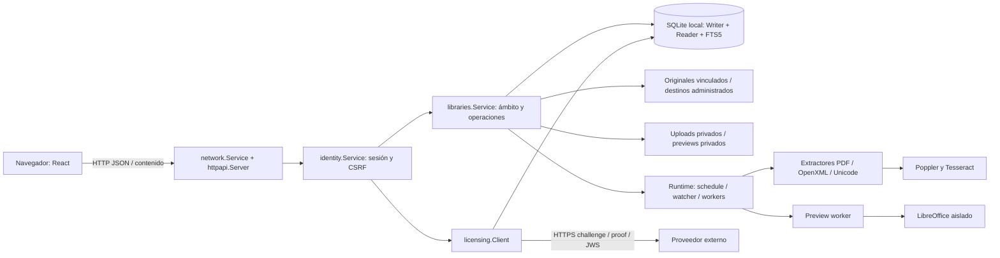
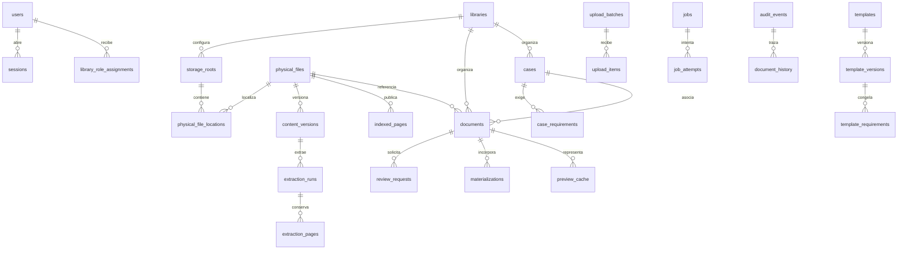
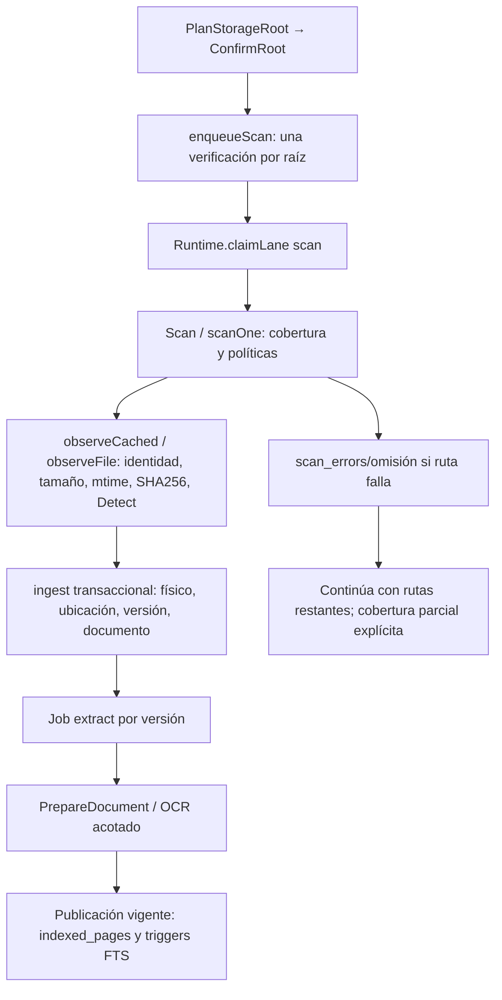
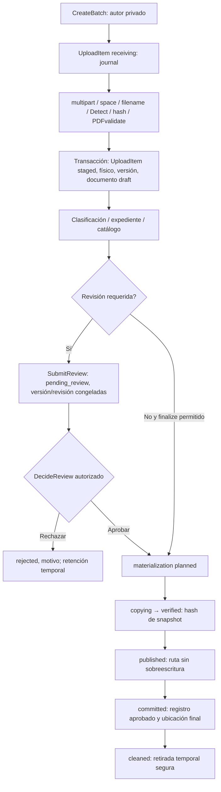
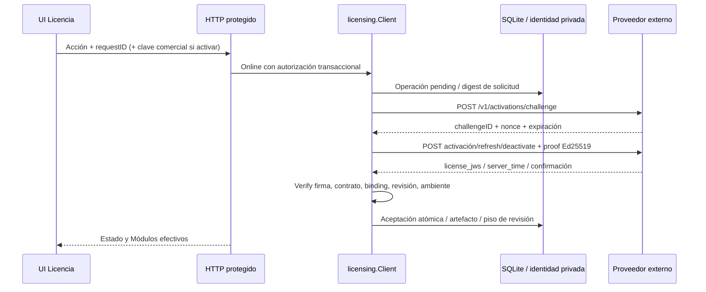

# AIBID — Inventario técnico

**Fecha de elaboración: 2026-10-09.** Actualización de la base elaborada el 8 de octubre; nombres y procedimientos contrastados con la transición de producción. Base de trabajo para los futuros manuales; no es un manual final.

## Fuente de verdad y límites

Arquitectura obtenida de código actual, migraciones ejecutables, configuración tipada y scripts. No se abrió DB real ni se copió configuración privada de usuarios; las pruebas de ejecución utilizan estado ficticio. `db/schema.proposed.sql`, requisitos y documentos históricos contienen propuestas: **no sustituyen las migraciones aplicables**. Funcionalidades/controles y procedimientos están en [01](01-inventario-funcional.md), [02](02-pantallas-y-permisos.md) y [03](03-instalacion-y-operacion.md).

Se localizan **133 combinaciones método/ruta de API y salud**, **67 tablas/virtuales creadas por 14 migraciones**, más `schema_migrations` creada por storage, y **38 índices explícitos** en migraciones. Este catálogo se obtuvo leyendo SQL, no introspectando una instancia real. Índices automáticos por PK/UNIQUE y tablas sombra FTS no se cuentan como tablas funcionales adicionales. Los ALTER posteriores se inventarían en apéndice para no tratar el CREATE inicial como esquema final completo.

## Arquitectura general

AIBID es una aplicación de servidor local con frontend SPA servido por el mismo binario, no un conjunto de microservicios. El navegador usa HTTP JSON y endpoints de contenido; el proceso Go contiene identidad, servicios de dominio, scheduler/workers, cliente de licencia y acceso SQLite. LibreOffice y Poppler/Tesseract se ejecutan como procesos externos controlados. El proveedor de licencias es externo y pertenece a otro proyecto no inspeccionado.



### Tecnologías encontradas

| Capa | Tecnología / versión fijada en proyecto | Origen / alcance |
| --- | --- | --- |
| Servidor | Go 1.27.1; net/http ServeMux con patrones método y parámetros; database/sql;slogJSON | go.mod; cmd/gestor-documental/main.go; internal/httpapi/server.go |
| SQLite | modernc.org/sqlite1.59.0 incrustado; engine≥3.51.3 requerido, WAL+FTS5 | internal/storage/database.go; no depende sqlite3 CLI. |
| Filesystem | fsnotify1.10.1; APIs Go os.OpenRoot; identidad física por SO | internal/libraries/watcher.go/filesystem.go/identity_*. |
| Criptografía | x/crypto0.57, Argon2id; crypto/ed25519, SHA256; x/sys0.48, x/term0.46 | internal/identity/password.go; internal/licensing. |
| Interfaz | React/ReactDOM19.3; TypeScript 5.9.3; Vite 8.3 | web/package.json; assets embebidos en binario Go. |
| Gráficas | Chart.js 4.5.1 carga local diferida; tablas accesibles | web/src/DashboardChart.tsx; sin CDN/ApexCharts. |
| Pruebas | Go testing, fixtures; Playwright1.63 con servidor e2e; Node≥22.12 para build | web/package.json; no prerrequisito de usuario instalado. |
| PDF/OCR | pdfinfo, pdftotext, pdftoppm (Poppler); Tesseract, spa/eng | internal/extraction/pdf.go; herramientas externas. |
| Preview | LibreOffice local opcional; perfil temporal/restricciones; PDFderivado | internal/previews/converter.go. |
| Empaquetado | Python scriptor; NSIS+PowerShell5.1; pkgbuild/productbuild+shell+launchd; Debian/APT+systemd | scripts/build_installers.py; packaging por SO. |

Son versiones del código inspeccionado, no recomendaciones actualizadas del ecosistema. No se instalaron ni actualizaron dependencias para investigar. Avisos de terceros en [packaging/THIRD-PARTY.md](../../packaging/THIRD-PARTY.md). Apache/XAMPP aparece en ruta de workspace, **no forma parte del runtime AIBID**. No PHP/MySQL ni servicio backend de licencia remoto incluido.

## Estructura y responsabilidades

| Ruta real | Componentes / responsabilidad | Relación principal |
| --- | --- | --- |
| cmd/gestor-documental | main.run, readCredentials, doctor; host_windows windowsService.Execute; host de otras plataformas | CLI, bootstrap/recuperación, exclusividad/DB, inicio network/runtime/license y shutdown. |
| cmd/aibid-launcher | main_windows | Aplicación WindowsGUI; lee URL pública y abre browser; no recibe config privada. |
| internal/httpapi | Server.Handler, boundary, protected; *_handlers; JSON/paginación/audit | Capa HTTP que traduce DTOs→servicios y errores domain.Error→envelope. |
| internal/identity | Service, LoadPrincipal, Authenticate, AuthorizedWrite, Bootstrap, RecoverAdministrator; Login/password/users | Autenticación, permiso global, sesión/revisión y escritura auditada. |
| internal/domain | Principal, User, Error, ID/tokens, digest/timestamp | Tipos compartidos y utilidades; errores seguros. |
| internal/config | Config, Load, Validate, InitializeWith, ProvisionProvider/PrepareProvider | JSON tipado, privacidad/rutas, red y confianza de proveedor. |
| internal/storage | Database.Open, Write, migrate, RollbackEmpty; private/local/space; upgrade_backup | SQLite local con writer único/readers; lock, protection, migraciones/backup interno. |
| db | migrations.go embeds; 14pares SQLup/down | Cadena de esquema real y semillas de roles; proposed no autoritativo. |
| internal/libraries | Service.Read/write/require/Create/UpdateConfiguration/SetMember; archivos por caso | Dominio documental, autorización de biblioteca, UIflags, workflows y consultas. |
| internal/libraries runtime/scanner/watcher | Service.Start (crea Runtime)/Close/scheduleOnce/claimLane/recoverJobs; Scan/scanOne/ingest; eventsLost | Cola persistida, leases/fencing, raíces y descubrimiento concurrente. |
| internal/extraction | registry, PrepareDocument, CompleteDocument, Result.add; extractDOCX/XLSX/TXT/CSV; PDF | Motores de contenido acotados y contexto de unidades. |
| internal/documentformat | Formats, Detect, Policy.Admit/IndexReason/Resolve, OpenOffice, TextReader, OpenCSV | Catálogo, MIMEbytes, validación de paquetes/texto y admisión. |
| internal/previews | Program/Available/Generator/Convert; sanitize; process_* | LibreOffice aislado, snapshot sanitizado, timeout/PDFlimit. |
| internal/licensing | Client.New/Status/Online/Import/OfflineRequest/Run/Check; Verify; RecoverIdentity | Cliente contratofirmado, identidad privada, estado/offline/renovación; proveedor externo. |
| internal/network | Service.Start/Change/Close; firewall/portcheck_* | Listener y diagnóstico por SO; rollback de transición y persistencia. |
| internal/diagnostics | Context.Safe, Record/RecordTx, ReadPolicy, Prune/PruneTx | Allowlist de contexto, agrupación/retención/códigos. |
| internal/audit | Append | Evento append-only en transacción; históricos separados de diagnósticos. |
| internal/maintenance | EraseInternal | Borra solo metadata interna reconocida con protecciones; preserva físicos. |
| web/src | App/Settings/Libraries/Documents/ClassificationForm/Workflow/Search… | SPA; navegación/granularidad PAN; cancelación de peticiones/control de estados. |
| packaging | windows/macos/ubuntu, THIRD-PARTY | Instaladores y wrappers operativos específicos; identificadores internos conservados. |
| scripts | build_installers.py; check_windows_script.ps1; test_windows_firewall.ps1; icon generator | Build/verificación de artefactos; no funcionalidades de usuario. |
| cmd/license-mock; internal/e2eserver; web/tests | Simuladores y datos de pruebas | Infraestructura de pruebas; no proveedor/servidor de producción ni feature instalada. |
| dist; docs; documentacion/base-manuales | Artefactos/informesprevios y esta base documental | No alterados paquetes ni documentos previos. |

La autorización de la capa HTTP no reemplaza la de dominio. `Server.protected("")` **no significa público**: exige sesión/CSRF y administración de seguridad de licencia; el servicio recupera permiso/ámbito. Todas las mutaciones se revalidan dentro de `AuthorizedWrite` para impedir uso de permisos revocados entre consulta y guardado.

## Almacenamiento y esquema

### Conexiones, integridad y migración

`storage.Open` exige filesystem local y archivos regulares no enlaces para DB/WAL/SHM. Construye URIfile con unidad Windows en **path**, no authority; parámetros no se concatenan con ruta insegura. Writer1conexión, transacciones immediate, foreign_keys1, busy_timeout5000ms, synchronousFULL, WAL. Reader4conexiones `mode=ro` y `query_only=1`. Sonda FTS5 del engine incrustado y rechaza engine antiguo. No abrir un sqlite3 del SO para inferir versión de engine del producto.

`Database.Write` abre transacción, rollback diferido y commit de resultado completo. Migraciones embebidas ordenadas con SHA256 de SQL; `schema_migrations(name,checksum,applied_at)` STRICT guarda aplicación. Cada migración se aplica en transacción; checksum alterado o migración desconocida/esquema posterior causa rechazo. Down solo en `RollbackEmpty`, condicionado a no evidencia/uso, no downgrade genérico. Snapshot previo a migración0014 explicado en03; no restore certificado.

Auditoría `audit_events` tiene triggers que impidenUPDATE/DELETE. Versiones de plantilla y configuración poseen inmutabilidad. FKs compuestas (id, library_id), unicidades y triggers de clasificación previenen referencia cruzada de expedientes/catálogos/archivos; no todas las asociaciones de eventos son FK por diseño para conservar referencias históricas.

### Relaciones esenciales



Diagrama de relaciones seleccionadas; cardinalidades expresan vínculos admitidos, no garantizan que exista al menos una fila hija. `documents.physical_file_id` tiene unicidad por identidad física según migración. Los punteros current_content_version_id/indexed_extraction_id/preferred_location_id hacen ciclos controlados; se insertan/actualizan transaccionalmente.

### Catálogo completo de tablas de migraciones

Campos son los **declarados en CREATE inicial**, seguidos de ALTER en apéndice. Referencias listadas son literales REFERENCES de la creación, no inventario final completo de todos ALTER/FKs. Para mantener esquema usar **cadena SQL original**, no recrearlo desde tabla resumida.

| Tabla | Responsabilidad | Campos CREATE inicial | REFERENCES inicial | Origen |
| --- | --- | --- | --- | --- |
| `users` | Identidad de cuenta, Hash de credencial, revision y deshabilitación | id, username, username_key, display_name, password_hash, credential_version, revision, disabled_at, created_at, updated_at | Sin REFERENCES literal inicial | [db/migrations/0001_identity.up.sql](../../db/migrations/0001_identity.up.sql) |
| `sessions` | Digesttoken/CSRF, credentialversion, tiempos/cierre | id, user_id, token_digest, csrf_token_digest, credential_version, started_at, last_activity_at, expires_at, closed_at, close_reason, observed_ip, user_agent | users | [db/migrations/0001_identity.up.sql](../../db/migrations/0001_identity.up.sql) |
| `authentication_attempts` | Resultado de acceso e IP/navegador observados | id, attempted_identifier, user_id, occurred_at, observed_ip, user_agent, outcome, request_id | users | [db/migrations/0001_identity.up.sql](../../db/migrations/0001_identity.up.sql) |
| `roles` | Perfiles globales/biblioteca sembrados | id, name, scope_kind | Sin REFERENCES literal inicial | [db/migrations/0001_identity.up.sql](../../db/migrations/0001_identity.up.sql) |
| `role_permissions` | Claves de permiso por rol | role_id, permission_key | roles | [db/migrations/0001_identity.up.sql](../../db/migrations/0001_identity.up.sql) |
| `global_role_assignments` | Asignación global usuario/rol | user_id, role_id, scope_kind | roles, users | [db/migrations/0001_identity.up.sql](../../db/migrations/0001_identity.up.sql) |
| `audit_events` | Evento append-only con actor/recurso/detalles | id, occurred_at, actor_kind, actor_user_id, session_id, observed_ip, request_id, event_type, library_id, case_id, document_id, details_json | Sin REFERENCES literal inicial | [db/migrations/0001_identity.up.sql](../../db/migrations/0001_identity.up.sql) |
| `bootstrap_state` | Ancla del administrador inicial | singleton, first_admin_id, completed_at | users | [db/migrations/0001_identity.up.sql](../../db/migrations/0001_identity.up.sql) |
| `authentication_throttles` | Límites persistidos por identificador/IP | scope, key_digest, attempt_count, window_started_at, next_allowed_at | Sin REFERENCES literal inicial | [db/migrations/0001_identity.up.sql](../../db/migrations/0001_identity.up.sql) |
| `libraries` | Modalidad, nombre, revision/OCR/configestado | id, name, mode, current_configuration_revision, revision, disabled_at, created_at, updated_at | Sin REFERENCES literal inicial | [db/migrations/0002_linked_libraries.up.sql](../../db/migrations/0002_linked_libraries.up.sql) |
| `library_role_assignments` | Asignación por biblioteca | user_id, library_id, role_id, scope_kind | libraries, roles, users | [db/migrations/0002_linked_libraries.up.sql](../../db/migrations/0002_linked_libraries.up.sql) |
| `storage_roots` | Rutas/origen/estado/intervalo/watch/revisión | id, library_id, storage_source, canonical_path, comparison_key, volume_identity, case_sensitive, status, configuration_revision, watch_mode, reconcile_interval_seconds, last_verified_at, last_error_code, created_at | libraries | [db/migrations/0002_linked_libraries.up.sql](../../db/migrations/0002_linked_libraries.up.sql) |
| `storage_root_configuration_versions` | Snapshot histórico de configuración raíz | root_id, revision, canonical_path, comparison_key, configuration_json, created_at, created_by | storage_roots, users | [db/migrations/0002_linked_libraries.up.sql](../../db/migrations/0002_linked_libraries.up.sql) |
| `root_operations` | Operaciones de alta/consolidación/retiro | id, library_id, requested_by, operation_kind, state, expected_configuration_json, private_plan_json, checkpoint_json, created_at, updated_at | libraries, users | [db/migrations/0002_linked_libraries.up.sql](../../db/migrations/0002_linked_libraries.up.sql) |
| `logical_folder_views` | Vista por raíz/prefijo, sin almacenamiento adicional | id, library_id, root_id, name, relative_prefix, created_at | libraries, storage_roots | [db/migrations/0002_linked_libraries.up.sql](../../db/migrations/0002_linked_libraries.up.sql) |
| `physical_files` | Identidad física, origen inmutable, availability, version/punteros | id, library_id, storage_source, os_identity_key, availability, integrity_status, primary_location_id, current_content_version_id, indexed_extraction_id, indexed_at, extraction_freshness, created_at | content_versions, extraction_runs, libraries, physical_file_locations | [db/migrations/0002_linked_libraries.up.sql](../../db/migrations/0002_linked_libraries.up.sql) |
| `physical_file_locations` | Rutas/alias actuales o retirados con raíz | id, physical_file_id, library_id, storage_source, root_id, relative_path, canonical_path, comparison_key, root_configuration_revision, first_seen_at, last_seen_at, retired_at | physical_files, storage_roots | [db/migrations/0002_linked_libraries.up.sql](../../db/migrations/0002_linked_libraries.up.sql) |
| `content_versions` | Firma/hash/tamaño/mtime/formato y vigencia | id, physical_file_id, generation, size_bytes, os_created_at, os_modified_at, sha256, observed_change_key, observed_at, change_origin | physical_files | [db/migrations/0002_linked_libraries.up.sql](../../db/migrations/0002_linked_libraries.up.sql) |
| `extraction_runs` | Ejecución/versionextractor/resumen/warnings/resultado | id, physical_file_id, content_version_id, extractor_revision, language_codes, status, page_count, completed_at, error_code | content_versions, physical_files | [db/migrations/0002_linked_libraries.up.sql](../../db/migrations/0002_linked_libraries.up.sql) |
| `extraction_pages` | Unidades históricas de texto nativo/OCR y contexto | id, extraction_id, page_number, extraction_method, page_text | extraction_runs | [db/migrations/0002_linked_libraries.up.sql](../../db/migrations/0002_linked_libraries.up.sql) |
| `documents` | Entidad documental/approval/classification/case/softdelete | id, library_id, physical_file_id, title, original_filename, filename_search_key, approval_status, revision, deleted_at, created_at | libraries, physical_files | [db/migrations/0002_linked_libraries.up.sql](../../db/migrations/0002_linked_libraries.up.sql) |
| `indexed_pages` | Publicación vigente de texto searchable | id, physical_file_id, extraction_id, page_number, page_text | extraction_runs, physical_files | [db/migrations/0002_linked_libraries.up.sql](../../db/migrations/0002_linked_libraries.up.sql) |
| `pages_fts` | Índice externo FTS5 vinculado a indexed_pages | Definición virtual FTS | Sin REFERENCES literal inicial | [db/migrations/0002_linked_libraries.up.sql](../../db/migrations/0002_linked_libraries.up.sql) |
| `jobs` | Cola, carril, target, idempotencia, lease/fencing/intentos | id, library_id, physical_file_id, job_type, target_version, idempotency_key, payload_json, status, attempt_count, max_attempts, available_at, lease_owner, lease_expires_at, fencing_token, last_error_code, retry_of_job_id, created_at | jobs, libraries, physical_files | [db/migrations/0002_linked_libraries.up.sql](../../db/migrations/0002_linked_libraries.up.sql) |
| `job_attempts` | Tentativas/errores/timing por trabajo | id, job_id, attempt_number, fencing_token, started_at, finished_at, error_code | jobs | [db/migrations/0002_linked_libraries.up.sql](../../db/migrations/0002_linked_libraries.up.sql) |
| `root_scans` | Cobertura/estado/generación de recorrido | id, root_id, configuration_revision, status, checkpoint_json, directories_seen, files_seen, started_at, completed_at, can_confirm_absence | storage_roots | [db/migrations/0002_linked_libraries.up.sql](../../db/migrations/0002_linked_libraries.up.sql) |
| `scan_file_observations` | Ubicaciones observadas por recorrido | scan_id, location_id, seen_at | physical_file_locations, root_scans | [db/migrations/0002_linked_libraries.up.sql](../../db/migrations/0002_linked_libraries.up.sql) |
| `search_audit_details` | Texto/filtros exactos con acceso especial | event_id, exact_query_text, search_type, consulted_library_ids_json, applied_filters_json, result_count, retain_until | audit_events | [db/migrations/0002_linked_libraries.up.sql](../../db/migrations/0002_linked_libraries.up.sql) |
| `document_notifications` | Avisos de cambios/versiones e historial | id, document_id, content_version_id, event_id, notification_kind, observation_key, created_at | audit_events, content_versions, documents | [db/migrations/0002_linked_libraries.up.sql](../../db/migrations/0002_linked_libraries.up.sql) |
| `notification_receipts` | Acuse porusuario/aviso | notification_id, user_id, acknowledged_at | document_notifications, users | [db/migrations/0002_linked_libraries.up.sql](../../db/migrations/0002_linked_libraries.up.sql) |
| `document_history` | Relación evento-documento | id, document_id, revision, event_id, snapshot_json | audit_events, documents | [db/migrations/0002_linked_libraries.up.sql](../../db/migrations/0002_linked_libraries.up.sql) |
| `idempotency_requests` | Respuesta/operation/payloaddigest por solicitud | actor_user_id, operation, idempotency_key, request_digest, resource_id, status, created_at | users | [db/migrations/0002_linked_libraries.up.sql](../../db/migrations/0002_linked_libraries.up.sql) |
| `root_plans` | Plan y configuración esperada por operación de raíz | id, library_id, actor_user_id, server_path, directory_identity, relation, related_root_ids_json, expected_revision, expires_at, committed_root_id | libraries, storage_roots, users | [db/migrations/0002_linked_libraries.up.sql](../../db/migrations/0002_linked_libraries.up.sql) |
| `categories` | Categorías con archivado por biblioteca | id, library_id, name, revision, archived_at | libraries | [db/migrations/0003_managed_organization.up.sql](../../db/migrations/0003_managed_organization.up.sql) |
| `document_types` | Tipo, categoría, multiplicidad/título | id, library_id, category_id, name, revision, allows_multiple, requires_descriptive_title, archived_at | categories | [db/migrations/0003_managed_organization.up.sql](../../db/migrations/0003_managed_organization.up.sql) |
| `templates` | Plantilla identificada por biblioteca | id, library_id, name, archived_at | libraries | [db/migrations/0003_managed_organization.up.sql](../../db/migrations/0003_managed_organization.up.sql) |
| `template_versions` | Versiones inmutables de plantilla | id, template_id, library_id, revision, created_at | templates | [db/migrations/0003_managed_organization.up.sql](../../db/migrations/0003_managed_organization.up.sql) |
| `template_requirements` | Snapshot de exigencias por versión | id, template_version_id, library_id, category_id, document_type_id, required_count, mandatory, allows_multiple | document_types, template_versions | [db/migrations/0003_managed_organization.up.sql](../../db/migrations/0003_managed_organization.up.sql) |
| `cases` | Identificador/ejercicio y origen de plantilla | id, library_id, identifier, identifier_key, revision, exercise, template_version_id, requirements_initialized_at, deleted_at, created_at | libraries, template_versions | [db/migrations/0003_managed_organization.up.sql](../../db/migrations/0003_managed_organization.up.sql) |
| `case_requirements` | Requisitos copiados/ajustados con revision | id, case_id, library_id, category_id, document_type_id, source_template_requirement_id, required_count, mandatory, allows_multiple, revision | cases, document_types, template_requirements | [db/migrations/0003_managed_organization.up.sql](../../db/migrations/0003_managed_organization.up.sql) |
| `library_configuration_versions` | Configuración congelada para incorporación | library_id, revision, mode, settings_json, created_by, created_at | libraries, users | [db/migrations/0003_managed_organization.up.sql](../../db/migrations/0003_managed_organization.up.sql) |
| `upload_batches` | Lotes privados por autor/biblioteca | id, library_id, created_by, client_batch_id, created_at | libraries, users | [db/migrations/0003_managed_organization.up.sql](../../db/migrations/0003_managed_organization.up.sql) |
| `upload_items` | Journal de recepción, documento, estado y retención | id, batch_id, library_id, client_file_id, original_filename, document_id, private_temporary_locator, status, error_code, size_bytes, sha256, created_at | documents, upload_batches | [db/migrations/0003_managed_organization.up.sql](../../db/migrations/0003_managed_organization.up.sql) |
| `review_requests` | Solicitud versión/revisión y asignación/decisión | id, document_id, library_id, document_revision, content_version_id, requested_by, assigned_reviewer_id, status, requested_at, decided_by, decided_at, reason | content_versions, documents, users | [db/migrations/0004_document_workflow.up.sql](../../db/migrations/0004_document_workflow.up.sql) |
| `materializations` | Journal de copia/publicación/commit/snapshot | id, document_id, library_id, physical_file_id, content_version_id, document_revision, target_root_id, root_revision, library_configuration_revision, target_relative_path, target_comparison_key, partial_relative_path, expected_sha256, expected_size_bytes, state, published_identity, approved_by, decision_kind, review_id, error_code, created_at, updated_at | content_versions, documents, library_configuration_versions, physical_files, review_requests, storage_roots, users | [db/migrations/0004_document_workflow.up.sql](../../db/migrations/0004_document_workflow.up.sql) |
| `library_document_sequences` | Consecutivo estable por biblioteca | library_id, next_number | libraries | [db/migrations/0004_document_workflow.up.sql](../../db/migrations/0004_document_workflow.up.sql) |
| `license_installation` | Ancla pública de identidad instalada | singleton, installation_id, public_key, fingerprint_version, initial_fingerprint_hash, created_at | Sin REFERENCES literal inicial | [db/migrations/0005_license_client.up.sql](../../db/migrations/0005_license_client.up.sql) |
| `license_state` | JWS firmado/estado/reloj/contacto | singleton, current_jws, deactivated, offline_deactivation_pending, last_trusted_at, last_observed_at, last_contact_at, last_error_code, clock_warning | Sin REFERENCES literal inicial | [db/migrations/0005_license_client.up.sql](../../db/migrations/0005_license_client.up.sql) |
| `license_revision_floors` | Piso de revisión antirollback | activation_id, license_id, highest_revision, jws_sha256, deactivated | Sin REFERENCES literal inicial | [db/migrations/0005_license_client.up.sql](../../db/migrations/0005_license_client.up.sql) |
| `license_artifacts` | Solicitudes/respuestas privadas e integridad | id, direction, action, request_id, contents, sha256, actor_user_id, created_at | Sin REFERENCES literal inicial | [db/migrations/0005_license_client.up.sql](../../db/migrations/0005_license_client.up.sql) |
| `license_operations` | Idempotencia/operaciones online pendientes | request_id, action, request_digest, request_json, status, error_code, created_at, updated_at | Sin REFERENCES literal inicial | [db/migrations/0005_license_client.up.sql](../../db/migrations/0005_license_client.up.sql) |
| `file_scan_cache` | Firma/hash previa por ruta | root_id, relative_path, identity_key, size_bytes, modified_ns, sha256, hashed_at | storage_roots | [db/migrations/0006_processing_visibility.up.sql](../../db/migrations/0006_processing_visibility.up.sql) |
| `scan_progress` | Descubrimiento/contadores/ruta/directorios | scan_id, current_path, unchanged_files, hashed_files, excluded_directories, updated_at, partial | root_scans | [db/migrations/0006_processing_visibility.up.sql](../../db/migrations/0006_processing_visibility.up.sql) |
| `scan_errors` | Errores puntuales por raíz/ruta | root_id, relative_path, error_code, occurred_at | storage_roots | [db/migrations/0006_processing_visibility.up.sql](../../db/migrations/0006_processing_visibility.up.sql) |
| `job_progress` | Fase/unidades de operación | job_id, operation, relative_path, completed_units, total_units, updated_at | jobs | [db/migrations/0006_processing_visibility.up.sql](../../db/migrations/0006_processing_visibility.up.sql) |
| `job_controls` | Cancelación solicitada por trabajo | job_id, cancel_requested | jobs | [db/migrations/0006_processing_visibility.up.sql](../../db/migrations/0006_processing_visibility.up.sql) |
| `root_scan_controls` | Pausa explícita de raíz | root_id, paused | storage_roots | [db/migrations/0006_processing_visibility.up.sql](../../db/migrations/0006_processing_visibility.up.sql) |
| `processing_settings` | Presupuesto global auto/manual versionado | singleton, mode, native_workers, ocr_workers, total_workers, revision, updated_at | Sin REFERENCES literal inicial | [db/migrations/0007_processing_settings.up.sql](../../db/migrations/0007_processing_settings.up.sql) |
| `root_watch_recovery` | Generación de eventos perdidos y barrera | root_id, loss_generation, recovered_generation | storage_roots | [db/migrations/0008_reconciliation.up.sql](../../db/migrations/0008_reconciliation.up.sql) |
| `document_file_settings` | Políticas global/biblioteca, herencia y revisión | scope, configuration_json, revision, updated_at | Sin REFERENCES literal inicial | [db/migrations/0009_document_formats.up.sql](../../db/migrations/0009_document_formats.up.sql) |
| `document_file_skips` | Omisiones por reglas, distintas de error | root_id, relative_path, error_code, detection_json, observed_at | storage_roots | [db/migrations/0009_document_formats.up.sql](../../db/migrations/0009_document_formats.up.sql) |
| `processing_policy` | Pausa, attempts, delay, timeoutglobal | singleton, paused, maximum_attempts, retry_delay_seconds, timeout_seconds, revision, updated_at | Sin REFERENCES literal inicial | [db/migrations/0011_processing_policy.up.sql](../../db/migrations/0011_processing_policy.up.sql) |
| `preview_settings` | Cache/converter/fuente/retención global | singleton, enabled, maximum_cache_mb, maximum_idle_days, maximum_source_mb, automatic_cleanup, converter_path, revision | Sin REFERENCES literal inicial | [db/migrations/0012_preview_cache.up.sql](../../db/migrations/0012_preview_cache.up.sql) |
| `preview_cache` | Derivados por doc/hash/generador, LRU y estado | id, document_id, content_version_id, source_hash, generator_version, requested_by, status, media_type, size_bytes, error_code, created_at, generated_at, last_accessed_at | content_versions, documents, users | [db/migrations/0012_preview_cache.up.sql](../../db/migrations/0012_preview_cache.up.sql) |
| `advanced_settings` | OverridesJSON por global/Ámbito de biblioteca | scope, configuration_json, revision, updated_at | Sin REFERENCES literal inicial | [db/migrations/0013_advanced_settings.up.sql](../../db/migrations/0013_advanced_settings.up.sql) |
| `diagnostic_policy` | Retención/maximumevents/revisión | singleton, retention_days, maximum_events, revision | Sin REFERENCES literal inicial | [db/migrations/0014_observability.up.sql](../../db/migrations/0014_observability.up.sql) |
| `diagnostic_events` | Incidencias agrupadas por firma y contexto allowlist | id, signature, occurred_at, last_occurred_at, module, code, severity, status, message, context_json, occurrences, revision | Sin REFERENCES literal inicial | [db/migrations/0014_observability.up.sql](../../db/migrations/0014_observability.up.sql) |

`schema_migrations` no aparece entre esas67 porque se crea en [internal/storage/database.go](../../internal/storage/database.go), no en una migración .up. `pages_fts` es virtual `fts5(page_text,content='indexed_pages',content_rowid='id',tokenize='unicode61 remove_diacritics 2')`; triggers indexed_pages insert/delete/update sincronizan índice. Texto histórico extraction_pages conserva evidencia aunque se despublique indexed_pages.

### Índices explícitos y exclusión concurrente

| Índice | Tabla | Único | Expresión / filtro |
| --- | --- | --- | --- |
| `sessions_one_open_per_user` | sessions | Sí | `(user_id) WHERE closed_at IS NULL` |
| `sessions_history` | sessions | No | `(user_id, started_at DESC)` |
| `authentication_attempts_time` | authentication_attempts | No | `(occurred_at DESC)` |
| `authentication_attempts_rate` | authentication_attempts | No | `(observed_ip, occurred_at)` |
| `audit_time` | audit_events | No | `(occurred_at DESC, id)` |
| `audit_library` | audit_events | No | `(library_id, occurred_at DESC)` |
| `audit_document` | audit_events | No | `(document_id, occurred_at DESC)` |
| `audit_actor` | audit_events | No | `(actor_user_id, occurred_at DESC)` |
| `authentication_attempts_identifier` | authentication_attempts | No | `(attempted_identifier, occurred_at)` |
| `library_memberships` | library_role_assignments | No | `(library_id, user_id)` |
| `storage_roots_unique_path` | storage_roots | Sí | `(comparison_key) WHERE status NOT IN ('retired', 'superseded')` |
| `storage_roots_library` | storage_roots | No | `(library_id, status)` |
| `physical_files_os_identity` | physical_files | Sí | `(os_identity_key) WHERE os_identity_key IS NOT NULL` |
| `physical_files_library_availability` | physical_files | No | `(library_id, availability)` |
| `physical_locations_current_path` | physical_file_locations | Sí | `(comparison_key) WHERE retired_at IS NULL` |
| `physical_locations_explorer` | physical_file_locations | No | `(root_id, relative_path)` |
| `physical_locations_file` | physical_file_locations | No | `(physical_file_id, retired_at)` |
| `content_versions_hash` | content_versions | No | `(sha256) WHERE sha256 IS NOT NULL` |
| `jobs_claim` | jobs | No | `(status, available_at, created_at)` |
| `jobs_one_running_file` | jobs | Sí | `(physical_file_id) WHERE status = 'running' AND physical_file_id IS NOT NULL` |
| `root_scans_one_running` | root_scans | Sí | `(root_id) WHERE status = 'running'` |
| `jobs_one_running_root` | jobs | Sí | `(target_version) WHERE status='running' AND job_type='scan'` |
| `root_scans_history` | root_scans | No | `(root_id,started_at DESC)` |
| `documents_case_status` | documents | No | `(case_id,document_type_id,approval_status) WHERE deleted_at IS NULL` |
| `documents_library_filters` | documents | No | `(library_id,category_id,document_type_id) WHERE deleted_at IS NULL` |
| `uploads_document` | upload_items | No | `(document_id,status)` |
| `review_one_pending` | review_requests | Sí | `(document_id) WHERE status='pending'` |
| `review_library_inbox` | review_requests | No | `(library_id,status,requested_at,id)` |
| `license_artifacts_time` | license_artifacts | No | `(created_at,id)` |
| `jobs_processing_target` | jobs | No | `(job_type,target_version,status)` |
| `jobs_file_version` | jobs | No | `(physical_file_id,target_version,job_type,created_at DESC)` |
| `audit_library_actor_time` | audit_events | No | `(library_id,actor_user_id,occurred_at DESC,id DESC)` |
| `audit_library_type_time` | audit_events | No | `(library_id,event_type,occurred_at DESC,id DESC)` |
| `job_attempts_finished` | job_attempts | No | `(finished_at,job_id)` |
| `jobs_one_root_verification` | jobs | Sí | `(target_version) WHERE job_type IN ('scan','verify_managed') AND status IN ('queued','running','retry_wait','paused')` |
| `preview_cache_lru` | preview_cache | No | `(status,last_accessed_at,id)` |
| `diagnostic_events_time` | diagnostic_events | No | `(last_occurred_at DESC,id DESC)` |
| `diagnostic_events_filters` | diagnostic_events | No | `(module,severity,status,last_occurred_at DESC)` |

Unicidades clave: una sesión abierta/usuario, una tarea running por físico, un scanrunning por raíz, un pendingreview por documento, una ruta actual por comparison_key, una identidad OS cuando disponible. Migración0008 refuerza verificación scan/verify_managed de una misma raíz en cola; el worker admite raíces distintas sin duplicar la misma. No confundir cuatro workers con cuatro scans de una raíz.

### Cadena de migraciones y cambios posteriores a CREATE

| Fuente real | Tablas nuevas | Tablas alteradas |
| --- | --- | --- |
| [db/migrations/0001_identity.up.sql](../../db/migrations/0001_identity.up.sql) | users, sessions, authentication_attempts, roles, role_permissions, global_role_assignments, audit_events, bootstrap_state, authentication_throttles | — |
| [db/migrations/0002_linked_libraries.up.sql](../../db/migrations/0002_linked_libraries.up.sql) | libraries, library_role_assignments, storage_roots, storage_root_configuration_versions, root_operations, logical_folder_views, physical_files, physical_file_locations, content_versions, extraction_runs, extraction_pages, documents, indexed_pages, pages_fts, jobs, job_attempts, root_scans, scan_file_observations, search_audit_details, document_notifications, notification_receipts, document_history, idempotency_requests, root_plans | libraries, root_scans, storage_roots |
| [db/migrations/0003_managed_organization.up.sql](../../db/migrations/0003_managed_organization.up.sql) | categories, document_types, templates, template_versions, template_requirements, cases, case_requirements, library_configuration_versions, upload_batches, upload_items | documents, libraries, root_plans |
| [db/migrations/0004_document_workflow.up.sql](../../db/migrations/0004_document_workflow.up.sql) | review_requests, materializations, library_document_sequences | documents, upload_items |
| [db/migrations/0005_license_client.up.sql](../../db/migrations/0005_license_client.up.sql) | license_installation, license_state, license_revision_floors, license_artifacts, license_operations | — |
| [db/migrations/0006_processing_visibility.up.sql](../../db/migrations/0006_processing_visibility.up.sql) | file_scan_cache, scan_progress, scan_errors, job_progress, job_controls, root_scan_controls | — |
| [db/migrations/0007_processing_settings.up.sql](../../db/migrations/0007_processing_settings.up.sql) | processing_settings | — |
| [db/migrations/0008_reconciliation.up.sql](../../db/migrations/0008_reconciliation.up.sql) | root_watch_recovery | root_scans, scan_progress |
| [db/migrations/0009_document_formats.up.sql](../../db/migrations/0009_document_formats.up.sql) | document_file_settings, document_file_skips | content_versions, file_scan_cache, upload_items |
| [db/migrations/0010_document_extractors.up.sql](../../db/migrations/0010_document_extractors.up.sql) | — | extraction_pages, extraction_runs |
| [db/migrations/0011_processing_policy.up.sql](../../db/migrations/0011_processing_policy.up.sql) | processing_policy | jobs |
| [db/migrations/0012_preview_cache.up.sql](../../db/migrations/0012_preview_cache.up.sql) | preview_settings, preview_cache | — |
| [db/migrations/0013_advanced_settings.up.sql](../../db/migrations/0013_advanced_settings.up.sql) | advanced_settings | — |
| [db/migrations/0014_observability.up.sql](../../db/migrations/0014_observability.up.sql) | diagnostic_policy, diagnostic_events | — |

Cambios declarados en [db/migrations/0002_linked_libraries.up.sql](../../db/migrations/0002_linked_libraries.up.sql):

```sql
ALTER TABLE root_scans ADD COLUMN last_error_code TEXT;
ALTER TABLE storage_roots ADD COLUMN directory_identity TEXT NOT NULL DEFAULT '';
ALTER TABLE storage_roots ADD COLUMN last_scan_at TEXT;
ALTER TABLE libraries ADD COLUMN ocr_languages TEXT NOT NULL DEFAULT 'spa';
```

Cambios declarados en [db/migrations/0003_managed_organization.up.sql](../../db/migrations/0003_managed_organization.up.sql):

```sql
ALTER TABLE libraries ADD COLUMN settings_json TEXT NOT NULL DEFAULT '{"identifier_label":"Expediente","exercise_enabled":false,"cases_enabled":true,"structure_pattern":"{identificador}/{categoria}","filename_pattern":"original","filename_prefix":"","default_managed_root_id":""}' CHECK(json_valid(settings_json));
ALTER TABLE root_plans ADD COLUMN storage_source TEXT NOT NULL DEFAULT 'linked' CHECK(storage_source IN ('linked','managed'));
ALTER TABLE documents ADD COLUMN case_id TEXT REFERENCES cases(id);
ALTER TABLE documents ADD COLUMN category_id TEXT REFERENCES categories(id);
ALTER TABLE documents ADD COLUMN document_type_id TEXT REFERENCES document_types(id);
ALTER TABLE documents ADD COLUMN created_by TEXT REFERENCES users(id);
ALTER TABLE documents ADD COLUMN metadata_json TEXT NOT NULL DEFAULT '{}' CHECK(json_valid(metadata_json));
```

Cambios declarados en [db/migrations/0004_document_workflow.up.sql](../../db/migrations/0004_document_workflow.up.sql):

```sql
ALTER TABLE documents ADD COLUMN approved_content_version_id TEXT REFERENCES content_versions(id);
ALTER TABLE documents ADD COLUMN approved_by TEXT REFERENCES users(id);
ALTER TABLE documents ADD COLUMN approved_at TEXT;
ALTER TABLE upload_items ADD COLUMN retain_until TEXT;
```

Cambios declarados en [db/migrations/0008_reconciliation.up.sql](../../db/migrations/0008_reconciliation.up.sql):

```sql
ALTER TABLE root_scans ADD COLUMN loss_generation INTEGER NOT NULL DEFAULT 0;
ALTER TABLE scan_progress ADD COLUMN changed_files INTEGER NOT NULL DEFAULT 0;
```

Cambios declarados en [db/migrations/0009_document_formats.up.sql](../../db/migrations/0009_document_formats.up.sql):

```sql
ALTER TABLE content_versions ADD COLUMN document_format TEXT NOT NULL DEFAULT 'pdf';
ALTER TABLE content_versions ADD COLUMN detected_mime TEXT NOT NULL DEFAULT 'application/pdf';
ALTER TABLE content_versions ADD COLUMN original_extension TEXT NOT NULL DEFAULT '.pdf';
ALTER TABLE content_versions ADD COLUMN extension_mismatch INTEGER NOT NULL DEFAULT 0 CHECK(extension_mismatch IN (0,1));
ALTER TABLE content_versions ADD COLUMN index_block_reason TEXT NOT NULL DEFAULT '';
ALTER TABLE upload_items ADD COLUMN detection_json TEXT NOT NULL DEFAULT '{}' CHECK(json_valid(detection_json));
ALTER TABLE file_scan_cache ADD COLUMN detection_json TEXT NOT NULL DEFAULT '{}' CHECK(json_valid(detection_json));
```

Cambios declarados en [db/migrations/0010_document_extractors.up.sql](../../db/migrations/0010_document_extractors.up.sql):

```sql
ALTER TABLE extraction_runs ADD COLUMN extractor_id TEXT NOT NULL DEFAULT '';
ALTER TABLE extraction_runs ADD COLUMN extractor_version TEXT NOT NULL DEFAULT '';
ALTER TABLE extraction_runs ADD COLUMN document_format TEXT NOT NULL DEFAULT 'pdf';
ALTER TABLE extraction_runs ADD COLUMN started_at TEXT;
ALTER TABLE extraction_runs ADD COLUMN result_code TEXT NOT NULL DEFAULT '';
ALTER TABLE extraction_runs ADD COLUMN unit_count INTEGER NOT NULL DEFAULT 0 CHECK(unit_count>=0);
ALTER TABLE extraction_runs ADD COLUMN summary_json TEXT NOT NULL DEFAULT '{}' CHECK(json_valid(summary_json));
ALTER TABLE extraction_runs ADD COLUMN warnings_json TEXT NOT NULL DEFAULT '[]' CHECK(json_valid(warnings_json));
ALTER TABLE extraction_pages ADD COLUMN unit_kind TEXT NOT NULL DEFAULT 'page';
ALTER TABLE extraction_pages ADD COLUMN context_label TEXT NOT NULL DEFAULT '';
ALTER TABLE extraction_pages ADD COLUMN context_json TEXT NOT NULL DEFAULT '{}' CHECK(json_valid(context_json));
```

Cambios declarados en [db/migrations/0011_processing_policy.up.sql](../../db/migrations/0011_processing_policy.up.sql):

```sql
ALTER TABLE jobs ADD COLUMN retry_delay_seconds INTEGER NOT NULL DEFAULT 2 CHECK(retry_delay_seconds BETWEEN 1 AND 3600);
ALTER TABLE jobs ADD COLUMN timeout_seconds INTEGER NOT NULL DEFAULT 3600 CHECK(timeout_seconds BETWEEN 10 AND 3600);
```

No se reproducen UPDATE/INSERT de datos reales. Las semillas de roles están en02. Las migraciones de formato/extractores preservan extracción/FTS previa; page_number permanece ordinal técnico aun cuando unidad no sea página PDF.

## Flujos documentales completos

### Biblioteca vinculada: originales externos



El plan compara igualdad, descendencia, antecesor o independencia de la carpeta, y conserva la revisión esperada. Una subcarpeta crea vista lógica; una antecesora puede consolidar raíces sin perder identidades, texto e historial. Los destinos administrados rechazan solapamientos incompatibles. El plan se revalida antes de confirmar.

`Scan` abre una raíz confinada con `os.OpenRoot`, recorre una cola de directorios y registra cobertura. Aplica exclusiones del sistema y reglas de archivos; rechaza enlaces y rutas fuera del ámbito. Tiene límite de 100000 directorios vistos más pendientes. `observeCached` compara identidad física, tamaño y mtime; cuando necesita leer, `observeFile` calcula SHA-256 y detecta formato sobre el mismo handle. Comprueba estabilidad antes de persistir. Los eventos de vigilancia invalidan la caché de la ruta afectada.

Una identidad de archivo del SO permite reconocer renombrados o hard links. Una copia distinta con el mismo hash conserva registro propio: el hash de contenido no sustituye identidad física. `ingest` registra físico, ubicación, versión y documento transaccionalmente; encola extracción mientras sigue el descubrimiento. No espera a conocer el total de archivos.

Un error de lectura individual deja evidencia en `scan_errors` y continúa con las rutas restantes. Fallos de DB, cancelación o pérdida de raíz detienen la operación. Un recorrido parcial no confirma desapariciones sobre cobertura fallida; una raíz desconectada conserva evidencia previa. Una omisión por reglas tampoco equivale a eliminación del original.

Cambiar bytes externos crea una versión vinculada; el índice se reemplaza solo al publicar una extracción válida. El original no se mueve ni se modifica. La aprobación de vinculados se conserva conforme a las reglas del flujo. Un retiro explícito del índice hace soft delete y no se revierte por un escaneo periódico.

Fuentes: [scanner.go](../../internal/libraries/scanner.go), [scan_cache.go](../../internal/libraries/scan_cache.go), [filesystem.go](../../internal/libraries/filesystem.go), [roots.go](../../internal/libraries/roots.go). Funciones relacionadas: FUN-022 a FUN-037, FUN-078 y FUN-079.

### Carga administrada: borrador, revisión y publicación



El backend ofrece dos slots de recepción; la UI envía archivos secuencialmente y permite seleccionar hasta 100. `upload_items.receiving` funciona como journal de recepción: todavía no representa un documento publicado. El nombre admite hasta 250 runes; no permite separadores de ruta, dos puntos, NUL, CR/LF ni espacio o punto finales. El multipart exige primero `client_file_id` y después un único archivo.

`Upload` valida cuenta autora, lote, idempotencia, tamaño, bytes reales y PDF cuando corresponde. Exige espacio libre para el máximo permitido por la biblioteca más 64 MiB; esa reserva no se calcula solamente con el tamaño real del archivo. Un fallo conserva diagnóstico y limpia el temporal reconocido. El commit válido crea documento, físico, versión y tarea de extracción de forma atómica. Antes de publicación el borrador solo es visible para autor y revisores autorizados; no se expone su locator privado como ruta descargable libre.

La clasificación comprueba que categoría, tipo y expediente pertenecen a la misma biblioteca; valida título, metadatos y multiplicidad. La plantilla se copia como snapshot al inicializar requisitos. Después se ajustan requisitos locales sin alterar la plantilla histórica. El avance considera documentos aprobados válidos: un administrado alterado o ausente no contribuye; un vinculado aprobado puede conservar aprobación aunque el original esté temporalmente inaccesible.

`FinalizeDocument` exige que la política admita confirmación directa. `DecideReview` verifica revisor, asignación, autor y versión/revisión esperadas. Una decisión de aprobar puede iniciar materialización asíncrona; no significa que la copia final ya esté disponible.

La materialización congela configuración de destino y nomenclatura. Copia desde temporal privado, comprueba hash, publica sin sobrescribir una colisión existente, confirma la transacción y después retira temporal. El sufijo estable y consecutivo evitan nombres ambiguos. Fallos conservan temporal y journal; un reintento reconoce fases confirmadas para no duplicar archivos. Antes de publicar vuelve a validar autoridad, licencia y destino.

La verificación administrada compara existencia y hash del original final. Un archivo ilegible no impide verificar los demás; cambios no se convierten automáticamente en aprobación válida. Fuentes: [uploads.go](../../internal/libraries/uploads.go), [classification.go](../../internal/libraries/classification.go), [cases.go](../../internal/libraries/cases.go), [workflow.go](../../internal/libraries/workflow.go), [materialization.go](../../internal/libraries/materialization.go), [managed_integrity.go](../../internal/libraries/managed_integrity.go). FUN-038 a FUN-060 y FUN-083.

### Extracción, publicación y reindexación

El catálogo `documentformat.Formats` declara PDF, DOCX, XLSX, TXT y CSV. El registro de extractores en `internal/extraction/document.go` tiene pruebas que verifican esa correspondencia. La capacidad del motor y la política de la biblioteca son distintas: por defecto se almacenan los cinco formatos, pero solo PDF se indexa.

`queueNewlyIndexable` puede encolar una primera extracción antes retenida por reglas cuando se habilita indexación. No es un reindexado general, no actualiza por sí solo todas las revisiones de motor ni revive cancelaciones o fallos terminales.

| Formato | Motor/contexto | Contenido extraído | Límites/advertencias |
| --- | --- | --- | --- |
| PDF | Poppler:Tamaño/páginas→texto nativo batch por formfeed; OCR conrender+Tesseract | Unidad página, método native/ocr; umbraldefault32letras/dígitos | Páginasdefault1000(config1–10000), timeoutoperación120(config5–300); OCR soloPDF; OCR_DISABLED. |
| DOCX | OpenXML streaming namespacevalidado; extractDOCX | Parágrafos, incluyendo tabla(fila/celda/sección), body y header/footer/foot/endnotes relacionados | Ignora referenciasexternas/deletedtrack/instrfield/altChunk conwarnings. Logo/blankparagraph no deben ocultar body; noOCR de imagen. |
| XLSX | OpenXML relaciones/workbook/worksheets/sharedStrings | Hoja porunidad, nombre/address/cells, inline/shared, cachedvalues; searchable sheet vacíoformateado | ≤1024hojas; sharedStrings≤200000/32 MiB; no evalúaformulas, formato financiero no aplicado; warning formulas_missing/cached. |
| TXT | TextReader UTF8 o UTF16 conBOM; streaming | Bloques de líneas con contexto | No adivinaANSI/singlebyte; NUL/controlbinarios rechazados; máximo unidad/texto. |
| CSV | OpenCSV, delimitador compatible y records consistentes | Bloques filas/celdas; encabezado inferido y contexto | No ejecuta fórmulas; CSV_HEADER_INFERRED; quotedrecords acotados; extensión desambiguaCSV de prosa. |


`Result.add` rechaza más de 50000 unidades, más de 4 MiB por unidad o más de 32 MiB de texto total. No publica un documento truncado como extracción correcta. Guarda descriptor y versión del extractor, formato, resumen, advertencias y contexto de cada unidad. `page_number` es ordinal técnico estable; solo PDF tiene necesariamente páginas físicas.

La publicación comprueba versión objetivo y fencing, además de autorización y estado. Actualiza `indexed_extraction_id` e `indexed_pages` con triggers FTS dentro del resultado válido. Los runs y unidades históricas anteriores se conservan. Reindexar mantiene identidad, expediente e historial; una extracción nueva fallida no elimina el texto válido previo.

Fuentes: [extraction.go](../../internal/libraries/extraction.go), [document.go](../../internal/extraction/document.go), [reindex.go](../../internal/libraries/reindex.go).

## Seguridad de formatos y procesos externos

`Detect` identifica bytes reales y MIME sobre el mismo handle usado para hash; una extensión reconocida debe coincidir con el contenido. El límite absoluto de detección es 4096 MiB. Se bloquean ejecutables, scripts, markup activo, paquetes, comprimidos genéricos, Office antiguo (.doc/.xls) y formatos con macros (.docm/.xlsm). Una extensión desconocida solo puede conservarse mediante `store_text` si sus bytes son texto Unicode validado; no abre una excepción para ZIP ni binarios.

Los paquetes DOCX/XLSX se inspeccionan antes de parsear estructuras Office: directorio central máximo 4 MiB, hasta 10000 entradas, sin ZIP64, volúmenes divididos, datos anexos ambiguos, cifrado, enlaces, path traversal o duplicados de nombre sin distinción de mayúsculas. Límites de 64 MiB por entrada, 512 MiB total expandido y ratio de compresión máximo 200. Deben coincidir relaciones, namespaces, parte principal y content types.

VBA, ActiveX y objetos embebidos se rechazan. Solo partes de PrinterSettings con ruta, patrón y tipo exactos admiten .bin como datos opacos; nunca se ejecutan ni se envían a un driver. El parser no consulta relaciones externas y admite cancelación. Texto acepta UTF-8 o UTF-16 con BOM; no adivina codificaciones de un byte para convertir binarios en texto.

Poppler, Tesseract y LibreOffice se ejecutan con argumentos mediante APIs de procesos, sin construir un shell a partir de nombres de archivo. Usan entorno acotado y temporales privados; OCR limita hilos internos con OMP_THREAD_LIMIT. La implementación controla stdout/stderr, deadlines y terminación por grupos de procesos Unix o Job Objects Windows.

Estas defensas no equivalen a un sandbox completo del SO frente a cualquier vulnerabilidad de un parser externo. La validación con corpus ampliado y fidelidad del convertidor siguen en VAL-018 y VAL-019. Fuentes: [format.go](../../internal/documentformat/format.go), [office.go](../../internal/documentformat/office.go), [text.go](../../internal/documentformat/text.go), [process_unix.go](../../internal/extraction/process_unix.go), [process_windows.go](../../internal/extraction/process_windows.go).

## Scheduler, colas y recuperación

`Service.Start (crea Runtime)` recupera trabajos, materializaciones y previews. Arranca scheduler con tick de un segundo, watcher con buffer de 512 eventos, workers de contenido y OCR según el presupuesto global, canal OCR de capacidad 2 × OCR, **cuatro workers de reconciliación** y un worker de preview. Las operaciones de contenido comparten límite total entre bibliotecas; los recorridos avanzan por un carril separado.

`claimLane` asigna trabajos en transacción, con lease y fencing. Respeta licencia, modalidad, pausa general, automatización y prioridad manual. Solicitudes simultáneas de la misma raíz se agrupan/excluyen; raíces distintas pueden avanzar concurrentemente. Deshabilitar automatización en una biblioteca no debe bloquear trabajos elegibles de otra.

| Persistencia | Responsabilidad | Recuperación |
| --- | --- | --- |
| jobs/job_attempts | Targetversion, estado, intentos, nextavailable, leaseowner, expires, fencing | Startup cierra tentative incompleta PROCESS_RESTARTED; running→cancelled si cancel pedido, failed si agotó, otherwise retry_wait; incrementafencing. |
| root_scans/observations/scan_progress/errors/cache | Cobertura y última ruta/contadoresfirmas | Recorrido incompleto no confirmsmissing; cache evita rereadhash sin cambios; errores puntuales reintentables. |
| root_watch_recovery | loss_generation/ack, barrera de recuperación | Overflow llama eventsLost y exige fullscancompleto antes de reconocer cobertura; noack por parcial. |
| job_controls/root_scan_controls | Cancelación cooperativa/pausa explícita raíz | Scan cancelado permanecepausado; nueva verificaciónmanual reanuda; extractcancelado no Reactivación por recorrido periódico. |
| materializations | Journal copying/publication/commit/cleanup | Operación incompleta marca failed/PROCESS_RESTARTED, Reintento con identidad de archivo y versión congelada; committed/cleaned conservados. |
| preview_cache | queued/generating/ready/error/obsolete/unavailable | Startup recupera generación huérfana; errorwrite retries no repiteconvert; La invalidación por vaciado impide publicar. |
| processing_policy / settings / advanced_settings | Pause/retry/timeout/concurrencia/herencia | Revisiones persistidas; policy jobcapturada primerclaim; snapshot activo no cambia al guardar. |


La política predeterminada permite hasta cinco intentos, espera inicial de dos segundos con duplicación hasta una hora y tiempo máximo de 3600 segundos por documento. El timeout incluye lectura, extracción, espera de OCR y publicación. Solo fallos transitorios se reintentan automáticamente; errores deterministas terminan con diagnóstico. La falta de licencia/módulo pausa sin consumir intentos. Los recorridos de carpeta no usan el timeout documental como límite universal.

Al reiniciar, el lock exclusivo prueba que no sobrevive otro worker sobre el estado. Se cierran intentos incompletos con PROCESS_RESTARTED; trabajos running pasan a cancelled si tenían cancelación, failed si agotaron intentos, o retry_wait en otro caso. Incrementar fencing invalida resultados de generaciones anteriores. Las cancelaciones explícitas no se deshacen mediante una reconciliación periódica.

Si terminó la extracción/conversión pero falla guardar su resultado, se reintenta **solo la escritura final**, con espera de 1 a 30 segundos y cancelación al apagar. No se vuelve a ejecutar el programa externo ni se consume otra tentativa documental por ese fallo de persistencia. WORKER_STATE_WRITE_FAILED y WORKER_STATE_RECOVERED van a logs sanitizados porque SQLite puede estar precisamente indisponible.

Una indisponibilidad persistente puede seguir impidiendo confirmar el estado: el mecanismo no garantiza recuperación de un disco físicamente dañado. `Runtime.Close` cancela y espera workers; el shutdown HTTP del host tiene 15 s, transiciones de listener pueden drenar hasta 35 s y servicios del SO tienen límites de parada de 60 s. No convertir estos valores en garantía de cancelación instantánea de todo syscall SMB. Validación física/red: VAL-012 y VAL-013.

Fuentes: [runtime.go](../../internal/libraries/runtime.go), [job_control.go](../../internal/libraries/job_control.go), [ocr_workers.go](../../internal/libraries/ocr_workers.go), [processing_policy.go](../../internal/libraries/processing_policy.go).

## Previews y caché

El servicio de preview verifica lectura, visibilidad privada y reglas globales/locales. La clave de caché combina documento, hash de la fuente y versión/fingerprint del generador. El fingerprint incluye ruta, tamaño y mtime del ejecutable LibreOffice; cambiar convertidor vuelve obsoleta una representación previa.

Abrir un PDF de caché no concede acceso independiente al documento. El backend revalida permiso, documento, hash y generador vigentes; comprueba archivo, MIME, rangos y registra LRU. Un cambio de contenido o de versión invalida la representación.

El worker usa snapshot Office sanitizado, sin relaciones activas/externas, con perfil propio que desactiva macros, OLE y actualización automática. El original conserva hash. Conversión máxima 120 s; PDF derivado máximo 64 MiB. Sus errores son independientes de extracción e índice.

Política inicial: previews habilitadas, caché 512 MiB, antigüedad sin uso 30 días, fuente 64 MiB y limpieza por antigüedad habilitada. LRU por capacidad se aplica siempre; limpieza se comprueba al iniciar, cada hora y al publicar nuevas vistas. La política de biblioteca puede limitar origen/habilitación, pero el convertidor y caché son globales. Desactivación global prevalece.

Vaciar caché elimina derivados y solicitudes pendientes; invalida publicaciones de conversiones activas. No elimina originales, índices, expedientes ni auditoría. TXT/CSV no tienen preview visual equivalente. Fuentes: [previews.go](../../internal/libraries/previews.go), [preview_worker.go](../../internal/libraries/preview_worker.go), [preview_settings.go](../../internal/libraries/preview_settings.go), [sanitize.go](../../internal/previews/sanitize.go), [converter.go](../../internal/previews/converter.go).

## Búsqueda, duplicados y trazabilidad

`Search` limita ámbitos con `search.execute` y filtros, además de `visibleDocumentSQL` para documentos privados. Busca nombre, identificador o texto, con filtros de formato, origen, aprobación, disponibilidad, categoría, tipo, ejercicio y expediente. FTS5 utiliza únicamente texto publicado. Los términos son tratados por el backend; snippets son segmentos React, no HTML externo.

`summary_only` devuelve totales por biblioteca. Cada SearchSection pagina de forma independiente con tamaños 10/25/50. Explorer lista hijos directos; buscar carpeta y subcarpetas utiliza otro alcance. Los cursores codifican tiempo/ID y scope ligado a usuario/listado/filtros. Cambiar filtros reinicia posición y cancela respuestas antiguas para no mezclar filas. SQL recibe valores parametrizados.

`DuplicateGroups/DuplicateDocuments` agrupa hashes actuales de archivos visibles y no retirados. Puede incluir otras bibliotecas autorizadas cuando al menos un archivo del grupo pertenece a la seleccionada. Cantidad de copias, archivos e identidades de ubicación no son equivalentes: hard links pueden compartir identidad física. No se implementa fusión ni borrado físico de duplicados. Igualdad de hash significa igualdad de bytes, no similitud semántica de documentos.

`audit.Append` registra eventos con la misma transacción de la acción; distingue personas de procesos del sistema. `document_history` los vincula al documento. `search_audit_details` guarda consultas exactas con permiso especial sobre **todos** sus ámbitos; el permiso de auditoría global general no basta para revelarlas. Consolidación y retiro conservan evidencia histórica.

Avisos y acuses modifican solo el pendiente por usuario, no el archivo. Combinaciones excepcionales de avisos y privacidad siguen en VAL-015. Fuentes: [search.go](../../internal/libraries/search.go), [duplicates.go](../../internal/libraries/duplicates.go), [search_audit.go](../../internal/libraries/search_audit.go), [audit.go](../../internal/audit/audit.go).

## Identidad, sesiones y seguridad HTTP

La contraseña admite 6–128 runes UTF-8 sin complejidad adicional obligatoria. Argon2id utiliza 64 MiB, tres iteraciones, paralelismo uno, salt aleatoria de 16 bytes y resultado de 32 bytes. Dos slots limitan cálculo concurrente; una hash ficticia evita una comprobación trivialmente más rápida para usuario inexistente. Se compara en tiempo constante y no se guarda contraseña plana.

El usuario se normaliza a minúsculas/trim y valida patrón ASCII `^[a-z0-9][a-z0-9._@-]{2,79}$`. Otras longitudes usan validaciones específicas; no suponer equivalencia entre bytes, runes y maxLength UI (VAL-021).

Cookies HttpOnly, SameSite=Lax y Path=/; HTTPS usa `__Host-documental-session` con Secure, HTTP local `documental-local-session`. SQLite conserva digest del token/CSRF y versión de credencial, no el token utilizable. Solo una sesión abierta por usuario; login nuevo reemplaza la anterior en transacción. Cambio/reset de contraseña, revocación y deshabilitación invalidan acceso.

La duración predeterminada es 30 min de inactividad y 12 h absolutas. El límite persistido de login usa ventana de 15 min, cinco intentos por identificador y treinta por IP. `Authenticate(touch=true)` actualiza actividad como máximo cada minuto. **auth/session y system/status usan touch=false; otras consultas pueden usar true.** La prueba de sondeo sin prolongación cubre su escenario específico, no todas las pantallas con polling; esa diferencia debe conservarse en la redacción.

`boundary` valida Host y Origin. LAN admite hosts de interfaces IPv4 y puerto actual; local rechaza conexiones remotas mantenidas tras una conmutación. HTTPS debe ser directo o venir de proxy CIDR explícitamente confiado con X-Forwarded-Proto=https. Sec-Fetch-Site=cross-site se rechaza; escrituras necesitan CSRF. La IP observada solo utiliza X-Forwarded-For de proxies confiados, con límite de cadena de 16 saltos.

Headers incluyen CSP de recursos propios, nosniff, no-store, Referrer-Policy y HSTS en HTTPS. Framing general se deniega; los endpoints de contenido ajustan cabeceras para iframe autorizado del mismo origen. No es autorización para embeber documentos públicamente.

JSON debe ser un objeto único, UTF-8 y de máximo 64 KiB; se rechazan claves duplicadas incluso por mayúsculas, desconocidas y profundidad superior a 16. If-Match utiliza revisión positiva entre comillas: falta produce 428, conflicto de usuario 412; otros recursos pueden devolver 409. Idempotency-Key existe donde se implementó, no de forma universal. Después de timeout de una escritura se debe consultar resultado antes de iniciar otra solicitud.

La respuesta de error contiene code/message/request_id y X-Request-ID. Fallos internos no copian SQL, cuerpo o secretos al mensaje público. Los logs de CLI/EventLog al arrancar requieren validación separada VAL-016. Fuentes: [password.go](../../internal/identity/password.go), [service.go](../../internal/identity/service.go), [login.go](../../internal/identity/login.go), [server.go](../../internal/httpapi/server.go), [json.go](../../internal/httpapi/json.go), [api.ts](../../web/src/api.ts).

## Licenciamiento: cliente implementado



La identidad privada está en `state/license/installation.json`: campos installation_id, private_seed, public_key y created_at, **sin valores publicados aquí**. El estado público de SQLite la ancla a la instalación y fingerprint del equipo por SO. Archivo privado protegido y binding deben coincidir al abrir. Recuperación local conserva evidencia/journal y requiere confirmación y motivo; genera identidad que necesita nueva activación, no libera por sí misma una plaza del proveedor.

La licencia es JWS compacto EdDSA/Ed25519. Se valida contrato estricto, kid, propósito y ambiente, firma, ID de instalación, clave pública, fingerprint, fechas UTC, modalidad y piso de revisión. Las claves de confianza son públicas; nunca se incluyen claves comerciales ni private_seed. La provisión del instalador conserva configuración y otras claves válidas, y prohíbe bypass/claves de desarrollo en build comercial.

El cliente HTTPS tiene timeout de 15 s y rechaza redirecciones. Solicita challenge con ID, nonce y expiración acotada; firma prueba sobre bytes contractuales exactos. Consume POST /v1/activations/challenge, /v1/activations, /v1/activations/refresh y /v1/activations/deactivate. Proveedor configurado en código: https://aibid.adariel.com. **No se invocó ni se inspeccionó su servidor en esta investigación** (VAL-008); solo se documenta el cliente disponible.

Renovación automática sigue refresh_hours (24 por defecto; cero indica manual). Un fallo transitorio conserva última licencia firmada válida; no reinicia la tolerancia. El reloj efectivo mantiene piso para evitar extensiones mediante retroceso. Perpetua tiene uso sin vencimiento y mantenimiento/versions incluidas separados; suscripción exige vencimiento y tolerancia de 15 días con límites exclusivos.

Active/grace permiten escrituras sujetas a Módulos. Expired/revoked conservan lectura autorizada; invalid/unactivated bloquean documentos, pero administración de seguridad/recuperación sigue accesible. Feature keys: linked_libraries, managed_libraries, ocr, expedientes, review_workflow. Permisos personales y Módulos comerciales son independientes. La verificación de integridad administrada continúa en solo lectura.

OfflineRequest firma sobre `LICREQ-V1\\n` y payload codificado; almacena solicitud privada. Import limita a 64 KiB y valida firma, binding y revisión antes de aceptar atómicamente. Una solicitud offline de desactivación no libera cupo hasta confirmación del proveedor. Historial devuelve últimas cien solicitudes/respuestas y sus descargas requieren license.manage. Fuentes: [network.go](../../internal/licensing/network.go), [artifacts.go](../../internal/licensing/artifacts.go), [contract.go](../../internal/licensing/contract.go), [policy.go](../../internal/licensing/policy.go), [recovery.go](../../internal/licensing/recovery.go).

## Configuración persistente y precedencia

| Configuración / campos | Persistencia | Reglas reales |
| --- | --- | --- |
| listen_address, public_url, network_mode, state_directory, upload_directory, tls_certificate, tls_private_key, trusted_proxies | config.json privado | Origenabs sincredenciales/path/query/fragment;listenIPexplicitport1–65535;HTTPloopback salvoLANexplicit;Estado absoluto, privado, local y fuera de htdocs. |
| session_idle_minutes, session_absolute_hours, login_window_minutes, login_identifier_limit, login_ip_limit | config.json | Predeterminados30/12/15/5/30; rangos1–1440 min,1–168 h,1–60 min,1–100identifier,1–1000IP. |
| indexing tools/pdfinfo/pdftext/render/tesseract/tessdata/fontconfig; maximum_file_mb / maximum_pages / page_timeout_seconds / workers | Config.Indexing (extraction.Options) | Valores iniciales e instalaciones; reglasDB efectivas ylimites hardcaptienen precedencia; no confundirlegacy filelimitconfig1–2048 conpolíticaDB1–4096. |
| license.server_url, trusted_keys, refresh_hours, development_bypass, development_ca_file | Config.License (licensing.Options) | Build comercial rechaza claves, bypass y CA de desarrollo;refresh0–720 h;HTTPSorigin; nosecretvaluesaquí. |
| Nombre/modalidad/organization/defaultdest/structure/naming/review/retention | libraries + library_configuration_versions | Revision Y snapshot de configuración congelada para operación;ampliarhybrid, Sin mover históricos. |
| store_formats, index_formats, maximum_file_mb/index_mb, unknown_policy, non_indexable_policy | document_file_settings(scope global/library) | Overridesnull hereda/list[] explícita; Intersección de almacenamiento e indexación heredada ysizeheredadomin;revisionsglobal/local. |
| mode, native_workers, ocr_workers, total_workers | processing_settings | AutoRecommendCPU/RAM;manual8/4/8;globalshared;Ajuste de workers al guardar. |
| paused, maximum_attempts, retry_delay_seconds, timeout_seconds | processing_policy | Predeterminadosfalse/5/2/3600;Capturado al primer intento;generalpausa. |
| automatic_processing, reprocess_changes, manual_priority, ocr*, maximum_pages, page_timeout_seconds, watcher_enabled, ignore*, ignored_extensions, preview_enabled/source_mb | advanced_settings scopeglobal/library | Global+override granular;nullhereda, revisionglobal/local/preview;Parámetros del trabajo activo conservados. |
| enabled, maximum_cache_mb, maximum_idle_days, maximum_source_mb, automatic_cleanup, converter_path, revision | preview_settings | Globalcache/converteralways;librarypolicy enabled/source compatible;capLRUalways. |
| retention_days, maximum_events, revision | diagnostic_policy | 30 d/5000default;1–365,100–50000;podanoinmutaudit. |
| enabled, interval/watchmode, Revisión de raíz | storage_roots + versiones | Interval10s–30 d porraíz;cancelpausepersistroot_scan_controls. |

No se publican configuraciones completas ni variables de entorno con valores secretos. Config carga JSON estricto de máximo 64 KiB. InitializeWith crea archivo privado con O_EXCL y no sobrescribe. ProvisionProvider guarda configuración anterior y reemplaza de forma controlada. El cambio de red conserva el runtime documental; un fallo revierte listener y configuración.

Los accesos a archivos se confinan con os.OpenRoot y protecciones contra enlaces/reparse points. La ruta debe existir y ser accesible por la cuenta del servicio, no solamente por el usuario web o de escritorio. Para recursos Windows de red, usar UNC y comprobar identidad efectiva; una unidad mapeada en la sesión interactiva no garantiza acceso del servicio. Los identificadores del SO alimentan fingerprint de licencia, sin publicar sus valores privados.

## Observabilidad, errores y tiempos de espera

El Dashboard resume documentos no retirados de bibliotecas activas, incluidos borradores privados como conteos administrativos; esos totales no conceden acceso al contenido. Cuenta cada documento una vez aunque tenga varias rutas. Las incorporaciones usan fecha de registro; reprocesar no es una incorporación nueva. Tendencia de treinta días incluye ceros; hoy/semana/mes usan calendario del servicio y semana desde lunes. La prueba previa cubre cambios DST.

OCR cuenta documentos con índice vigente que pasaron por reconocimiento, incluso si una página devolvió texto vacío. Promedio de trabajos terminados en 24 h excluye espera inicial de cola, incluye lectura/ejecución/espera OCR/publicación. Gráficos locales tienen tablas accesibles; distribución documental y estados de tarea son conceptos diferentes.

Los diagnósticos usan Context.Safe con allowlist de identificadores, operación y códigos. No admiten rutas libres, contenido o credenciales como reporte. La firma agrupa repeticiones con primera/última fecha y contador. Marcar revisado no repara ni reintenta; una repetición reabre incidencia. Retención inicial treinta días/cinco mil registros; guardado puede podar inmediatamente. Auditoría append-only tiene ciclo independiente.

Logs HTTP internos contienen request_id/error_type, no SQL crudo; logs de recuperación usan códigos e IDs. Los mensajes locales de arranque del host/CLI usan vías distintas y todavía necesitan la revisión VAL-016.

| Operación | Límite / comportamiento | Origen |
| --- | --- | --- |
| API navegador | 45 s incluye body/import; AbortController al navegar; Timeout sin reintento automático de POST;errornullsafe | web/src/api.ts |
| Carga navegador | 120 s; UUIDarchivo reutiliza enerrorred/429; verificarestado antesredoblar | web/src/api.ts; web/src/Uploads.tsx |
| HTTP normal | ReadHeader5 s, Read20 s, Write30 s, Idle60 s, headers16 KiB | internal/network/service.go |
| Carga multipart del servidor | Readdeadline5 min; Writedeadline5min+Indexing.PageTimeoutSeconds+30 s; Máximo de cuerpo: archivo+64 KiB | internal/httpapi/organization_handlers.go uploadFile |
| Licencia clienteHTTP | 15 s, Redirecciones prohibidas | internal/licensing/client.go/network.go |
| Documento | 10–3600s(default3600), esperaOCRincluida | processing_policy/runtime |
| PDF/OCR por operación | 5–300s(default120), Procesos cancelables | advanced_settings/extraction |
| Preview | 120 s yPDF≤64 MiB; proceso aislado | internal/previews/converter.go |
| DBbusy/writeoutcome | busy5000ms; Backoff de escritura final1–30 s, cancelshutdown, Solo reintento DB | internal/storage/database.go; libraries/job_control.go |
| Scan | Discovery/cancel/pause;directoriolimit100000;no Timeout universal de documento | internal/libraries/scanner.go |
| SondeosUI | session30 s, roots5 s, processing2.5 s, materialization/reindex/preview1.5 s, license30 s, dashboard15 s | Componentesweb correspondientes. |
| Firewall / identitymachine | Subcomandos Externos con contexto y tiempo acotados (lectura de estado); no Creación automática de reglas en Linux/macOS | internal/network/firewall_*; internal/licensing/fingerprint_* |


Se distinguen límites de cliente y servidor: puede expirar la petición cliente después de que una escritura se haya confirmado. No ejecutar otra acción con UUID nuevo sin verificar el estado. Un timeout documental no demuestra cancelación instantánea de una lectura SMB bloqueada. Pruebas previas de 9000 archivos y race cubren regresiones, no garantizan rendimiento o recuperación de un NAS real (VAL-012/VAL-013).

## API HTTP implementada

Las rutas de negocio están bajo `/api/v1`. GET /health/live no exige sesión, pero sí atraviesa la validación de Host. Login es público con Origin y limitación de intentos. Ningún ejemplo de esta base incluye una credencial.

Fallback /api responde NOT_FOUND. El frontend acepta GET/HEAD solamente para rutas SPA conocidas y assets; rechaza paths ocultos y páginas inexistentes. La tabla registra combinaciones explícitas método/ruta; HEAD implícito de un patrón GET no se suma como otra funcionalidad.

“Ámbito” resume la autorización del servicio; no enumera toda restricción de licencia, estado o revisión. protected sin permiso global explícito **sigue exigiendo sesión**. Leer handler y FUN asociada antes de usar una acción: un flag can_* no es permiso definitivo.

POST search registra auditoría. Endpoints GET de contenido, historial o preview pueden tocar actividad, registrar apertura o LRU; no deben invocarse para una investigación estrictamente libre de escrituras.

| Método / ruta | Handler | Protección / ámbito | Origen |
| --- | --- | --- | --- |
| `GET /api/v1/account` | `account` | Sesión propia | [internal/httpapi/server.go](../../internal/httpapi/server.go) |
| `GET /api/v1/account/sessions` | `sessions` | Sesiones propias; endpointglobal sessions.read_all | [internal/httpapi/server.go](../../internal/httpapi/server.go) |
| `GET /api/v1/audit-events` | `auditList` | audit.read_global | [internal/httpapi/server.go](../../internal/httpapi/server.go) |
| `GET /api/v1/audit-events/{id}` | `event` | audit.read_global | [internal/httpapi/server.go](../../internal/httpapi/server.go) |
| `GET /api/v1/audit-options` | `auditOptions` | audit.read_global | [internal/httpapi/server.go](../../internal/httpapi/server.go) |
| `GET /api/v1/auth/session` | `session` | Sesión; touch=false | [internal/httpapi/server.go](../../internal/httpapi/server.go) |
| `GET /api/v1/authentication-attempts` | `attempts` | authentication_attempts.read | [internal/httpapi/server.go](../../internal/httpapi/server.go) |
| `GET /api/v1/cases/{case}` | `getCase` | documents.read | [internal/httpapi/organization_handlers.go](../../internal/httpapi/organization_handlers.go) |
| `GET /api/v1/cases/{case}/requirements` | `caseRequirements` | documents.read | [internal/httpapi/organization_handlers.go](../../internal/httpapi/organization_handlers.go) |
| `GET /api/v1/documents/{document}` | `document` | documents.read + visibleDocumentSQL | [internal/httpapi/library_handlers.go](../../internal/httpapi/library_handlers.go) |
| `GET /api/v1/documents/{document}/content` | `documentContent` | documents.read(content)/documents.download(download) | [internal/httpapi/library_handlers.go](../../internal/httpapi/library_handlers.go) |
| `GET /api/v1/documents/{document}/download` | `documentContent` | documents.read(content)/documents.download(download) | [internal/httpapi/library_handlers.go](../../internal/httpapi/library_handlers.go) |
| `GET /api/v1/documents/{document}/history` | `documentHistory` | documents.read +Ámbito de historial | [internal/httpapi/library_handlers.go](../../internal/httpapi/library_handlers.go) |
| `GET /api/v1/documents/{document}/pages/{page}/text` | `documentText` | documents.read | [internal/httpapi/library_handlers.go](../../internal/httpapi/library_handlers.go) |
| `GET /api/v1/documents/{document}/preview` | `documentPreview` | documents.read +visibilidad/policy | [internal/httpapi/server.go](../../internal/httpapi/server.go) |
| `GET /api/v1/documents/{document}/preview/content` | `previewContent` | documents.read +currentHash/generador | [internal/httpapi/server.go](../../internal/httpapi/server.go) |
| `GET /api/v1/documents/{document}/workflow` | `documentWorkflow` | documents.read +visibilidad | [internal/httpapi/workflow_handlers.go](../../internal/httpapi/workflow_handlers.go) |
| `GET /api/v1/jobs/{job}` | `getJob` | indexing.run | [internal/httpapi/library_handlers.go](../../internal/httpapi/library_handlers.go) |
| `GET /api/v1/libraries` | `listLibraries` | Roles biblioteca / permissions.manage_global | [internal/httpapi/library_handlers.go](../../internal/httpapi/library_handlers.go) |
| `GET /api/v1/libraries/{library}` | `getLibrary` | Ámbito biblioteca | [internal/httpapi/library_handlers.go](../../internal/httpapi/library_handlers.go) |
| `GET /api/v1/libraries/{library}/advanced-settings` | `advancedConfiguration` | system.configure(global)/libraries.configure(local) | [internal/httpapi/server.go](../../internal/httpapi/server.go) |
| `GET /api/v1/libraries/{library}/audit-events` | `auditList` | audit.read_global / audit.read_library | [internal/httpapi/library_handlers.go](../../internal/httpapi/library_handlers.go) |
| `GET /api/v1/libraries/{library}/audit-events/{event}` | `libraryAuditDetail` | audit.read_library yrestriccióndetalle | [internal/httpapi/library_handlers.go](../../internal/httpapi/library_handlers.go) |
| `GET /api/v1/libraries/{library}/audit-options` | `auditOptions` | audit.read_global / audit.read_library | [internal/httpapi/library_handlers.go](../../internal/httpapi/library_handlers.go) |
| `GET /api/v1/libraries/{library}/cases` | `caseList` | documents.read | [internal/httpapi/organization_handlers.go](../../internal/httpapi/organization_handlers.go) |
| `GET /api/v1/libraries/{library}/categories` | `catalogList` | documents.read +organización | [internal/httpapi/organization_handlers.go](../../internal/httpapi/organization_handlers.go) |
| `GET /api/v1/libraries/{library}/document-types` | `catalogList` | documents.read +organización | [internal/httpapi/organization_handlers.go](../../internal/httpapi/organization_handlers.go) |
| `GET /api/v1/libraries/{library}/duplicates` | `duplicateGroups` | documents.read + visibilidad | [internal/httpapi/library_handlers.go](../../internal/httpapi/library_handlers.go) |
| `GET /api/v1/libraries/{library}/duplicates/{hash}` | `duplicateDocuments` | documents.read +hash | [internal/httpapi/library_handlers.go](../../internal/httpapi/library_handlers.go) |
| `GET /api/v1/libraries/{library}/explorer` | `explorer` | documents.read | [internal/httpapi/library_handlers.go](../../internal/httpapi/library_handlers.go) |
| `GET /api/v1/libraries/{library}/file-settings` | `fileConfiguration` | system.configure(global)/libraries.configure(local) | [internal/httpapi/library_handlers.go](../../internal/httpapi/library_handlers.go) |
| `GET /api/v1/libraries/{library}/folder-views` | `libraryViews` | documents.read | [internal/httpapi/library_handlers.go](../../internal/httpapi/library_handlers.go) |
| `GET /api/v1/libraries/{library}/folders` | `libraryFolders` | documents.read | [internal/httpapi/library_handlers.go](../../internal/httpapi/library_handlers.go) |
| `GET /api/v1/libraries/{library}/jobs` | `libraryJobs` | indexing.run | [internal/httpapi/library_handlers.go](../../internal/httpapi/library_handlers.go) |
| `GET /api/v1/libraries/{library}/member-candidates` | `memberCandidates` | Gestión permisos | [internal/httpapi/library_handlers.go](../../internal/httpapi/library_handlers.go) |
| `GET /api/v1/libraries/{library}/members` | `libraryMembers` | permissions.manage_library / permissions.manage_global | [internal/httpapi/library_handlers.go](../../internal/httpapi/library_handlers.go) |
| `GET /api/v1/libraries/{library}/processing` | `processing` | indexing.run | [internal/httpapi/library_handlers.go](../../internal/httpapi/library_handlers.go) |
| `GET /api/v1/libraries/{library}/reviewers` | `libraryReviewers` | documents.submit | [internal/httpapi/workflow_handlers.go](../../internal/httpapi/workflow_handlers.go) |
| `GET /api/v1/libraries/{library}/reviews` | `pendingReviews` | documents.review Por ámbito | [internal/httpapi/workflow_handlers.go](../../internal/httpapi/workflow_handlers.go) |
| `GET /api/v1/libraries/{library}/roots` | `libraryRoots` | Ámbito roots | [internal/httpapi/library_handlers.go](../../internal/httpapi/library_handlers.go) |
| `GET /api/v1/libraries/{library}/templates` | `templateList` | documents.read | [internal/httpapi/organization_handlers.go](../../internal/httpapi/organization_handlers.go) |
| `GET /api/v1/libraries/{library}/upload-batches` | `uploadBatches` | Autor/revisorsegúnscope | [internal/httpapi/organization_handlers.go](../../internal/httpapi/organization_handlers.go) |
| `GET /api/v1/license` | `licenseStatus` | license.manage | [internal/httpapi/license_handlers.go](../../internal/httpapi/license_handlers.go) |
| `GET /api/v1/license/artifacts` | `licenseArtifacts` | license.manage | [internal/httpapi/license_handlers.go](../../internal/httpapi/license_handlers.go) |
| `GET /api/v1/license/artifacts/{id}` | `licenseArtifact` | license.manage | [internal/httpapi/license_handlers.go](../../internal/httpapi/license_handlers.go) |
| `GET /api/v1/materializations/{operation}` | `materialization` | Documento visible | [internal/httpapi/workflow_handlers.go](../../internal/httpapi/workflow_handlers.go) |
| `GET /api/v1/notifications` | `notifications` | documents.read Por ámbito | [internal/httpapi/library_handlers.go](../../internal/httpapi/library_handlers.go) |
| `GET /api/v1/reviews/pending` | `pendingReviews` | documents.review Por ámbito | [internal/httpapi/workflow_handlers.go](../../internal/httpapi/workflow_handlers.go) |
| `GET /api/v1/roles` | `roles` | permissions.manage_global | [internal/httpapi/server.go](../../internal/httpapi/server.go) |
| `GET /api/v1/search-events` | `searchEvents` | audit.search_details todosámbitos | [internal/httpapi/library_handlers.go](../../internal/httpapi/library_handlers.go) |
| `GET /api/v1/sessions` | `sessions` | sessions.read_all | [internal/httpapi/server.go](../../internal/httpapi/server.go) |
| `GET /api/v1/system/advanced` | `advancedConfiguration` | system.configure | [internal/httpapi/server.go](../../internal/httpapi/server.go) |
| `GET /api/v1/system/dashboard` | `Dashboard` | system.configure | [internal/httpapi/observability.go](../../internal/httpapi/observability.go) |
| `GET /api/v1/system/dashboard/libraries` | `DashboardLibraries` | system.configure | [internal/httpapi/observability.go](../../internal/httpapi/observability.go) |
| `GET /api/v1/system/error-policy` | `diagnosticPolicy` | system.configure | [internal/httpapi/observability.go](../../internal/httpapi/observability.go) |
| `GET /api/v1/system/errors` | `DiagnosticEvents` | system.configure | [internal/httpapi/observability.go](../../internal/httpapi/observability.go) |
| `GET /api/v1/system/errors/{id}/diagnostic` | `SupportDiagnostic` | system.configure | [internal/httpapi/observability.go](../../internal/httpapi/observability.go) |
| `GET /api/v1/system/files` | `fileConfiguration` | system.configure | [internal/httpapi/server.go](../../internal/httpapi/server.go) |
| `GET /api/v1/system/network` | `networkConfiguration` | system.configure | [internal/httpapi/server.go](../../internal/httpapi/server.go) |
| `GET /api/v1/system/previews` | `previewConfiguration` | system.configure | [internal/httpapi/server.go](../../internal/httpapi/server.go) |
| `GET /api/v1/system/processing` | `processingConfiguration` | system.configure | [internal/httpapi/server.go](../../internal/httpapi/server.go) |
| `GET /api/v1/system/processing-policy` | `processingPolicy` | system.configure | [internal/httpapi/server.go](../../internal/httpapi/server.go) |
| `GET /api/v1/system/status` | `status` | system.configure | [internal/httpapi/server.go](../../internal/httpapi/server.go) |
| `GET /api/v1/upload-batches/{batch}` | `getBatch` | Autor/revisorsegúnscope | [internal/httpapi/organization_handlers.go](../../internal/httpapi/organization_handlers.go) |
| `GET /api/v1/upload-batches/{batch}/items` | `batchItems` | Autor/revisor/visibilidad | [internal/httpapi/organization_handlers.go](../../internal/httpapi/organization_handlers.go) |
| `GET /api/v1/users` | `users` | users.manage | [internal/httpapi/server.go](../../internal/httpapi/server.go) |
| `GET /health/live` | `health/live` | Público; límite Host/origen | [internal/httpapi/server.go](../../internal/httpapi/server.go) |
| `PATCH /api/v1/cases/{case}` | `caseSave` | cases.manage +revisionenPATCH | [internal/httpapi/organization_handlers.go](../../internal/httpapi/organization_handlers.go) |
| `PATCH /api/v1/cases/{case}/requirements/{requirement}` | `updateRequirement` | requirements.edit +revision | [internal/httpapi/organization_handlers.go](../../internal/httpapi/organization_handlers.go) |
| `PATCH /api/v1/categories/{entry}` | `catalogSave` | catalogs.manage +revisionenPATCH | [internal/httpapi/organization_handlers.go](../../internal/httpapi/organization_handlers.go) |
| `PATCH /api/v1/document-types/{entry}` | `catalogSave` | catalogs.manage +revisionenPATCH | [internal/httpapi/organization_handlers.go](../../internal/httpapi/organization_handlers.go) |
| `PATCH /api/v1/documents/{document}/classification` | `classifyDocument` | documents.classify/associate/reassign segúnruta +If-Match | [internal/httpapi/organization_handlers.go](../../internal/httpapi/organization_handlers.go) |
| `PATCH /api/v1/libraries/{library}` | `updateLibrary` | libraries.configure + If-Match | [internal/httpapi/library_handlers.go](../../internal/httpapi/library_handlers.go) |
| `PATCH /api/v1/roots/{root}` | `configureRoot` | storage.manage_roots + revision | [internal/httpapi/library_handlers.go](../../internal/httpapi/library_handlers.go) |
| `PATCH /api/v1/system/errors/{id}` | `ReviewDiagnostic` | system.configure | [internal/httpapi/observability.go](../../internal/httpapi/observability.go) |
| `PATCH /api/v1/users/{id}` | `updateUser` | users.manage | [internal/httpapi/server.go](../../internal/httpapi/server.go) |
| `POST /api/v1/account/password` | `changePassword` | Sesión propia+contraseñaactual | [internal/httpapi/server.go](../../internal/httpapi/server.go) |
| `POST /api/v1/auth/login` | `login` | Público; rate/origin | [internal/httpapi/server.go](../../internal/httpapi/server.go) |
| `POST /api/v1/auth/logout` | `logout` | Sesión propia | [internal/httpapi/server.go](../../internal/httpapi/server.go) |
| `POST /api/v1/cases/{case}/initialize-requirements` | `initializeCase` | requirements.edit, solo una vez | [internal/httpapi/organization_handlers.go](../../internal/httpapi/organization_handlers.go) |
| `POST /api/v1/documents/{document}/associate` | `classifyDocument` | documents.classify/associate/reassign segúnruta +If-Match | [internal/httpapi/organization_handlers.go](../../internal/httpapi/organization_handlers.go) |
| `POST /api/v1/documents/{document}/cancel` | `cancelUpload` | documents.cancel_own +autor/revision | [internal/httpapi/organization_handlers.go](../../internal/httpapi/organization_handlers.go) |
| `POST /api/v1/documents/{document}/finalize` | `finalizeDocument` | documents.finalize +If-Match +policy | [internal/httpapi/workflow_handlers.go](../../internal/httpapi/workflow_handlers.go) |
| `POST /api/v1/documents/{document}/preview` | `documentPreview` | documents.read +visibilidad/policy | [internal/httpapi/server.go](../../internal/httpapi/server.go) |
| `POST /api/v1/documents/{document}/reassign` | `classifyDocument` | documents.classify/associate/reassign segúnruta +If-Match | [internal/httpapi/organization_handlers.go](../../internal/httpapi/organization_handlers.go) |
| `POST /api/v1/documents/{document}/reindex` | `reindexDocument` | indexing.run +Idempotency-Key | [internal/httpapi/library_handlers.go](../../internal/httpapi/library_handlers.go) |
| `POST /api/v1/documents/{document}/remove-index` | `removeDocumentIndex` | documents.remove_index + If-Match | [internal/httpapi/library_handlers.go](../../internal/httpapi/library_handlers.go) |
| `POST /api/v1/documents/{document}/submit` | `submitReview` | documents.submit +If-Match | [internal/httpapi/workflow_handlers.go](../../internal/httpapi/workflow_handlers.go) |
| `POST /api/v1/jobs/{job}/cancel` | `cancelJob` | indexing.run +tipocancelable | [internal/httpapi/library_handlers.go](../../internal/httpapi/library_handlers.go) |
| `POST /api/v1/jobs/{job}/retry` | `retryJob` | indexing.retry | [internal/httpapi/library_handlers.go](../../internal/httpapi/library_handlers.go) |
| `POST /api/v1/libraries` | `createLibrary` | libraries.create + permissions.manage_global +Módulos | [internal/httpapi/library_handlers.go](../../internal/httpapi/library_handlers.go) |
| `POST /api/v1/libraries/{library}/cases` | `caseSave` | cases.manage +revisionenPATCH | [internal/httpapi/organization_handlers.go](../../internal/httpapi/organization_handlers.go) |
| `POST /api/v1/libraries/{library}/categories` | `catalogSave` | catalogs.manage +revisionenPATCH | [internal/httpapi/organization_handlers.go](../../internal/httpapi/organization_handlers.go) |
| `POST /api/v1/libraries/{library}/document-types` | `catalogSave` | catalogs.manage +revisionenPATCH | [internal/httpapi/organization_handlers.go](../../internal/httpapi/organization_handlers.go) |
| `POST /api/v1/libraries/{library}/folder-views` | `addView` | storage.manage_roots | [internal/httpapi/library_handlers.go](../../internal/httpapi/library_handlers.go) |
| `POST /api/v1/libraries/{library}/naming-preview` | `namingPreview` | libraries.configure | [internal/httpapi/organization_handlers.go](../../internal/httpapi/organization_handlers.go) |
| `POST /api/v1/libraries/{library}/root-consolidations` | `confirmRoot` | storage.manage_roots + Plan y revisión | [internal/httpapi/library_handlers.go](../../internal/httpapi/library_handlers.go) |
| `POST /api/v1/libraries/{library}/root-plans` | `planRoot` | storage.manage_roots | [internal/httpapi/library_handlers.go](../../internal/httpapi/library_handlers.go) |
| `POST /api/v1/libraries/{library}/roots` | `confirmRoot` | storage.manage_roots + Plan y revisión | [internal/httpapi/library_handlers.go](../../internal/httpapi/library_handlers.go) |
| `POST /api/v1/libraries/{library}/templates` | `templateSave` | templates.manage +snapshot/revision | [internal/httpapi/organization_handlers.go](../../internal/httpapi/organization_handlers.go) |
| `POST /api/v1/libraries/{library}/upload-batches` | `createBatch` | documents.upload +idempotencia | [internal/httpapi/organization_handlers.go](../../internal/httpapi/organization_handlers.go) |
| `POST /api/v1/libraries/{library}/verify` | `verifyLibrary` | indexing.run | [internal/httpapi/library_handlers.go](../../internal/httpapi/library_handlers.go) |
| `POST /api/v1/license/activate` | `licenseOnline` | license.manage | [internal/httpapi/license_handlers.go](../../internal/httpapi/license_handlers.go) |
| `POST /api/v1/license/deactivate` | `licenseOnline` | license.manage | [internal/httpapi/license_handlers.go](../../internal/httpapi/license_handlers.go) |
| `POST /api/v1/license/import` | `licenseImport` | license.manage | [internal/httpapi/license_handlers.go](../../internal/httpapi/license_handlers.go) |
| `POST /api/v1/license/offline-requests` | `licenseOffline` | license.manage | [internal/httpapi/license_handlers.go](../../internal/httpapi/license_handlers.go) |
| `POST /api/v1/license/refresh` | `licenseOnline` | license.manage | [internal/httpapi/license_handlers.go](../../internal/httpapi/license_handlers.go) |
| `POST /api/v1/materializations/{operation}/retry` | `retryMaterialization` | Autoridad del aprobador / indexing.retry segúnoperación | [internal/httpapi/workflow_handlers.go](../../internal/httpapi/workflow_handlers.go) |
| `POST /api/v1/notifications/{notice}/acknowledge` | `acknowledgeNotice` | documents.read Por ámbito | [internal/httpapi/library_handlers.go](../../internal/httpapi/library_handlers.go) |
| `POST /api/v1/reviews/{review}/approve` | `decideReview` | documents.approve/reject +asignación/autor/version | [internal/httpapi/workflow_handlers.go](../../internal/httpapi/workflow_handlers.go) |
| `POST /api/v1/reviews/{review}/reject` | `decideReview` | documents.approve/reject +asignación/autor/version | [internal/httpapi/workflow_handlers.go](../../internal/httpapi/workflow_handlers.go) |
| `POST /api/v1/roots/{root}/retire` | `retireRoot` | storage.manage_roots +plan | [internal/httpapi/library_handlers.go](../../internal/httpapi/library_handlers.go) |
| `POST /api/v1/roots/{root}/retirement-plans` | `retirementPlan` | storage.manage_roots | [internal/httpapi/library_handlers.go](../../internal/httpapi/library_handlers.go) |
| `POST /api/v1/roots/{root}/retry-errors` | `retryScanErrors` | indexing.retry | [internal/httpapi/library_handlers.go](../../internal/httpapi/library_handlers.go) |
| `POST /api/v1/search` | `search` | search.execute en cadaámbito | [internal/httpapi/library_handlers.go](../../internal/httpapi/library_handlers.go) |
| `POST /api/v1/storage/path-inspections` | `inspectPath` | Permiso administrativo de almacenamiento validado | [internal/httpapi/library_handlers.go](../../internal/httpapi/library_handlers.go) |
| `POST /api/v1/system/previews/clear` | `clearPreviews` | system.configure | [internal/httpapi/server.go](../../internal/httpapi/server.go) |
| `POST /api/v1/templates/{template}/versions` | `templateSave` | templates.manage +snapshot/revision | [internal/httpapi/organization_handlers.go](../../internal/httpapi/organization_handlers.go) |
| `POST /api/v1/upload-batches/{batch}/files` | `uploadFile` | documents.upload +autorbatch +multipart | [internal/httpapi/organization_handlers.go](../../internal/httpapi/organization_handlers.go) |
| `POST /api/v1/users` | `createUser` | users.manage | [internal/httpapi/server.go](../../internal/httpapi/server.go) |
| `POST /api/v1/users/{id}/password-reset` | `resetPassword` | users.reset_password | [internal/httpapi/server.go](../../internal/httpapi/server.go) |
| `POST /api/v1/users/{id}/revoke-sessions` | `revokeSessions` | sessions.revoke | [internal/httpapi/server.go](../../internal/httpapi/server.go) |
| `PUT /api/v1/libraries/{library}/advanced-settings` | `advancedConfiguration` | system.configure(global)/libraries.configure(local) | [internal/httpapi/server.go](../../internal/httpapi/server.go) |
| `PUT /api/v1/libraries/{library}/file-settings` | `fileConfiguration` | system.configure(global)/libraries.configure(local) | [internal/httpapi/library_handlers.go](../../internal/httpapi/library_handlers.go) |
| `PUT /api/v1/libraries/{library}/members/{user}` | `setLibraryMember` | permissions.manage_library / permissions.manage_global | [internal/httpapi/library_handlers.go](../../internal/httpapi/library_handlers.go) |
| `PUT /api/v1/system/advanced` | `advancedConfiguration` | system.configure | [internal/httpapi/server.go](../../internal/httpapi/server.go) |
| `PUT /api/v1/system/error-policy` | `diagnosticPolicy` | system.configure | [internal/httpapi/observability.go](../../internal/httpapi/observability.go) |
| `PUT /api/v1/system/files` | `fileConfiguration` | system.configure | [internal/httpapi/server.go](../../internal/httpapi/server.go) |
| `PUT /api/v1/system/network` | `networkConfiguration` | system.configure | [internal/httpapi/server.go](../../internal/httpapi/server.go) |
| `PUT /api/v1/system/previews` | `previewConfiguration` | system.configure | [internal/httpapi/server.go](../../internal/httpapi/server.go) |
| `PUT /api/v1/system/processing` | `processingConfiguration` | system.configure | [internal/httpapi/server.go](../../internal/httpapi/server.go) |
| `PUT /api/v1/system/processing-policy` | `processingPolicy` | system.configure | [internal/httpapi/server.go](../../internal/httpapi/server.go) |
| `PUT /api/v1/users/{id}/global-roles` | `setRoles` | permissions.manage_global | [internal/httpapi/server.go](../../internal/httpapi/server.go) |

### Inputs de operaciones principales

| Grupo de endpoints | Campos / contrato implementado | Revisión/idempotencia |
| --- | --- | --- |
| Auth/account/users | username/password;current_password/new_password;display_name/disabled;role_ids;reset/reason | If-Matchusuario obligatorio dondecambia/reassignroles; login nocomercial. |
| Libraries create/update | name, mode, manager_user_id;ocr_languages, settings; Settings organización/naming/review/retention | Idempotency-Key en creación; If-Match en actualización; modo linked/managed/hybrid. |
| Rootplan/register/consolidate | server_path, storage_source; plan_id, expected_configuration_revision; root_id/relative_prefix/name para view | Revisión esperada del plan y revalidación de ruta; Plan de retiro de raíz y reference_policy. |
| Configuración de raíz | enabled, reconcile_interval_seconds | If-Matcho revisiónsegún handler;10s–30 d. |
| Search | query, search_type, library_ids, filters, summary_only, cursor, limit | Filtros formatoroot/view/prefix/storage_source/availability/approval/category/type/case/exercise/unassigned; scopecursor. |
| Catalog/template | name, category_id, allows_multiple, requires_descriptive_title, archived;requirements(category_id, document_type_id, required_count, mandatory) | Revisión en PATCH de catálogo; Snapshot inmutable de versión de plantilla. |
| Case/requirements | identifier, exercise, template_version_id;required_count, mandatory, revision | If-Matchcase; initializeuna vez; Revisión propia de requisito. |
| Upload | POST de lote con idempotencia de solicitud; multipart client_file_id seguido file único | UUIDarchivo/batchprivate;Máximo efectivo del cuerpo+64 KiB. |
| Classify/associate/reassign | case_id, category_id, document_type_id, title, metadata, reasonsegúnmodo | If-Matchdocument; motivo parareasignación/cancelación. |
| Review/materialize | reviewer_id;expected_document_revision;reason cuando rechaza/retry | Asignación/revisión/contenidofrozen; finalize If-Match; noingreso arbitraryruta final. |
| Reindex/remove | Reindexación con header Idempotency-Key; remove reason, expected_case_id | If-Matchremove; confirmacionesUI;backendcaseexpected. |
| Settings | Política tipada yrevision/global_revision/preview_revision; no campos libres | Revisionstable;globalvsinherit null/localarrays. |
| Diagnostics | filtersfrom/to/module/severity/status; status, revision; retention_days/maximum_events/revision | Revisión para PATCH del diagnóstico;copynoprivatepaths. |
| License | request_id, license_key, confirm;offlineaction/request; multipart.lic | Idempotencia yfirmabinding;deactconfirm;artifactscope. |

Los nombres enviados están en [organization_handlers.go](../../internal/httpapi/organization_handlers.go), [workflow_handlers.go](../../internal/httpapi/workflow_handlers.go), [library_handlers.go](../../internal/httpapi/library_handlers.go) y tipos de [libraryTypes.ts](../../web/src/libraryTypes.ts) / [organizationTypes.ts](../../web/src/organizationTypes.ts). El cuadro de familias no es un documento OpenAPI ni sustituye los modelos reales.

La tabla siguiente enumera claves JSON inline y query keys literales encontradas en handlers. Algunas pertenecen a DTO de respuesta: **no asumir que todas son campos de entrada** sin leer el handler. Los campos de modelos externos se localizan en sus estructuras tipadas, aunque no figuren como JSON inline en esta tabla.

| Archivo / handler | Claves JSON inline encontradas | Querykeys literales |
| --- | --- | --- |
| [internal/httpapi/processing_settings.go](../../internal/httpapi/processing_settings.go) — `processingConfiguration` | configuration, revision | — |
| [internal/httpapi/lists.go](../../internal/httpapi/lists.go) — `readPage` | — | cursor, direction, limit |
| [internal/httpapi/lists.go](../../internal/httpapi/lists.go) — `sessions` | — | close_reason, user_id |
| [internal/httpapi/lists.go](../../internal/httpapi/lists.go) — `attempts` | — | outcome |
| [internal/httpapi/network_settings.go](../../internal/httpapi/network_settings.go) — `networkConfiguration` | mode, revision | — |
| [internal/httpapi/file_settings.go](../../internal/httpapi/file_settings.go) — `fileConfiguration` | configuration, global_revision, overrides, revision | — |
| [internal/httpapi/organization_handlers.go](../../internal/httpapi/organization_handlers.go) — `templateSave` | name, requirements | — |
| [internal/httpapi/organization_handlers.go](../../internal/httpapi/organization_handlers.go) — `caseList` | — | cursor, q |
| [internal/httpapi/organization_handlers.go](../../internal/httpapi/organization_handlers.go) — `caseSave` | exercise, identifier, template_version_id | — |
| [internal/httpapi/organization_handlers.go](../../internal/httpapi/organization_handlers.go) — `initializeCase` | template_version_id | — |
| [internal/httpapi/organization_handlers.go](../../internal/httpapi/organization_handlers.go) — `updateRequirement` | mandatory, required_count | — |
| [internal/httpapi/organization_handlers.go](../../internal/httpapi/organization_handlers.go) — `cancelUpload` | reason | — |
| [internal/httpapi/organization_handlers.go](../../internal/httpapi/organization_handlers.go) — `uploadBatches` | — | cursor |
| [internal/httpapi/organization_handlers.go](../../internal/httpapi/organization_handlers.go) — `createBatch` | client_batch_id | — |
| [internal/httpapi/workflow_handlers.go](../../internal/httpapi/workflow_handlers.go) — `submitReview` | reviewer_id | — |
| [internal/httpapi/workflow_handlers.go](../../internal/httpapi/workflow_handlers.go) — `pendingReviews` | — | cursor, library_id |
| [internal/httpapi/workflow_handlers.go](../../internal/httpapi/workflow_handlers.go) — `decideReview` | expected_document_revision, reason | — |
| [internal/httpapi/workflow_handlers.go](../../internal/httpapi/workflow_handlers.go) — `retryMaterialization` | reason | — |
| [internal/httpapi/observability.go](../../internal/httpapi/observability.go) — `observabilityRoutes` | revision, status | cursor, from, module, severity, status, to |
| [internal/httpapi/library_handlers.go](../../internal/httpapi/library_handlers.go) — `createLibrary` | manager_user_id, mode, name | — |
| [internal/httpapi/library_handlers.go](../../internal/httpapi/library_handlers.go) — `updateLibrary` | mode, name, ocr_languages, settings | — |
| [internal/httpapi/library_handlers.go](../../internal/httpapi/library_handlers.go) — `setLibraryMember` | role_ids | — |
| [internal/httpapi/library_handlers.go](../../internal/httpapi/library_handlers.go) — `planRoot` | server_path, storage_source | — |
| [internal/httpapi/library_handlers.go](../../internal/httpapi/library_handlers.go) — `confirmRoot` | expected_configuration_revision, plan_id | — |
| [internal/httpapi/library_handlers.go](../../internal/httpapi/library_handlers.go) — `configureRoot` | enabled, reconcile_interval_seconds | — |
| [internal/httpapi/library_handlers.go](../../internal/httpapi/library_handlers.go) — `retireRoot` | plan_id, reference_policy | — |
| [internal/httpapi/library_handlers.go](../../internal/httpapi/library_handlers.go) — `addView` | name, relative_prefix, root_id | — |
| [internal/httpapi/library_handlers.go](../../internal/httpapi/library_handlers.go) — `verifyLibrary` | root_id | — |
| [internal/httpapi/library_handlers.go](../../internal/httpapi/library_handlers.go) — `explorer` | — | availability, case_id, category_id, cursor, direct_children, document_type_id, exercise, format, limit, prefix, q, root_id, search_type, storage_source, unassigned, view_id |
| [internal/httpapi/library_handlers.go](../../internal/httpapi/library_handlers.go) — `documentHistory` | — | cursor |
| [internal/httpapi/library_handlers.go](../../internal/httpapi/library_handlers.go) — `removeDocumentIndex` | expected_case_id, reason | — |
| [internal/httpapi/library_handlers.go](../../internal/httpapi/library_handlers.go) — `libraryJobs` | — | cursor |
| [internal/httpapi/library_handlers.go](../../internal/httpapi/library_handlers.go) — `retryJob` | reason | — |
| [internal/httpapi/library_handlers.go](../../internal/httpapi/library_handlers.go) — `libraryEvents` | — | cursor |
| [internal/httpapi/library_handlers.go](../../internal/httpapi/library_handlers.go) — `searchEvents` | — | cursor |
| [internal/httpapi/library_handlers.go](../../internal/httpapi/library_handlers.go) — `memberCandidates` | — | q |
| [internal/httpapi/library_handlers.go](../../internal/httpapi/library_handlers.go) — `libraryFolders` | — | cursor, prefix, root_id, view_id |
| [internal/httpapi/library_handlers.go](../../internal/httpapi/library_handlers.go) — `inspectPath` | library_id, server_path, storage_source | — |
| [internal/httpapi/previews.go](../../internal/httpapi/previews.go) — `previewConfiguration` | converter_available, generator_version | — |
| [internal/httpapi/previews.go](../../internal/httpapi/previews.go) — `clearPreviews` | confirm | — |
| [internal/httpapi/previews.go](../../internal/httpapi/previews.go) — `documentPreview` | retry | — |
| [internal/httpapi/license_handlers.go](../../internal/httpapi/license_handlers.go) — `licenseStatus` | pending_operations | — |
| [internal/httpapi/license_handlers.go](../../internal/httpapi/license_handlers.go) — `licenseOnline` | confirm, license_key, request_id | — |
| [internal/httpapi/license_handlers.go](../../internal/httpapi/license_handlers.go) — `licenseOffline` | action, request_id | — |
| [internal/httpapi/identity_handlers.go](../../internal/httpapi/identity_handlers.go) — `login` | password, username | — |
| [internal/httpapi/identity_handlers.go](../../internal/httpapi/identity_handlers.go) — `changePassword` | current_password, new_password | — |
| [internal/httpapi/identity_handlers.go](../../internal/httpapi/identity_handlers.go) — `createUser` | display_name, password, username | — |
| [internal/httpapi/identity_handlers.go](../../internal/httpapi/identity_handlers.go) — `updateUser` | disabled, display_name | — |
| [internal/httpapi/identity_handlers.go](../../internal/httpapi/identity_handlers.go) — `resetPassword` | new_password | — |
| [internal/httpapi/identity_handlers.go](../../internal/httpapi/identity_handlers.go) — `revokeSessions` | reason | — |
| [internal/httpapi/identity_handlers.go](../../internal/httpapi/identity_handlers.go) — `setRoles` | role_ids | — |

## Empaquetado, operación y evolución

El build de web ejecuta comprobación TypeScript y Vite; Go incrusta sus assets. El script de paquetes genera binarios PE/ELF y payload macOS con herramientas, avisos de terceros, manifiestos y marcadores. NSIS/PowerShell prepara servicio, ACL y firewall en Windows; macOS usa Installer/launchd y manifiesto por hash; Ubuntu usa Debian/APT y systemd. La identidad nueva es AIBID. En actualización se conservan las cuentas y rutas persistentes que sostienen permisos/activación; las unidades nuevas y excepciones de SID se detallan en la sección de identidad y en 03.

Los checksums de migración, los marcadores admitidos y el bloqueo de estado protegen la actualización. InitializeWith no sobrescribe configuración. Los fallos deben mantenerse visibles; no forzar migración editando el marcador o schema_migrations. La copia SQLite previa a migración de observabilidad no es respaldo completo ni dispone de restauración integral certificada.

EraseInternal valida rutas reservadas y exclusividad antes de borrar metadatos reconocidos; conserva cargas físicas, originales administrados/vinculados y archivos desconocidos. Una preview no puede convertirse en documento ni raíz vinculada dentro del estado privado. No existe downgrade de una base con evidencia mediante rollback-empty.

El manifiesto QA previo registra 175 pruebas principales Go aprobadas en 13 paquetes, 104 principales con race en tres paquetes, 80 principales de compilación comercial en doce paquetes y 22 escenarios de navegador. Son resultados anteriores, no pruebas ejecutadas durante esta investigación. Conteos principales excluyen subtests; LocalDocumentCorpus y LiveProvider omitidos no cuentan como aprobados. LibreOffice tiene evidencia separada con fixtures. Esos resultados pertenecen a la entrega histórica. Los paquetes actuales se generan con identidad AIBID; véase el informe de transición para resultados nuevos. Instalación nativa, SMB, disco lleno y restauración integral siguen pendientes.

Consultar [pendientes](07-pendientes-validacion.md) antes de afirmar preparación operativa: plataformas nativas, proveedor externo, respaldo/restauración y logs locales. No implementar funciones nuevas para hacer coincidir un manual con deseos no realizados. Una actualización documental debe revisar fuentes afectadas, conservar identificadores FUN/PAN/CAP/VAL y registrar fecha y alcance de la evidencia.

## Identidad de producción, instalación y codificación

Versión técnica `internal/buildinfo.Version=1.0.0`, canal `production` en los paquetes. Primera edición comercial AIBID 1.0. Frontend `aibid-web` 1.0.0. Backend instalado `aibid-server`/`aibid-server.exe`; launcher Windows `AIBID.exe`. Valores nuevos: Windows AIBID/NT SERVICE\AIBID; Ubuntu aibid.service/cuenta aibid; macOS app.aibid/cuenta _aibid. Rutas y comandos exactos en [03](03-instalacion-y-operacion.md). No confundir cmd/gestor-documental, el módulo Go o product_id gestor_documental con branding de pruebas: se conservan imports y contrato firmado.

Windows PowerShell5.1 necesita un único BOM UTF-8 en cada .ps1. El transporte anterior nsExec::ExecToLog no acordaba UTF-8 y aplicaba conversiones ANSI/OEM. installer-action.ps1 transmite literales escapados por EncodedCommand UTF-16LE, captura streams .NET en un archivo UTF-16LE y NSIS usa FileReadUTF16LE para mostrarlo. manage lee explícitamente configuración/manifiesto JSON como UTF-8 sin depender del locale y decodifica la salida UTF-8 de Go; sc.exe se ejecuta con ProcessStartInfo y quoting CRT, conservando comillas internas de binPath y barras finales. Su salida de consola no se reinterpreta como UTF-8: un fallo se comunica mediante código y mensaje propio. El wrapper termina el árbol de procesos al exceder diez minutos; SCM se acota a sesenta segundos. No se modifica la configuración regional del sistema.

macOS/Linux usan fuentes shell UTF-8 sin BOM y argumentos quoted. El plist se actualiza con plutil y se renueva su hash en el manifiesto; las rutas Unicode no pasan por conversiones heredadas. El bundle APT utiliza un alias temporal de repositorio y acepta directorios con espacios. Los selectores de perfiles rechazan ambigüedad/enlaces, preservan cuentas/identidad privada y migran con el nuevo binario. El esquema continúa en 14; no se agregó restauración integral.

launcher.json publica solo public_url y service_name de una allowlist AIBID/AIBIDTest. Ausencia del campo permite leer el formato histórico. La opción de host --windows-service también admite únicamente esos dos nombres; la usa el perfil detectado para SCM, EventLog y diagnóstico del firewall. Las cuentas y rutas históricas se enumeran únicamente en [migración](03-instalacion-y-operacion.md#migracion-instalaciones-anteriores).

Licenciamiento conserva product_id, contrato V1, claves de confianza e identidad/binding; app_version pasa a 1.0.0. Pruebas locales del cliente no sustituyen comprobar que el servidor externo admite esa versión. No se consultó ni modificó el proveedor. Pruebas y resultados de Unicode, perfiles, paquetes y binario extraído: [informe de transición](../../docs/TRANSICION-PRODUCCION.md). No afirmar comprobación visual del instalador Windows ni instalación nativa Ubuntu/macOS a partir de estos resultados.
